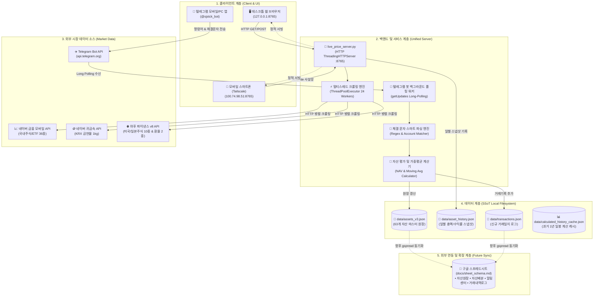

# 통합 자산 관리 시스템 아키텍처 명세서 (`SYSTEM_ARCHITECTURE.md`)

> **문서 버전**: v4.1  
> **최종 갱신일**: 2026-11-06  
> **작성 및 관리**: `architect` (금융 아키텍트 전담 설계자)  
> **단일 진실 공급원(SSoT) 대상**: `developer`, `qa-verifier`, `asset-monitor`

---

## 1. 시스템 개요 및 설계 철학 (System Overview)

본 시스템은 국내외 복수 금융기관(삼성증권, 나무증권, 키움증권, KB증권, 토스뱅크, 새마을금고 등)에 분산된 **63개 실보유 자산(주식, ETF, 연금, 외화, 금현물, 채권, 예적금, RP, 예수금 등)**을 실시간으로 통합 관제하고, 리스크 배분 및 거래 변동을 추적하기 위해 구축된 **개인 전용 금융 자산 컨트롤 타워(Personal Asset Control Tower)**입니다.

### 핵심 설계 철학
1. **로컬 우선(Local-First) & 제로 레이턴시(Zero-Latency)**:
   - 외부 클라우드나 서드파티 DB 의존성을 배제하고, 로컬 파일 시스템(`data/`)을 기반으로 초경량 싱글 인메모리 프로세스로 운영되어 즉각적인 조회와 제어를 보장합니다.
2. **단일 진실 공급원(SSoT, Single Source of Truth) 원칙**:
   - 자산의 기본 상태는 `data/assets_v3.json`을 유일한 정본(Master Ledger)으로 취급합니다.
   - 일별 시계열 스냅샷은 `data/asset_history.json`에 영구 기록하며, 개별 거래 변동은 `data/transactions.json` 거래일지에 누적합니다.
3. **사설망 기반의 안전한 원격 모바일 접속 (Tailscale Secure Mesh)**:
   - 공인 IP 포트포워딩이나 취약한 외부 공개 없이, WireGuard 기반의 Tailscale VPN 사설망(`100.74.98.51:8765`)을 통해 외부 모바일(스마트폰) 환경에서 안전하게 대시보드에 접근합니다.
4. **대화형 스마트 파싱 (Telegram Smart Bot Interaction)**:
   - 증권사에서 전송되는 비정형 체결 알림 문자(SMS/알림톡)를 텔레그램 봇(`@sjstck_bot`)에 전달하면, 스마트 파싱 엔진이 종목·단가·수량을 자동 해석하여 자산 원장과 거래일지에 실시간 반영합니다.

---

## 2. 전체 시스템 아키텍처 (High-Level Architecture)



---

## 3. 핵심 컴포넌트 역할 명세 (Core Components)

### 3.1 통합 웹 & API 서버 (`src/live_price_server.py`)
- **실행 환경**: Python 3.12+ 내장 `http.server.ThreadingHTTPServer` 기반 경량 고성능 데몬.
- **네트워크 바인딩**: `0.0.0.0:8765` (로컬 `127.0.0.1`, LAN 사설 IP, Tailscale 사설망 `100.74.98.51` 전 포트 바인딩).
- **주요 역할**:
  1. `web/` 디렉토리 정적 에셋(`index.html`, `manifest.json` 등) 서빙.
  2. 모바일/원격 접속을 위한 CORS 전역 헤더(`Access-Control-Allow-Origin: *`) 주입.
  3. 실시간 REST API 엔드포인트 제공 (`/api/prices`, `/api/history`, `/api/snapshot`, `/api/telegram/status`, `/api/telegram/send-summary`, `/api/health`).
  4. 데몬 기동 시 백그라운드 스레드로 **텔레그램 봇 폴링 워커(`telegram_polling_worker`)** 동시 구동.

### 3.2 사전 번들 빌더 (`build_web_index.py`)
- **역할**: `web/index.html`을 생성하는 Python 빌드 스크립트.
- **특징**:
  - `data/assets_v3.json`과 `data/calculated_history_cache.json`, `data/asset_history.json`의 최신 데이터를 인라인 자바스크립트 객체(`const initialAssets = [...]`, `const historyCache = {...}`)로 빌드 타임에 주입하여, 최초 접속 시 네트워크 지연 없는 초고속 로딩을 달성합니다.
  - 연금 포함/제외 시계열 데이터와 SVG 차트의 사전 좌표 데이터를 번들링합니다.

### 3.3 반응형 SPA 웹 대시보드 (`web/index.html`)
- **기술 스택**: 순수 HTML5, TailwindCSS (CDN), Lucide Icons, Vanilla JavaScript (외부 중량 프레임워크 배제).
- **디자인 원칙**:
  - **가로스크롤 제로(Zero Horizontal Scroll)**: 390px 뷰포트(삼성 갤럭시 S26, 아이폰 등)에서 모든 텍스트가 줄바꿈/말줄임표 처리되어 완벽한 1단 모바일 레이아웃 구현.
  - **반응형 SVG 차트**: 1:1 종횡비 viewBox 기반의 순수 SVG 라인/영역 차트로 고점/저점 마커 상시 표기 및 상단 고정 호버 배너 적용.
  - **듀얼 토글 체계**: 상단 `연금자산 포함` 체크박스 및 `위험자산만 보기` 체크박스를 통한 실시간 동적 포트폴리오 재계산.

### 3.4 실시간 멀티스레드 크롤러 엔진 (Crawler Engine)
- **병렬 수집**: `concurrent.futures.ThreadPoolExecutor(max_workers=24)`를 통한 전 종목 동시 크롤링 (평균 응답 속도 1.2초 내외).
- **대상 및 엔드포인트**:
  1. 국내 주식/ETF 36종: 네이버 금융 모바일 엔드포인트 (`https://m.stock.naver.com/api/stock/{ticker}/basic`)
  2. KRX 금현물(1kg): 네이버 귀금속 API (`https://m.stock.naver.com/front-api/marketIndex/prices?category=metals&reutersCode=M04020000`)
  3. 해외 주식 6종 & 일본 주식 4종 & 환율 2종: 야후 파이낸스 차트 API (`https://query1.finance.yahoo.com/v8/finance/chart/{ticker}?interval=1d&range=1d`)
- **캐싱 및 실시간 전략**:
  - **웹 대시보드**: 15초 TTL(Time-to-Live) 인메모리 캐시 적용으로 외부 API 호출 부하 최소화.
  - **텔레그램 질의 & 체결 문자 수신**: 캐시를 무시하고 즉시 강제 갱신(`force_refresh=True`) 수행하여 항상 초단위 최신 시세를 산출.

### 3.5 텔레그램 인터랙티브 봇 (`@sjstck_bot`)
- **동작 방식**: 웹훅(Webhook)이 아닌 **롱 폴링(Long-Polling)** 방식(`getUpdates?timeout=15`)을 채택하여 외부 포트 개방 없이 방화벽/사설망 내부에서 독립 동작.
- **인터랙티브 기능**:
  - 대화형 브리핑 명령어: `자산`, `요약`, `수익률`, `비중`, `연금`, `주식`, `현금`, `해외`, `금`, `계좌`, `알림`
  - 종목/축약어 검색: `삼전`, `하이닉스`, `테슬라`, `박스`, `코루`, `이토추`, `우라늄`, `구리` 등 자유 검색 지원.
  - 체결 문자 스마트 파싱 및 실시간 답장 전송.

---

## 4. 데이터 저장소 및 단일 진실 공급원(SSoT) 구조

시스템은 데이터의 성격에 따라 4개의 파일로 분리 관리하며, 단일 진실 공급원(SSoT) 원칙을 엄격히 준수합니다.

```
data/
├── assets_v3.json              # [SSoT] 63개 실보유 자산 마스터 원장
├── asset_history.json          # [스냅샷] 일별 실자산 총액 및 수익률 영구 이력
├── transactions.json           # [거래일지] 체결 문자 및 웹 유입 거래 로그 (신설)
└── calculated_history_cache.json # [캐시] 1년치 일봉 데이터 기반 계산 시계열 캐시
```

### 4.1 마스터 자산 원장 (`data/assets_v3.json`)
- **역할**: 현재 보유 중인 모든 자산의 실시간 잔고와 단가, 계좌 정보를 담고 있는 유일한 마스터 원장.
- **보유 자산 수**: 총 63개 자산 (일반자산 47종 + 연금자산 16종).
- **레코드 필드 스키마**:
```json
{
  "id": "AST-001",
  "category": "현금성자산",           // 대분류 (국내주식, 해외주식, 현금성자산, 연금, 원자재)
  "institution": "새마을금고",        // 금융기관명
  "account_name": "정기예탁금",      // 계좌명
  "account_num": "9110-7140-7949-3", // 계좌번호 (마스킹 포함)
  "asset_type": "정기예탁금",        // 상품 세부유형
  "name": "삼성전자 새마을금고 정기예탁금", // 종목명
  "ticker": "DEP-MG-2027",           // 티커 또는 고유자산 식별코드
  "maturity_date": "2027-09-03",     // 만기일자 (YYYY-MM-DD 또는 null)
  "interest_rate": "일반과세",        // 금리 또는 과세구분
  "currency": "KRW",                 // 기준 통화 (KRW, USD, JPY)
  "quantity": 30000000.0,            // 보유 수량 / 원금
  "buy_price": 1.0,                  // 1주당 매수단가 (원통화)
  "current_price": 1.0,              // 1주당 현재가 (원통화)
  "valuation_origin": 30000000.0,    // 원통화 총 평가금액 (quantity * current_price)
  "profit_origin": 0.0,              // 원통화 평가손익
  "return_rate": 0.0,                // 수익률 (%)
  "buy_krw": 30000000.0,             // 원화 환산 매입금액
  "valuation_krw": 30000000.0,       // 원화 환산 총 평가금액 (포트폴리오 비중 기준)
  "profit_krw": 0.0,                 // 원화 환산 평가손익
  "tags": [ "예금", "정기예탁금", "현금성자산", "단기금융", "확정금리", "안전자산", "원화" ]
}
```

### 4.2 일별 자산 총액 및 수익률 스냅샷 (`data/asset_history.json`)
- **역할**: 매일 장 마감 시점 또는 사용자의 실시간 요청 시점의 실제 자산 총액을 영구 보존하는 스냅샷 일지.
- **스키마 구조**:
```json
[
  {
    "date": "2026-11-06",
    "total_krw": 996679834,             // 연금 포함 실제 총 순자산
    "buy_krw": 840561600,               // 연금 포함 총 매입원금
    "profit_krw": 156118234,            // 연금 포함 총 평가손익
    "return_pct": 6.96,                 // 연초 대비 누적 수익률 (%)
    "cost_return_pct": 18.57,           // 원금 대비 단순 손익률 (%)
    "total_krw_no_pension": 913194984,  // 연금 제외 실제 총 순자산
    "buy_krw_no_pension": 768469326,   // 연금 제외 총 매입원금
    "period_returns": {
      "1D": -7.73, "1W": -7.33, "1M": -17.0, "3M": -11.29, "6M": -23.94, "YTD": 7.1, "1Y": 11.89
    },
    "is_real_snapshot": true,
    "updated_at": "2026-11-06T23:11:13.267236+09:00"
  }
]
```

### 4.3 거래내역 로그 및 체결 일지 (`data/transactions.json` 신규 스키마)
- **역할**: 텔레그램 봇이나 웹을 통해 유입된 개별 체결 통보, 입출금, 배당 등 모든 트랜잭션을 영구 기록하는 거래 장부.
- **스키마 정의**:
```json
[
  {
    "tx_id": "TX-20261106-143000-A1B2",
    "timestamp": "2026-11-06T14:30:00+09:00",
    "tx_type": "매수",                 // 매수, 매도, 입금, 출금, 배당
    "asset_name": "삼성전자",          // 종목명
    "ticker": "005930",                // 종목코드
    "institution": "삼성증권",          // 금융기관명
    "account_name": "종합(주식보상S)",   // 계좌명
    "account_num": "7084-****",        // 계좌식별자
    "currency": "KRW",                 // 거래 통화
    "quantity": 10.0,                  // 체결 수량
    "price": 58500.0,                  // 체결 단가
    "total_amount": 585000.0,          // 체결 총액 (quantity * price)
    "fee": 0.0,                        // 거래 수수료/제세금
    "applied_to_ledger": true,         // assets_v3.json 반영 완료 여부
    "channel": "telegram_bot",         // telegram_bot, web_input, manual
    "raw_message": "[삼성증권] 11/06 14:30 삼성전자(005930) 10주 매수체결 단가: 58,500원",
    "notes": "기존 수량 1,300주 ➔ 1,310주, 평균단가 ₩58,100 ➔ ₩58,103 갱신 완료",
    "created_at": "2026-11-06T14:30:05.123456+09:00"
  }
]
```

---

## 5. 자산 변동 관리 체계 분석 및 구글 스프레드시트 연동 상태

### 5.1 사용자 질의에 대한 아키텍처 답변
> **사용자 질문**: *"자산 변동에 대해서 별도의 일지를 갖는지 아니면 구글스프레드시트에 업데이트하는지 알려줘"*

**[공식 설계 안내]**:
1. **현재 시스템의 운영 방식: "초고속 로컬 3중 일지 체계 (Local-First SSoT)"**
   - 현재 시스템은 외부 구글 네트워크 지연과 인증 오류에 구애받지 않는 안정성을 위해 **로컬 JSON 파일 3중 체계**를 별도의 공식 일지로 채택하고 있습니다:
     - **자산 상태 마스터**: `data/assets_v3.json` (실시간 63개 자산 원장)
     - **시계열 추이 일지**: `data/asset_history.json` (일별 자산 총액 및 구간별 수익률 스냅샷)
     - **개별 거래 일지**: `data/transactions.json` (텔레그램 체결 문자 및 매매 변동 내역)
2. **구글 스프레드시트와의 관계: "설계 완료 및 파이프라인 연계 준비 상태"**
   - 이미 `docs/sheet_schema.md`에 구글 스프레드시트의 **4대 탭(`자산원장`, `자산배분`, `알림센터`, `거래내역로그`)** 규격과 20개 컬럼 스키마가 1:1 완벽하게 설계되어 있습니다.
   - 현재 단계에서는 로컬 파일이 단일 진실 공급원(SSoT)으로 최우선 작동하며, 향후 Google Service Account 인증(JSON Key)이 등록되면 `gspread` 모듈을 통해 로컬의 `assets_v3.json` 및 `transactions.json`을 구글 스프레드시트로 **자동 주기적 백업(Sync)하거나 양방향 동기화**할 수 있도록 완벽히 분리된 인터페이스로 설계되어 있습니다.

---

## 6. 자산 위험도 분류 체계 및 63개 전 종목 명세 (Risk Classification)

### 6.1 3대 위험군 분류 기준
1. **안전자산 (Safe Assets)**:
   - **정의**: 원금 손실 위험이 극히 낮거나 확정적인 이자를 제공하는 현금성 자산, 예적금, 단기채권, MMF, KOFR, 달러박스, 금현물.
   - **대상**: 정기예탁금, 원화/외화 예수금, 원화/USD RP, 토스 외화통장, `KODEX 머니마켓액티브`, `KODEX 미국머니마켓액티브`, `TIGER KOFR금리액티브`, `BOXX`, `ACE 미국30년국채액티브(H)`, `TIGER 미국달러단기채권액티브`, `금 99.99_1kg`.
2. **초위험자산 (Super-Risk Leverage 2X·3X Assets)**:
   - **정의**: 기초지수의 일간 변동폭을 2배 또는 3배로 추종하여 음의 복리 효과(Vol Drag) 및 극심한 변동성을 지닌 고위험 파생형 레버리지 ETF 3종.
   - **대상**:
     - `494310`: KODEX 반도체레버리지 (국내 2X 레버리지)
     - `KORU`: Direxion Daily MSCI South Korea Bull 3X Shares (해외 미국상장 한국 3X 레버리지)
     - `RAM`: Roundhill T-Rex 2X Long DRAM and Memory Device ETF (해외 미국상장 메모리 2X 레버리지)
3. **일반 위험자산 (General Risk Assets)**:
   - **정의**: 기업의 지분 가치 및 실물 시장 변동성에 노출되는 일반 보통주, 1배수 주식형 ETF, 테마형 ETF, 비철금속(구리실물).
   - **대상**: 삼성전자, SK하이닉스, 현대차, 테슬라, 이토추상사, 화낙, 미쓰이E&S, 각종 섹터 ETF(반도체, AI전력, 2차전지 등).

---
### 연금 포함 (총 63종) 자산 분류 현황

- **총 평가금액**: ₩1,060,050,090 (63개 자산)

#### 1. 안전자산 (22개 종목, ₩431,490,714, 비중 40.7%)
| No | 종목명 | 티커 | 대분류 | 금융기관/계좌 | 평가금액(KRW) | 비중(%) | 수익률(%) |
| :-: | :--- | :--- | :--- | :--- | :---: | :---: | :---: |
| 1 | **KODEX 머니마켓액티브** | `488770` | 현금성자산 | 나무증권 평생우대 [CMA] | ₩95,427,000 | 9.00% | +2.20% |
| 2 | **금 99.99_1kg** | `GOLD-KRX` | 원자재 | 나무증권 [금현물] | ₩79,415,900 | 7.49% | +45.82% |
| 3 | **TIGER KOFR금리액티브(합성)** | `449170` | 현금성자산 | 나무증권 평생우대 [CMA] | ₩57,173,425 | 5.39% | +2.66% |
| 4 | **KODEX 미국머니마켓액티브** | `0048J0` | 현금성자산 | 키움증권 중개형ISA | ₩48,974,420 | 4.62% | -4.48% |
| 5 | **Alpha Architect 1-3 Month Box ETF (BOXX)** | `BOXX` | 현금성자산 | 키움증권 위탁종합 (해외) | ₩31,875,570 | 3.01% | +1.33% |
| 6 | **삼성전자 새마을금고 정기예탁금** | `DEP-MG-2027` | 현금성자산 | 새마을금고 정기예탁금 | ₩30,000,000 | 2.83% | +0.00% |
| 7 | **토스 외화통장 엔화(JPY)** | `CASH-JPY-TOSS` | 현금성자산 | 토스뱅크 외화통장 | ₩21,538,911 | 2.03% | -4.95% |
| 8 | **USD 일반RP(7일, 3.50%) #1** | `RP-USD-7D-1` | 현금성자산 | 키움증권 위탁종합 (외화RP) | ₩15,530,121 | 1.47% | +0.00% |
| 9 | **KODEX 미국머니마켓액티브** | `0048J0` | 현금성자산 | 삼성증권 종합(주식보상S) | ₩15,156,210 | 1.43% | -3.90% |
| 10 | **USD 일반RP(7일, 3.50%) #2** | `RP-USD-7D-2` | 현금성자산 | 키움증권 위탁종합 (외화RP) | ₩7,509,600 | 0.71% | +0.00% |
| 11 | **USD 일반RP(수시, 3.35%)** | `RP-USD-ONDEMAND` | 현금성자산 | 키움증권 위탁종합 (외화RP) | ₩5,900,400 | 0.56% | +0.00% |
| 12 | **TIGER 미국달러단기채권액티브** | `329750` | 연금 | KB증권 신연금저축 | ₩5,895,800 | 0.56% | -2.44% |
| 13 | **KODEX 미국머니마켓액티브** | `0048J0` | 연금 | 삼성증권 퇴직연금(IRP) | ₩5,052,070 | 0.48% | -3.89% |
| 14 | **KB증권 연금예수금** | `CASH-KRW-KB` | 연금 | KB증권 신연금저축 | ₩4,031,065 | 0.38% | +0.00% |
| 15 | **일반RP(7일, 2.65%)** | `RP-KRW-ISA-7D` | 현금성자산 | 키움증권 중개형ISA | ₩2,580,000 | 0.24% | +0.00% |
| 16 | **삼성증권 일반예수금** | `CASH-KRW-SAMGEN` | 현금성자산 | 삼성증권 종합(주식보상S) | ₩2,555,616 | 0.24% | +0.00% |
| 17 | **ACE 미국30년국채액티브(H)** | `453850` | 연금 | 삼성증권 퇴직연금(IRP) | ₩2,246,760 | 0.21% | -12.82% |
| 18 | **키움증권 JPY 외화예수금** | `CASH-JPY-KIWOVS` | 현금성자산 | 키움증권 위탁종합 (해외) | ₩429,464 | 0.04% | +0.00% |
| 19 | **현금성자산(삼성증권)** | `CASH-KRW-SAMIRP` | 연금 | 삼성증권 퇴직연금(IRP) | ₩192,900 | 0.02% | +0.00% |
| 20 | **나무 금현물 예수금** | `CASH-KRW-NAMUGOLD` | 현금성자산 | 나무증권 [금현물] | ₩3,692 | 0.00% | +0.00% |
| 21 | **키움증권 원화예수금** | `CASH-KRW-KIWOVS` | 현금성자산 | 키움증권 위탁종합 (해외) | ₩1,482 | 0.00% | +0.00% |
| 22 | **키움증권 USD 외화예수금** | `CASH-USD-KIWOVS` | 현금성자산 | 키움증권 위탁종합 (해외) | ₩308 | 0.00% | +0.00% |


#### 1. 위험자산 (38개 종목, ₩618,128,905, 비중 58.31%)
| No | 종목명 | 티커 | 대분류 | 금융기관/계좌 | 평가금액(KRW) | 비중(%) | 수익률(%) |
| :-: | :--- | :--- | :--- | :--- | :---: | :---: | :---: |
| 1 | **삼성전자** | `005930` | 국내주식 | 삼성증권 종합(주식보상S) | ₩288,600,000 | 27.23% | +217.50% |
| 2 | **SK하이닉스** | `000660` | 국내주식 | 나무증권 평생우대 [CMA] | ₩39,592,000 | 3.73% | +8.03% |
| 3 | **현대차** | `005380` | 국내주식 | 삼성증권 종합(주식보상S) | ₩34,317,000 | 3.24% | +20.15% |
| 4 | **TIGER 반도체TOP10** | `396500` | 연금 | KB증권 신연금저축 | ₩22,292,424 | 2.10% | +22.49% |
| 5 | **삼성SDI** | `006400` | 국내주식 | 삼성증권 종합(주식보상S) | ₩21,890,000 | 2.06% | +72.48% |
| 6 | **대주전자재료** | `078600` | 국내주식 | 나무증권 평생우대 [CMA] | ₩20,941,200 | 1.98% | -16.49% |
| 7 | **KODEX AI전력핵심설비** | `487240` | 국내주식 | 나무증권 평생우대 [CMA] | ₩18,806,250 | 1.77% | -37.85% |
| 8 | **KODEX 200TR** | `278530` | 국내주식 | 나무증권 평생우대 [CMA] | ₩16,831,170 | 1.59% | +293.13% |
| 9 | **Tesla Inc (TSLA)** | `TSLA` | 해외주식 | 키움증권 위탁종합 (해외) | ₩16,300,190 | 1.54% | +3.74% |
| 10 | **KODEX 미국반도체** | `390390` | 연금 | KB증권 신연금저축 | ₩11,206,365 | 1.06% | +275.73% |
| 11 | **ITOCHU CORP (이토추상사, 8001)** | `8001.T` | 해외주식 | 키움증권 위탁종합 (해외) | ₩9,631,197 | 0.91% | +20.04% |
| 12 | **NAVER** | `035420` | 국내주식 | 삼성증권 종합(주식보상S) | ₩9,416,000 | 0.89% | -19.93% |
| 13 | **해성디에스** | `195870` | 국내주식 | 삼성증권 종합(주식보상S) | ₩9,227,350 | 0.87% | -12.57% |
| 14 | **MITSUI E&S HOLDINGS (미쓰이E&S홀딩스, 7003)** | `7003.T` | 해외주식 | 키움증권 위탁종합 (해외) | ₩8,921,262 | 0.84% | -39.62% |
| 15 | **KODEX 미국AI전력핵심인프라** | `487230` | 연금 | KB증권 신연금저축 | ₩8,822,456 | 0.83% | -2.29% |
| 16 | **기아** | `000270` | 국내주식 | 삼성증권 종합(주식보상S) | ₩8,509,600 | 0.80% | +19.10% |
| 17 | **TIGER 반도체TOP10** | `396500` | 연금 | 삼성증권 퇴직연금(IRP) | ₩7,987,740 | 0.75% | +10.14% |
| 18 | **TIGER 미국테크TOP10 INDXX** | `381170` | 연금 | KB증권 신연금저축 | ₩7,775,612 | 0.73% | +124.59% |
| 19 | **한전KPS** | `051600` | 국내주식 | 나무증권 평생우대 [CMA] | ₩7,458,200 | 0.70% | -26.19% |
| 20 | **삼성바이오로직스** | `207940` | 국내주식 | 나무증권 평생우대 [CMA] | ₩7,175,000 | 0.68% | +57.32% |
| 21 | **드림텍** | `192650` | 국내주식 | 나무증권 평생우대 [CMA] | ₩5,247,570 | 0.50% | -35.02% |
| 22 | **FANUC (화낙, 6954)** | `6954.T` | 해외주식 | 키움증권 위탁종합 (해외) | ₩4,790,577 | 0.45% | -8.80% |
| 23 | **TIGER 구리실물** | `160580` | 연금 | KB증권 신연금저축 | ₩4,306,077 | 0.41% | -1.37% |
| 24 | **NICE평가정보** | `030190` | 국내주식 | 나무증권 평생우대 [CMA] | ₩3,948,960 | 0.37% | +13.72% |
| 25 | **KODEX 미국나스닥100TR** | `379810` | 연금 | 삼성증권 퇴직연금(IRP) | ₩3,715,500 | 0.35% | +13.83% |
| 26 | **HD현대중공업** | `329180` | 국내주식 | 삼성증권 종합(주식보상S) | ₩3,468,000 | 0.33% | -41.27% |
| 27 | **Uranium Energy Corp (UEC)** | `UEC` | 해외주식 | 키움증권 위탁종합 (해외) | ₩2,824,816 | 0.27% | -37.42% |
| 28 | **GLOBAL X JAPAN SEMICONDUCTOR (282A)** | `282A.T` | 해외주식 | 키움증권 위탁종합 (해외) | ₩2,650,170 | 0.25% | +18.87% |
| 29 | **신흥에스이씨** | `243840` | 국내주식 | 나무증권 평생우대 [CMA] | ₩2,284,000 | 0.22% | -43.83% |
| 30 | **RISE 미국S&P500** | `379780` | 연금 | 삼성증권 퇴직연금(IRP) | ₩2,274,480 | 0.21% | +16.84% |
| 31 | **TIGER 차이나전기차SOLACTIVE** | `371460` | 연금 | KB증권 신연금저축 | ₩1,824,115 | 0.17% | -16.84% |
| 32 | **TIGER 미국다우존스30** | `245340` | 연금 | 삼성증권 퇴직연금(IRP) | ₩1,349,600 | 0.13% | +100.83% |
| 33 | **PLUS 미국S&P500(H)** | `269540` | 연금 | 삼성증권 퇴직연금(IRP) | ₩1,323,450 | 0.12% | +113.43% |
| 34 | **NuScale Power Corp (SMR)** | `SMR` | 해외주식 | 키움증권 위탁종합 (해외) | ₩1,197,044 | 0.11% | -63.54% |
| 35 | **삼성에피스홀딩스** | `0126Z0` | 국내주식 | 나무증권 평생우대 [CMA] | ₩931,500 | 0.09% | -65.95% |
| 36 | **씨메스로보틱스** | `475400` | 국내주식 | 삼성증권 종합(주식보상S) | ₩160,680 | 0.02% | -61.13% |
| 37 | **두산테스나** | `131970` | 국내주식 | 삼성증권 종합(주식보상S) | ₩82,900 | 0.01% | +144.41% |
| 38 | **한화비전** | `489790` | 국내주식 | 삼성증권 종합(주식보상S) | ₩48,450 | 0.00% | -11.77% |


#### 1. 초위험자산 (3개 종목, ₩10,430,471, 비중 0.98%)
| No | 종목명 | 티커 | 대분류 | 금융기관/계좌 | 평가금액(KRW) | 비중(%) | 수익률(%) |
| :-: | :--- | :--- | :--- | :--- | :---: | :---: | :---: |
| 1 | **Direxion Daily MSCI South Korea Bull 3X Shares (KORU)** | `KORU` | 해외주식 | 키움증권 위탁종합 (해외) | ₩4,478,202 | 0.42% | -60.49% |
| 2 | **Roundhill T-Rex 2X Long DRAM and Memory Device ETF (RAM)** | `RAM` | 해외주식 | 키움증권 위탁종합 (해외) | ₩3,356,389 | 0.32% | -60.71% |
| 3 | **KODEX 반도체레버리지** | `494310` | 국내주식 | 나무증권 평생우대 [CMA] | ₩2,595,880 | 0.24% | -67.89% |


### 연금 제외 (총 47종) 자산 분류 현황

- **총 평가금액**: ₩969,753,676 (47개 자산)

#### 1. 안전자산 (17개 종목, ₩414,072,119, 비중 42.7%)
| No | 종목명 | 티커 | 대분류 | 금융기관/계좌 | 평가금액(KRW) | 비중(%) | 수익률(%) |
| :-: | :--- | :--- | :--- | :--- | :---: | :---: | :---: |
| 1 | **KODEX 머니마켓액티브** | `488770` | 현금성자산 | 나무증권 평생우대 [CMA] | ₩95,427,000 | 9.84% | +2.20% |
| 2 | **금 99.99_1kg** | `GOLD-KRX` | 원자재 | 나무증권 [금현물] | ₩79,415,900 | 8.19% | +45.82% |
| 3 | **TIGER KOFR금리액티브(합성)** | `449170` | 현금성자산 | 나무증권 평생우대 [CMA] | ₩57,173,425 | 5.90% | +2.66% |
| 4 | **KODEX 미국머니마켓액티브** | `0048J0` | 현금성자산 | 키움증권 중개형ISA | ₩48,974,420 | 5.05% | -4.48% |
| 5 | **Alpha Architect 1-3 Month Box ETF (BOXX)** | `BOXX` | 현금성자산 | 키움증권 위탁종합 (해외) | ₩31,875,570 | 3.29% | +1.33% |
| 6 | **삼성전자 새마을금고 정기예탁금** | `DEP-MG-2027` | 현금성자산 | 새마을금고 정기예탁금 | ₩30,000,000 | 3.09% | +0.00% |
| 7 | **토스 외화통장 엔화(JPY)** | `CASH-JPY-TOSS` | 현금성자산 | 토스뱅크 외화통장 | ₩21,538,911 | 2.22% | -4.95% |
| 8 | **USD 일반RP(7일, 3.50%) #1** | `RP-USD-7D-1` | 현금성자산 | 키움증권 위탁종합 (외화RP) | ₩15,530,121 | 1.60% | +0.00% |
| 9 | **KODEX 미국머니마켓액티브** | `0048J0` | 현금성자산 | 삼성증권 종합(주식보상S) | ₩15,156,210 | 1.56% | -3.90% |
| 10 | **USD 일반RP(7일, 3.50%) #2** | `RP-USD-7D-2` | 현금성자산 | 키움증권 위탁종합 (외화RP) | ₩7,509,600 | 0.77% | +0.00% |
| 11 | **USD 일반RP(수시, 3.35%)** | `RP-USD-ONDEMAND` | 현금성자산 | 키움증권 위탁종합 (외화RP) | ₩5,900,400 | 0.61% | +0.00% |
| 12 | **일반RP(7일, 2.65%)** | `RP-KRW-ISA-7D` | 현금성자산 | 키움증권 중개형ISA | ₩2,580,000 | 0.27% | +0.00% |
| 13 | **삼성증권 일반예수금** | `CASH-KRW-SAMGEN` | 현금성자산 | 삼성증권 종합(주식보상S) | ₩2,555,616 | 0.26% | +0.00% |
| 14 | **키움증권 JPY 외화예수금** | `CASH-JPY-KIWOVS` | 현금성자산 | 키움증권 위탁종합 (해외) | ₩429,464 | 0.04% | +0.00% |
| 15 | **나무 금현물 예수금** | `CASH-KRW-NAMUGOLD` | 현금성자산 | 나무증권 [금현물] | ₩3,692 | 0.00% | +0.00% |
| 16 | **키움증권 원화예수금** | `CASH-KRW-KIWOVS` | 현금성자산 | 키움증권 위탁종합 (해외) | ₩1,482 | 0.00% | +0.00% |
| 17 | **키움증권 USD 외화예수금** | `CASH-USD-KIWOVS` | 현금성자산 | 키움증권 위탁종합 (해외) | ₩308 | 0.00% | +0.00% |


#### 1. 위험자산 (27개 종목, ₩545,251,086, 비중 56.23%)
| No | 종목명 | 티커 | 대분류 | 금융기관/계좌 | 평가금액(KRW) | 비중(%) | 수익률(%) |
| :-: | :--- | :--- | :--- | :--- | :---: | :---: | :---: |
| 1 | **삼성전자** | `005930` | 국내주식 | 삼성증권 종합(주식보상S) | ₩288,600,000 | 29.76% | +217.50% |
| 2 | **SK하이닉스** | `000660` | 국내주식 | 나무증권 평생우대 [CMA] | ₩39,592,000 | 4.08% | +8.03% |
| 3 | **현대차** | `005380` | 국내주식 | 삼성증권 종합(주식보상S) | ₩34,317,000 | 3.54% | +20.15% |
| 4 | **삼성SDI** | `006400` | 국내주식 | 삼성증권 종합(주식보상S) | ₩21,890,000 | 2.26% | +72.48% |
| 5 | **대주전자재료** | `078600` | 국내주식 | 나무증권 평생우대 [CMA] | ₩20,941,200 | 2.16% | -16.49% |
| 6 | **KODEX AI전력핵심설비** | `487240` | 국내주식 | 나무증권 평생우대 [CMA] | ₩18,806,250 | 1.94% | -37.85% |
| 7 | **KODEX 200TR** | `278530` | 국내주식 | 나무증권 평생우대 [CMA] | ₩16,831,170 | 1.74% | +293.13% |
| 8 | **Tesla Inc (TSLA)** | `TSLA` | 해외주식 | 키움증권 위탁종합 (해외) | ₩16,300,190 | 1.68% | +3.74% |
| 9 | **ITOCHU CORP (이토추상사, 8001)** | `8001.T` | 해외주식 | 키움증권 위탁종합 (해외) | ₩9,631,197 | 0.99% | +20.04% |
| 10 | **NAVER** | `035420` | 국내주식 | 삼성증권 종합(주식보상S) | ₩9,416,000 | 0.97% | -19.93% |
| 11 | **해성디에스** | `195870` | 국내주식 | 삼성증권 종합(주식보상S) | ₩9,227,350 | 0.95% | -12.57% |
| 12 | **MITSUI E&S HOLDINGS (미쓰이E&S홀딩스, 7003)** | `7003.T` | 해외주식 | 키움증권 위탁종합 (해외) | ₩8,921,262 | 0.92% | -39.62% |
| 13 | **기아** | `000270` | 국내주식 | 삼성증권 종합(주식보상S) | ₩8,509,600 | 0.88% | +19.10% |
| 14 | **한전KPS** | `051600` | 국내주식 | 나무증권 평생우대 [CMA] | ₩7,458,200 | 0.77% | -26.19% |
| 15 | **삼성바이오로직스** | `207940` | 국내주식 | 나무증권 평생우대 [CMA] | ₩7,175,000 | 0.74% | +57.32% |
| 16 | **드림텍** | `192650` | 국내주식 | 나무증권 평생우대 [CMA] | ₩5,247,570 | 0.54% | -35.02% |
| 17 | **FANUC (화낙, 6954)** | `6954.T` | 해외주식 | 키움증권 위탁종합 (해외) | ₩4,790,577 | 0.49% | -8.80% |
| 18 | **NICE평가정보** | `030190` | 국내주식 | 나무증권 평생우대 [CMA] | ₩3,948,960 | 0.41% | +13.72% |
| 19 | **HD현대중공업** | `329180` | 국내주식 | 삼성증권 종합(주식보상S) | ₩3,468,000 | 0.36% | -41.27% |
| 20 | **Uranium Energy Corp (UEC)** | `UEC` | 해외주식 | 키움증권 위탁종합 (해외) | ₩2,824,816 | 0.29% | -37.42% |
| 21 | **GLOBAL X JAPAN SEMICONDUCTOR (282A)** | `282A.T` | 해외주식 | 키움증권 위탁종합 (해외) | ₩2,650,170 | 0.27% | +18.87% |
| 22 | **신흥에스이씨** | `243840` | 국내주식 | 나무증권 평생우대 [CMA] | ₩2,284,000 | 0.24% | -43.83% |
| 23 | **NuScale Power Corp (SMR)** | `SMR` | 해외주식 | 키움증권 위탁종합 (해외) | ₩1,197,044 | 0.12% | -63.54% |
| 24 | **삼성에피스홀딩스** | `0126Z0` | 국내주식 | 나무증권 평생우대 [CMA] | ₩931,500 | 0.10% | -65.95% |
| 25 | **씨메스로보틱스** | `475400` | 국내주식 | 삼성증권 종합(주식보상S) | ₩160,680 | 0.02% | -61.13% |
| 26 | **두산테스나** | `131970` | 국내주식 | 삼성증권 종합(주식보상S) | ₩82,900 | 0.01% | +144.41% |
| 27 | **한화비전** | `489790` | 국내주식 | 삼성증권 종합(주식보상S) | ₩48,450 | 0.00% | -11.77% |


#### 1. 초위험자산 (3개 종목, ₩10,430,471, 비중 1.08%)
| No | 종목명 | 티커 | 대분류 | 금융기관/계좌 | 평가금액(KRW) | 비중(%) | 수익률(%) |
| :-: | :--- | :--- | :--- | :--- | :---: | :---: | :---: |
| 1 | **Direxion Daily MSCI South Korea Bull 3X Shares (KORU)** | `KORU` | 해외주식 | 키움증권 위탁종합 (해외) | ₩4,478,202 | 0.46% | -60.49% |
| 2 | **Roundhill T-Rex 2X Long DRAM and Memory Device ETF (RAM)** | `RAM` | 해외주식 | 키움증권 위탁종합 (해외) | ₩3,356,389 | 0.35% | -60.71% |
| 3 | **KODEX 반도체레버리지** | `494310` | 국내주식 | 나무증권 평생우대 [CMA] | ₩2,595,880 | 0.27% | -67.89% |


### 6.4 초위험자산(레버리지 3종) 집중 분석
- **전체 비중**: 연금 포함 기준 **0.98% (₩10,430,471)**, 연금 제외 기준 **1.08%**.
- **보유 계좌 특성**: 초위험 레버리지 자산은 제도상 퇴직연금/개인연금 계좌 내 편입이 금지되어 있어 **100% 일반 위탁계좌(나무증권 CMA, 키움증권 해외위탁)**에만 분산 보유되어 있습니다.
- **수익률 현황**: 3종 모두 -60% 이상의 큰 평가손실 상태로, 포트폴리오 차원에서 비중 1% 내외로 제한 관리 중입니다.

---

## 7. 텔레그램 체결 통보 문자 스마트 파싱 및 원장 반영 규칙

### 7.1 국내 주요 6대 증권사 체결 알림 패턴 및 정규표현식
텔레그램 봇(`@sjstck_bot`)으로 유입되는 문자열은 다음 정규식 엔진을 거쳐 정형 데이터로 변환됩니다:

| 증권사 | SMS / 알림톡 실제 수신 예시 | 매칭 패턴 및 정규표현식 특징 |
| :--- | :--- | :--- |
| **삼성증권** | `[삼성증권] 11/06 14:30 삼성전자(005930) 10주 매수체결 단가: 58,500원` | `r"\[삼성증권\].*?([가-힣A-Za-z0-9\s]+)\(([0-9]{6})\)\s+([0-9]+)주\s+(매수|매도)체결.*?단가:\s*([0-9,]+)원"` |
| **키움증권** | `[키움] 체결통보\n종목: KODEX 반도체레버리지\n구분: 매수\n수량: 100주\n단가: 8,650원` | `r"종목:\s*([^\n]+)\s*\n구분:\s*(매수|매도)\s*\n수량:\s*([0-9,]+)주\s*\n단가:\s*([\$₩]?[0-9,.]+)"` |
| **토스증권** | `[토스증권] SK하이닉스 5주가 185,000원에 매수 체결되었어요.` | `r"([가-힣A-Za-z0-9]+)\s+([0-9]+)주가\s+([0-9,]+)원에\s*(매수|매도)\s*체결"` |
| **KB증권** | `[KB증권] [체결] 현대차 3주 매수체결 단가: 245,000원 계좌: 338-***` | `r"\[KB증권\].*?([가-힣A-Za-z0-9]+)\s+([0-9]+)주\s+(매수|매도)체결.*?단가:\s*([0-9,]+)원"` |
| **미래에셋** | `[미래에셋] [매수] 삼성SDI 2주 365,000원 체결 11/06 09:35` | `r"\[미래에셋\].*?\[(매수|매도)\]\s+([가-힣A-Za-z0-9]+)\s+([0-9]+)주\s+([0-9,]+)원\s*체결"` |
| **해외주식** | `[키움] 해외체결 TSLA 매수 2주 단가: $215.50` | `r"([A-Za-z]+)\s+(매수|매도)\s+([0-9]+)주.*?단가:\s*[\$]?([0-9,.]+)"` |

### 7.2 스마트 파싱 추출 필드 및 트랜잭션 모델
- `timestamp`: 체결 일시 파싱 (누락 시 수신 현재 시각 할당)
- `tx_type`: `매수` 또는 `매도` 판정
- `asset_name` & `ticker`: 종목명 추출 후 `data/assets_v3.json`의 마스터 종목명/티커 사전과 퍼지 매칭(Fuzzy Match) 수행
- `quantity`: 체결 수량(float)
- `price`: 체결 단가(float, 통화 기호 및 쉼표 제거)
- `currency`: `$` 표기 시 `USD`, `¥` 표기 시 `JPY`, 그 외 `KRW`

### 7.3 원장 반영 수학적 알고리즘 (Ledger Calculation)

#### 1) 매수 (BUY) 체결 처리:
기존 보유 수량 $Q_0$, 기존 매수단가 $P_0$, 신규 매수수량 $\Delta Q$, 신규 매수단가 $P_{new}$:
1. **신규 보유수량**:
   $$Q_1 = Q_0 + \Delta Q$$
2. **이동가중평균 매수단가 (Weighted Average Cost)**:
   $$P_1 = \frac{(Q_0 \times P_0) + (\Delta Q \times P_{new})}{Q_0 + \Delta Q}$$
3. **원화 매입금액 ($BuyKRW$)**:
   $$BuyKRW_1 = BuyKRW_0 + (\Delta Q \times P_{new} \times FX)$$
4. **평가액 및 손익 재계산**:
   $$ValuationKRW_1 = Q_1 \times P_{current} \times FX$$
   $$ProfitKRW_1 = ValuationKRW_1 - BuyKRW_1$$
   $$ReturnRate_1 = \frac{ProfitKRW_1}{BuyKRW_1} \times 100$$
5. **예수금 연동**: 해당 증권사 계좌의 예수금 자산에서 체결 총액($\Delta Q \times P_{new}$) 자동 차감.

#### 2) 매도 (SELL) 체결 처리:
기존 보유 수량 $Q_0$에서 $\Delta Q$ 매도:
1. **신규 보유수량**:
   $$Q_1 = Q_0 - \Delta Q \quad (Q_1 \ge 0)$$
2. **매수단가 유지**: 이동평균법 규정에 따라 매도 시 매수단가는 변하지 않음 ($P_1 = P_0$).
3. **원화 매입금액 차감**:
   $$BuyKRW_1 = Q_1 \times P_0 \times FX$$
4. **실현손익 (Realized P&L) 산출 및 기록**:
   $$RealizedP\&L = \Delta Q \times (P_{sell} - P_0) \times FX$$
5. **예수금 연동**: 해당 증권사 계좌의 예수금 자산에 매도 대금($\Delta Q \times P_{sell}$) 자동 가산.

### 7.4 텔레그램 피드백 및 사용자 UX
체결 문자가 성공적으로 파싱되어 반영되면 텔레그램으로 다음과 같은 즉각적인 확인 리포트가 전송됩니다:
```html
✅ <b>[체결 내역 원장 반영 완료]</b>

📌 <b>종목명</b>: 삼성전자 (005930)
• <b>구분</b>: 매수 (10주 @ ₩58,500)
• <b>계좌</b>: 삼성증권 종합(주식보상S)

📊 <b>원장 갱신 결과</b>
• 보유수량: 1,300주 ➔ <b>1,310주</b> (+10주)
• 매수단가: ₩58,100 ➔ <b>₩58,103</b>
• 평가금액: <b>₩76,635,000</b> (수익률: +31.8%)
• 거래일지 ID: <code>TX-20261106-143000-A1B2</code>
```

---

## 8. 서빙, 네트워크 및 보안 아키텍처

1. **사설 가상망 암호화 (Tailscale Mesh Network)**:
   - 외부 인터넷에 포트를 포워딩하지 않고 WireGuard 기반 사설 터널링(`100.74.98.51:8765`)을 사용하므로, 비인가 외부인의 접근이 원천 차단됩니다.
2. **모바일 비보안 HTTP 호환성 보장**:
   - 모바일 사설망 브라우징 시 `crypto.subtle` 등 HTTPS 전용 브라우저 API 호출 실패로 인한 렌더링 락업을 방지하도록 전역 예외 처리 및 폴백 구현 완료.
3. **상시 가동 백그라운드 프로세스**:
   - PowerShell 및 Windows 서비스 백그라운드 태스크로 `live_price_server.py`를 영구 기동하여 24시간 텔레그램 봇 응답 및 시세 크롤링 지원.

---

## 9. REST API 엔드포인트 명세서

| 메서드 | 엔드포인트 | 역할 및 기능 | 반환 형식 |
| :---: | :--- | :--- | :---: |
| **GET** | `/` | 모바일/데스크톱 통합 대시보드 (`web/index.html`) 서빙 | `text/html` |
| **GET** | `/api/prices` | 63개 전 종목 실시간 크롤링 시세, 환율, 총 NAV 및 구간별 수익률 반환 | `application/json` |
| **GET** | `/api/history` | 1년치 일봉 기반 계산된 시계열 및 일별 실제 스냅샷 병합 데이터 반환 | `application/json` |
| **POST** | `/api/snapshot` | 오늘자 실제 자산 총액(`total_krw`, `total_krw_no_pension`)을 `asset_history.json`에 영구 기록 | `application/json` |
| **GET** | `/api/telegram/status` | 텔레그램 봇 폴링 워커 상태 및 최근 수신/발신 통계 확인 | `application/json` |
| **POST** | `/api/telegram/send-summary` | 웹 대시보드에서 텔레그램으로 즉시 최신 자산 요약 브리핑 전송 트리거 | `application/json` |
| **GET** | `/api/health` | 서버 헬스체크 및 바인딩된 로컬/LAN/Tailscale IP 목록 확인 | `application/json` |

---
> **설계자 승인**: `architect`  
> **차기 과업**: `developer`의 체결 파서 구현 및 `qa-verifier`의 검증 테스트 수행을 위한 단일 진실 공급원(SSoT)으로 활용됨.
