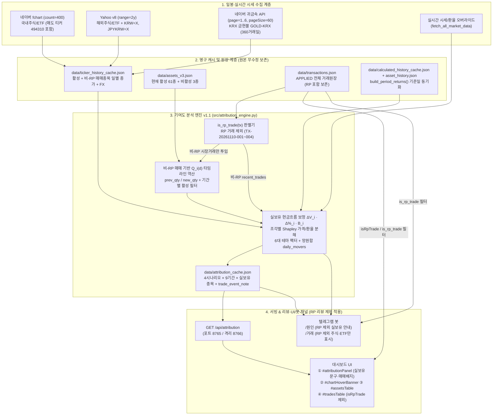
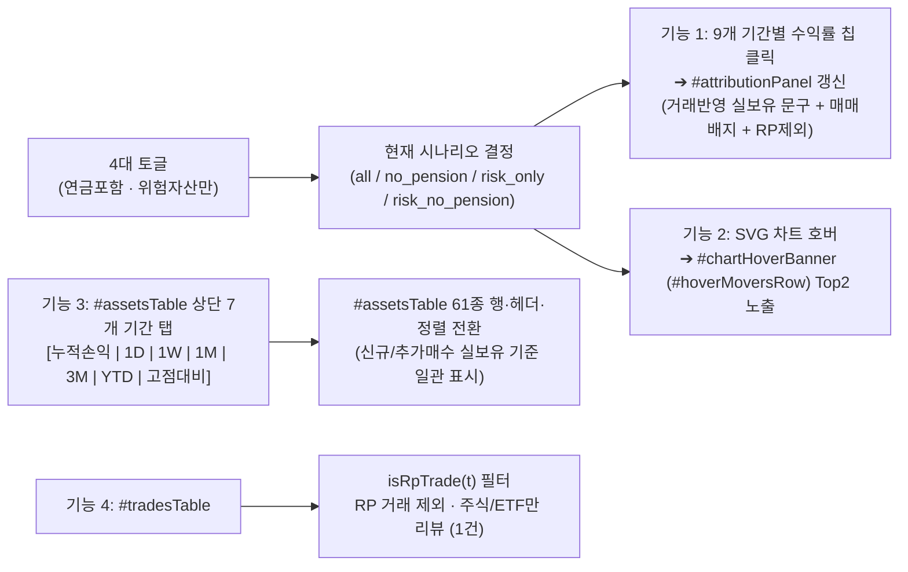

# 📊 계좌 총액 급등·급락 원인 자산 기여도 분석 설계 명세서 (`docs/attribution_analysis_spec.md`)

> **문서 식별자**: `docs/attribution_analysis_spec.md`  
> **문서 버전**: v1.1 (Phase 23.1 / T-28-5 SSoT — v1.0 개정)  
> **작성 일자**: 2026-11-15  
> **작성자**: 설계자 / 금융 분석가 (`architect`)  
> **대상 워크트리**: `C:\cowork\myasset-attribution` (`feat/attribution`)  
> **수신자**: 비서 (Main Orchestrator), 개발자 (`developer`), 품질 검증가 (`qa-verifier`)  
> **관련 구현 대상 (후속 태스크)**:
> - `src/attribution_engine.py` (개정 — 거래내역 기반 실보유수량 $Q_i(d)$ 타임라인 역산, 전량매도·신규매수·추가매수 현금흐름 보정 $\Delta V_i$·$\Delta\%_i$·일별 Movers·조각별 Shapley 분해, `_extract_recent_trades` RP 거래 제외, `trade_event_note` 생성)
> - `src/auto_backfill.py` (보완 — `data/ticker_history_cache.json` 갱신 시 비-RP `transactions.json` 매도 종목 티커(`494310` 등) 영구 유지)
> - `src/live_price_server.py` (개정 — `/api/attribution`, `/원인`·`_build_rollover_notice`·`/거래` 출력에서 RP 거래 제외 및 실보유 반영 문구 동기화)
> - `data/ticker_history_cache.json`, `data/attribution_cache.json` (v1.1 스키마 및 실보유 재계산 데이터)
> - `build_web_index.py` → `web/index.html`, `index.html` (단위 문구 `"거래내역 반영 실보유 기준"` 변경, `trade_event_note` 배지 노출, `load_compact_attribution_raw` 필드 확장, `#tradesTable` RP 거래 제외, `#assetsTable` 실보유 일관성)
> - `tests/test_attribution_qa.py`, `tests/verify_attribution_ui.js` (v1.1 수학적 불변식, 전량매도·신규매수·추가매수 케이스, RP 제외 3대 채널 회귀 검증)

---

## 📌 목차 (Table of Contents)
1. [개요 및 문제 정의](#1-개요-및-문제-정의)
   - 1.1 [현재 아키텍처의 공백 및 v1.1 개정 배경](#11-현재-아키텍처의-공백-및-v11-개정-배경)
   - 1.2 [전체 아키텍처 흐름](#12-전체-아키텍처-흐름)
2. [보유 종목별 기간 기여도(Attribution) 수학적 산출 공식](#2-보유-종목별-기간-기여도attribution-수학적-산출-공식)
   - 2.1 [평가 모수 확장(활성+매도이력 자산) 및 4대 시나리오 필터링 기준](#21-평가-모수-확장활성매도이력-자산-및-4대-시나리오-필터링-기준)
   - 2.2 [티커·자산 유형별 일별 가격 $P_i(d)$ 및 환율 $FX_i(d)$ 매핑 규칙](#22-티커자산-유형별-일별-가격-p_id-및-환율-fx_id-매핑-규칙)
   - 2.3 [거래내역 반영 실보유수량($Q_i(d)$) 타임라인 역산 및 현금흐름 보정 손익·가격/환율 분해 공식](#23-거래내역-반영-실보유수량q_id-타임라인-역산-및-현금흐름-보정-손익가격환율-분해-공식)
   - 2.4 [일별 Movers (`daily_movers`) 실보유 체결가 반영 및 망원합 불변식](#24-일별-movers-daily_movers-실보유-체결가-반영-및-망원합-불변식)
   - 2.5 [RP 거래 리뷰 전면 제외(`is_rp_trade(tx)`) SSoT 규칙 및 3대 적용 대상](#25-rp-거래-리뷰-전면-제외is_rp_tradetx-ssot-규칙-및-3대-적용-대상)
3. [6대 테마/매크로 팩터 분류 매핑(`factors`)](#3-6대-테마매크로-팩터-분류-매핑factors)
   - 3.1 [팩터 분류 체계 및 우선순위 판별 규칙 (MECE)](#31-팩터-분류-체계-및-우선순위-판별-규칙-mece)
   - 3.2 [활성 61종 + 매도이력 자산 팩터 배정표 및 무누락·무중복 검증](#32-활성-61종--매도이력-자산-팩터-배정표-및-무누락무중복-검증)
   - 3.3 [6대 팩터 변동액 합산 항등식 (환율 팩터 분리)](#33-6대-팩터-변동액-합산-항등식-환율-팩터-분리)
4. [커버리지, 날짜 정합성 및 백엔드 캐시/API 스키마](#4-커버리지-날짜-정합성-및-백엔드-캐시api-스키마)
   - 4.1 [기간 기준일($d_{\text{start}}$, $d_{\text{end}}$) 정합성 규칙 (`build_period_returns` 일치)](#41-기간-기준일d_start-d_end-정합성-규칙-build_period_returns-일치)
   - 4.2 [`data/ticker_history_cache.json` 스키마](#42-dataticker_history_cachejson-스키마)
   - 4.3 [`data/attribution_cache.json` 및 `GET /api/attribution` JSON 스키마](#43-dataattribution_cachejson-및-get-apiattribution-json-스키마)
   - 4.4 [격리 실행 환경변수 규격 (`PORT`, `DISABLE_TG_POLL`, `NO_BROWSER`)](#44-격리-실행-환경변수-규격-port-disable_tg_poll-no_browser)
5. [대시보드 웹 UI 상세 사양 (기여도 3대 기능 + 매매 리뷰 RP 제외)](#5-대시보드-웹-ui-상세-사양-기여도-3대-기능--매매-리뷰-rp-제외)
   - 5.1 [기능 1: 9개 기간별 수익률 칩 연동 & 「기간별 급등·급락 원인 분석 (`#attributionPanel`)」](#51-기능-1-9개-기간별-수익률-칩-연동--기간별-급등급락-원인-분석-attributionpanel)
   - 5.2 [기능 2: SVG 시계열 차트 호버(`#chartHoverBanner`) 당일 Top 2 급등·급락 노출](#52-기능-2-svg-시계열-차트-호버charthoverbanner-당일-top-2-급등급락-노출)
   - 5.3 [기능 3: 보유 자산 원장 테이블(`#assetsTable`) 상단 기간 전환 탭 및 정렬·표시 규칙](#53-기능-3-보유-자산-원장-테이블assetstable-상단-기간-전환-탭-및-정렬표시-규칙)
   - 5.4 [기능 4: 최근 매매내역 리뷰 테이블(`#tradesTable`) RP 거래 제외 규격](#54-기능-4-최근-매매내역-리뷰-테이블tradestable-rp-거래-제외-규격)
6. [텔레그램 봇 `/원인` 및 `/거래` 명령어 상세 사양](#6-텔레그램-봇-원인-및-거래-명령어-상세-사양)
   - 6.1 [명령어 별칭, 기간 인자 및 시나리오 파싱 규칙](#61-명령어-별칭-기간-인자-및-시나리오-파싱-규칙)
   - 6.2 [기본 `/원인` 호출 출력 포맷 (`1D`, `1W`, `고점대비(MDD)` 종합 요약)](#62-기본-원인-호출-출력-포맷-1d-1w-고점대비mdd-종합-요약)
   - 6.3 [특정 기간 호출 출력 포맷 (`/원인 1M`, `/원인 YTD`, `/원인 고점` 등)](#63-특정-기간-호출-출력-포맷-원인-1m-원인-ytd-원인-고점-등)
   - 6.4 [`?` 단축어 도움말 시트 업데이트 규격](#64--단축어-도움말-시트-업데이트-규격)
   - 6.5 [`/거래` 명령어 RP 거래 제외 규격](#65-거래-명령어-rp-거래-제외-규격)
7. [테스트 및 수용 기준 (Acceptance Criteria)](#7-테스트-및-수용-기준-acceptance-criteria)

---

## 1. 개요 및 문제 정의

### 1.1 현재 아키텍처의 공백 및 v1.1 개정 배경
기존 자산 관제탑(`v5.2`) 및 기여도 분석 엔진 **v1.0**은 4대 시나리오(`all`, `no_pension`, `risk_only`, `risk_no_pension`)와 9대 기간(`1D`, `1W`, `1M`, `3M`, `6M`, `YTD`, `1Y`, `peak_drawdown`, `trough_gain`)별 분해를 정립했으나, v1.0에서 **일정 보유수량($Q_i$ 고정) 가정**과 **매매 리뷰 내 RP 거래 혼재**로 인해 실투자 체감과 괴리가 발생하는 구조적 공백이 확인되었다.

1. **개별 일봉 데이터 비영구화 (v1.0 해결)**: `auto_backfill.py`가 종가를 수집한 뒤 합산 `daily_nav`만 저장하던 문제를 `ticker_history_cache.json` 영구화로 해소. (v1.1에서는 비-RP 매매 이력이 있는 전량 매도 종목 티커도 영구 유지)
2. **KRX 금현물(`GOLD-KRX`) 장기 시세 단절 (v1.0 해결)**: `fetch_naver_gold_daily()`가 `pageSize` 미지정으로 최근 **10거래일**만 반환하던 문제를 `page=1..6&pageSize=60` 페이지네이션으로 **360거래일** 확보.
3. **현금성 카테고리 내 시장형 ETF 취급 불일치 (v1.0 해결)**: `488770`, `449170`, `0048J0`, `329750`, `453850`, `BOXX`를 시장 종가로 추적.
4. **v1.0 일정 보유수량 가정의 한계 → v1.1 실보유수량($Q_i(d)$) 타임라인 반영**:
   - v1.0에서는 현재 수량 $Q_i=0$인 전량 매도 종목(예: `2026-11-06` `AST-037` `KODEX 반도체레버리지` 56주 @ 31,100원 = ₩1,741,600 매도)을 **모든 기간에서 일괄 배제**하고, 신규·추가 매수 종목도 시작 시점부터 현재 수량으로 소급 고정하였다.
   - 그 결과 `1M`·`3M`·`6M`·`고점대비(MDD)` 구간에서 `AST-037`이 계좌에 실제 가한 손실(`1M` 기준 **-₩1,693,720**, `고점대비` 기준 **-₩7,766,360**)이 Leaders/Draggers에서 누락되고, 기간 중 신규 매수 종목은 보유하지 않았던 매수 전 주가 등락이 기여도에 섞이는 왜곡이 발생한다.
   - **v1.1 해법**: 기존 기간별 등락률 체계(원금 대비 누적수익률로 전면 대체하지 않음)를 유지하되, `data/transactions.json`의 `APPLIED` 비-RP 시장성 거래 이력이 존재하는 시점부터 **`prev_qty` / `new_qty` 타임라인으로 일자별 실보유수량 $Q_i(d)$를 역산**하고 **보유구간 현금흐름 보정 손익($\Delta V_i$)**을 산출하여, 실제 보유했던 구간·수량의 손익만 정확히 기여도에 반영한다.
5. **매매내역 리뷰 채널의 RP 롤오버 노이즈 → v1.1 RP 거래 전면 제외**:
   - `2026-11-10` 외화 7일 만기 RP 롤오버(`TX-20261110-001`~`004`: `AST-057`/`058` 해지 → `AST-059` 수시RP 재매수)는 단기 자금 대기용 현금성 회전임에도 대시보드 `#tradesTable`, 원인 분석 `recent_trades`, 텔레그램 `/거래`·`/원인`에 섞여 실제 주식/ETF 매매 리뷰 가독성을 저해한다.
   - **v1.1 해법**: 원장(`data/assets_v3.json`, `data/transactions.json`) 감사 기록은 그대로 보존하되, 공통 판별 규칙 `is_rp_trade(tx)`를 SSoT로 정의하여 **3대 리뷰·표시 계층(대시보드 `#tradesTable`, `_extract_recent_trades`/`#attrTradeNotice`, 텔레그램 `/거래`·`/원인`)에서 RP 거래를 전면 제외**한다.

### 1.2 전체 아키텍처 흐름



---

## 2. 보유 종목별 기간 기여도(Attribution) 수학적 산출 공식

### 2.1 평가 모수 확장(활성+매도이력 자산) 및 4대 시나리오 필터링 기준

1. **기본 활성 자산 판별 (`is_active_asset(a)`)**:
   - `data/assets_v3.json` 전체 64개 레코드 중 현재 실질 보유 중인 **61종 활성 자산**을 기본 활성 모수 $\mathcal{A}_{\text{active}}$로 정의한다. (기존 `live_price_server.py` L1205 및 `build_web_index.py` L4597과 100% 동치)
   $$\text{is\_active}(a) \iff \bigl(\text{float}(a.\text{quantity} \lor 0) > 0\bigr) \;\lor\; \bigl(\text{float}(a.\text{valuation\_krw} \lor 0) > 0\bigr)$$

2. **거래내역 기반 평가 모수 확장 ($\mathcal{A}_{\text{eval}} = \mathcal{A}_{\text{active}} \cup \mathcal{A}_{\text{sold\_tx}}$)**:
   - v1.0에서는 잔고 0원 비활성 자산 3종을 일괄 배제했으나, **v1.1**에서는 `data/transactions.json`의 `status == "APPLIED"`이면서 **`not is_rp_trade(tx)`**인 시장성 매매(`BUY`/`SELL`) 이력이 존재하는 전량 매도 자산($\mathcal{A}_{\text{sold\_tx}}$)을 과거 구간 실보유 평가 대상에 포함한다.
   - **원장(`assets_v3.json`)에 ID가 없는 완전 청산 과거 종목**이 추후 `transactions.json`에 존재하는 경우에도 거래 메타데이터(`asset_id`, `asset_name`, `ticker`, `currency`, `category`, `quantity=0`, `valuation_krw=0`)로 가상 자산 레코드를 합성해 모수에 편입한다.
   - **비활성 3종 판정 결과 (`2026-11-15` 실데이터 기준)**:
     - **편입 ($\mathcal{A}_{\text{sold\_tx}}$, 1종)**: `AST-037` `KODEX 반도체레버리지` (`494310`, `category="국내주식"`, `2026-11-06` 56주 전량매도 비-RP 거래 `TX-20261106-001` 존재 ➔ **평가 모수 총 62종**)
     - **제외 유지 (RP 해지 2종)**: `AST-057` `USD 일반RP(7일, 3.50%) #1` (`RP-USD-7D-1`), `AST-058` `USD 일반RP(7일, 3.50%) #2` (`RP-USD-7D-2`) ➔ 거래 이력이 모두 `is_rp_trade(tx) == True`이므로 시세 기여도 모수에서 **영구 배제** (내부 RP 롤오버 급락 오탐 방지).

3. **4대 토글 시나리오별 모수 집합 $\mathcal{A}_S$ 및 기간별 활성 필터 $\mathcal{A}_{S, P}$**:
   - 먼저 시나리오 규칙(`src/history_metrics.py`의 `is_risk_asset(a)`)으로 $\mathcal{A}_S \subseteq \mathcal{A}_{\text{eval}}$를 필터링한다. (`AST-037`은 `category="국내주식"`, `레버리지` 태그 보유 위험자산이므로 4대 시나리오 모두의 $\mathcal{A}_S$에 포함됨)
   - 이어서 각 분석 기간 $P = [d_{\text{start}}, d_{\text{end}}]$마다 **실제 보유 또는 기간 내 매매가 있었던 종목만** 해당 기간 평가 집합 $\mathcal{A}_{S, P}$에 자동 편입한다:
     $$i \in \mathcal{A}_{S, P} \iff i \in \mathcal{A}_S \;\land\; \Bigl(Q_i(d_{\text{start}}) > 0 \;\lor\; Q_i(d_{\text{end}}) > 0 \;\lor\; \bigl|T_i(d_{\text{start}}, d_{\text{end}}]\bigr| > 0\Bigr)$$
     여기서 $T_i(d_{\text{start}}, d_{\text{end}}]$는 해당 자산의 `APPLIED` 비-RP 거래 중 $d_{\text{start}} < \text{tx\_date} \le d_{\text{end}}$ 구간에 체결된 거래 리스트이다.
   - **자동 필터링 검증**: `AST-037`은 `2026-11-06` 전량 매도 이후 $Q(d)=0$이므로 `1D`(`11/14~11/15`), `1W`(`11/08~11/15`)에서는 $\mathcal{A}_{S,P}$에서 **자동 제외**되어 61종이 되고, `1M`(`10/16~11/15`)~`trough_gain`에서는 $Q(d_{\text{start}})=56 > 0$이므로 **자동 포함**되어 62종이 된다.

| 시나리오 키 | 대시보드 토글 상태 | 필터 조건 | 현재 활성 보유(`scenario.asset_count`) | 매도이력 포함 평가 모수(`1M` 등 $\mathcal{A}_{S,P}$) | 원장 평가액 합계 (`assets_v3.json`) |
| :--- | :--- | :--- | :---: | :---: | :---: |
| `all` | 연금포함=ON, 위험자산만=OFF | $\mathcal{A}_{\text{eval}}$ 전체 | **61종** | **62종** (`+AST-037`) | ₩1,059,211,259 |
| `no_pension` | 연금포함=OFF, 위험자산만=OFF | `a.category != "연금"` | **45종** | **46종** (`+AST-037`) | ₩968,914,845 |
| `risk_only` | 연금포함=ON, 위험자산만=ON | `is_risk_asset(a) == True` | **40종** | **41종** (`+AST-037`) | ₩625,963,496 |
| `risk_no_pension` | 연금포함=OFF, 위험자산만=ON | `a.category != "연금" and is_risk_asset(a)` | **29종** | **30종** (`+AST-037`) | ₩553,085,677 |

> [!NOTE]
> `build_web_index.py` 일부 코드에서 사용된 별칭 `risk_all`은 API 수신 시 정규 키 `risk_only`로 자동 매핑(alias resolution)한다.

---

### 2.2 티커·자산 유형별 일별 가격 $P_i(d)$ 및 환율 $FX_i(d)$ 매핑 규칙

평가 모수 62종(현재 활성 61종 + 비-RP 매도이력 1종 `AST-037`)은 시장 가격 추적 여부에 따라 **시장가 거래 자산 50종(고유 티커 47개)**과 **고정가 현금·예금·RP 12종(원화 8종, 외화 4종)**으로 분류된다. 모든 날짜 $d \in [d_{\min}, d_{\max}]$에 대해 아래와 같이 일별 가격 $P_i(d)$와 적용 환율 $FX_i(d)$를 매핑한다. (`auto_backfill.py`의 `save_ticker_history_cache`는 활성 자산뿐 아니라 비-RP `transactions.json` 시장성 종목 티커(`494310` 등)도 함께 일봉 수집·보존한다.)

| 유형 코드 | 대상 자산 및 판별 조건 | 데이터 소스 및 수집 규격 | 일별 가격 $P_i(d)$ 및 환율 $FX_i(d)$ 규칙 |
| :--- | :--- | :--- | :--- |
| **`KR_EQUITY_ETF`** | **국내 주식·국내 상장 ETF (39개 행 / 36개 고유 티커, `AST-037` `494310` 포함)**<br/>`not ticker.startswith(("DEP-","CASH-","RP-"))` AND `currency == "KRW"` AND `ticker != "GOLD-KRX"`<br/>※ **주의**: `category == "현금성자산"` 또는 `"연금"` 내 상장 ETF(`488770`, `449170`, `0048J0`, `329750`, `453850`)도 반드시 시장 종가로 추적 | 네이버 금융 일봉 XML<br/>`fchart.stock.naver.com/sise.nhn?symbol={t}&timeframe=day&count=400&requestType=0` | • $P_i(d) = P_{\text{Naver}}(t_i, d)\;[\text{KRW}]$<br/>• $FX_i(d) \equiv 1.0$<br/>• 휴장일은 직전 영업일 `ffill`, 신규상장(`0126Z0` 2025-11-24 등) 상장 전 일자는 최초 거래일 종가 `bfill` |
| **`US_EQUITY_ETF`** | **미국 상장 주식·ETF (6종)**<br/>`currency == "USD"` AND `not ticker.startswith(("DEP-","CASH-","RP-"))`<br/>(`BOXX`, `TSLA`, `KORU`, `RAM`, `SMR`, `UEC`) | Yahoo Finance v8 Chart API<br/>`interval=1d&range=2y`<br/>+ `KRW=X` (`range=2y`) | • $P_i(d) = P_{\text{Yahoo}}(t_i, d)\;[\text{USD}]$<br/>• $FX_i(d) = FX_{\text{USD/KRW}}(d)$ (`KRW=X`)<br/>• `RAM`(2026-06-24 상장) 등 상장 전 구간은 최초 종가 `bfill` + `is_bfill_estimated=True` 표시 |
| **`JP_EQUITY_ETF`** | **일본 상장 주식·ETF (4종)**<br/>(`currency == "JPY"` OR `ticker.endswith(".T")`) AND `not ticker.startswith(("DEP-","CASH-","RP-"))`<br/>(`8001.T`, `7003.T`, `6954.T`, `282A.T`) | Yahoo Finance v8 Chart API<br/>`interval=1d&range=2y`<br/>+ `JPYKRW=X` (`range=2y`) | • $P_i(d) = P_{\text{Yahoo}}(t_i, d)\;[\text{JPY}]$<br/>• $FX_i(d) = FX_{\text{JPY/KRW}}(d)$ (`JPYKRW=X`, 1엔당 원화 `~8.34~9.0`)<br/>• **방어 규칙**: `if rate > 100: rate = rate / 100.0` (100엔 단위 반환 오차 방지; 절대 기존 `get_7d_category_weights`의 `/100` 무조건 나눗셈 오차를 답습하지 말 것) |
| **`GOLD_KRX`** | **KRX 금현물 (1종)**<br/>`ticker == "GOLD-KRX"` (`AST-053` 금 99.99_1kg 470g) | 네이버 귀금속 API 페이지네이션<br/>`reutersCode=M04020000&page={1..6}&pageSize=60` (360거래일 확보) | • $P_i(d) = P_{\text{KRX-Gold}}(d)\;[\text{KRW/g}]$<br/>• $FX_i(d) \equiv 1.0$ |
| **`FX_FIXED_CASH`** | **외화 고정가 현금·RP·예수금 (4종)**<br/>`ticker.startswith(("DEP-","CASH-","RP-"))` AND `currency in ("USD","JPY")`<br/>(`AST-056` 토스 엔화, `AST-059` USD 수시RP, `AST-061` 키움 JPY예수금, `AST-063` 키움 USD예수금) | `KRW=X` / `JPYKRW=X` (`range=2y`) | • $P_i(d) \equiv 1.0$ (외화 원금 단가 고정)<br/>• $FX_i(d) = FX_{\text{USD/KRW}}(d)$ 또는 $FX_{\text{JPY/KRW}}(d)$<br/>• 결과: 가격 변동 $0$원, **순수 환차손익(`fx_delta_krw`)만 반영** |
| **`KRW_FIXED_CASH`** | **원화 고정가 현금·예금·RP·예수금 (8종)**<br/>`currency == "KRW"` AND (`not ticker` OR `ticker.startswith(("DEP-","CASH-","RP-"))`)<br/>(`AST-001`, `010`, `017`, `038`, `055`, `060`, `062`, `064`) | 원장 `assets_v3.json` | • $V_i(d) \equiv \text{round}(a.\text{valuation\_krw})$ (상수)<br/>• $\Delta V_i = 0$, $\text{price\_delta\_krw} = 0$, $\text{fx\_delta\_krw} = 0$ |
| **`UNMAPPED_FALLBACK`** | **티커 미매핑 / API 수집 실패 자산**<br/>상장 티커이나 수집 시계열이 완전히 비어있는 경우 | 기존 `ticker_history_cache.json` → 원장 `valuation_krw` 폴백 | • 캐시 내 마지막 유효 시계열 우선 사용<br/>• 캐시 부재 시 $V_i(d) \equiv \text{round}(a.\text{valuation\_krw})$, `price_source="static_fallback"`, `is_estimated=True` 표기 |

#### 최종일(`d_end == today_str`) 실시간 시세 오버라이드 규칙
- `today_str`(= KST 당일) 시점의 분석 시 `fetch_all_market_data()`의 유효 실시간 시세(`prices[t]["price"]`, `fx["USDKRW"]`, `fx["JPYKRW"]`)가 존재하면 $P_i(\text{today\_str})$와 $FX_i(\text{today\_str})$를 실시간 값으로 오버라이드한다.
- 주말·장전·휴장일 등 당일 체결가가 없는 경우 `ffill` 규칙에 의해 직전 최종 거래일 종가가 그대로 유지된다.

#### 결측 일자 채움(Forward-Fill / Backward-Fill) 규칙
전체 달력 일자 $d \in [d_{\min}, d_{\max}]$에 대해 각 티커 $t$의 원천 거래일 집합 $\mathcal{D}_t$가 주어졌을 때:
$$P_t^{\text{filled}}(d) = \begin{cases} P_t(d), & d \in \mathcal{D}_t \\ P_t(\max\{d' \in \mathcal{D}_t \mid d' < d\}), & d > \min(\mathcal{D}_t) \text{ (Forward-Fill)} \\ P_t(\min(\mathcal{D}_t)), & d < \min(\mathcal{D}_t) \text{ (Backward-Fill, 신규상장 등)} \end{cases}$$

---

### 2.3 거래내역 반영 실보유수량($Q_i(d)$) 타임라인 역산 및 현금흐름 보정 손익·가격/환율 분해 공식

v1.1은 기존 기간별 등락률 프레임워크(직전 종가/기준일 대비 기간 등락률과 기여액)를 유지하면서, `data/transactions.json`의 비-RP 시장성 거래 이력을 반영해 **각 일자 $d$마다 투자자가 실제로 보유했던 수량 $Q_i(d)$**을 산출하고 **보유구간 현금흐름 보정 평가손익 $\Delta V_i$**를 계산한다.

#### (1) 일자별 마감 실보유수량 $Q_i(d)$ 타임라인 역산 규칙
1. **타임라인 반영 대상 거래 필터**:
   - `tx.get("status") == "APPLIED"`
   - AND `not is_rp_trade(tx)` (§2.5 SSoT 규칙)
   - AND `tx.get("trade_type") in ("BUY", "SELL")`
   - AND 해당 자산의 가격 유형이 고정 현금(`KRW_FIXED_CASH`, `FX_FIXED_CASH`)이 아닌 시장성 자산
   - ※ **이중 계상 방지**: `TX-20261106-001`처럼 매도 대금이 `cash_target_asset_id="AST-064"`(CMA 예수금)로 연동 입금되더라도, 매도 손익과 현금 유입(`SellAmountKRW`)은 원천 매매 종목(`AST-037`)에만 귀속되며 예수금 계좌(`AST-064`, `KRW_FIXED_CASH`)의 수량/잔고는 변동시키지 않는다(`delta_krw == 0`).
2. **정렬 및 마감 기준 수량($Q_i(d)$) 정의**:
   - 각 자산 $i$의 적격 거래를 `(tx_date, timestamp, tx_id)` 오름차순으로 정렬한 거래 리스트 $\mathcal{T}_i = [tx_1, tx_2, \dots, tx_K]$ ($tx_k$ 체결일 $d_k = tx_k.\text{timestamp}[:10]$)에 대해, 날짜 $d$ 장마감 기준 실보유수량 $Q_i(d)$는 다음과 같다:
   $$Q_i(d) = \begin{cases} \text{float}(a_i.\text{quantity}), & \text{if } \mathcal{T}_i = \emptyset \text{ (기간 내외 거래이력 없음)} \\ \text{float}(tx_1.\text{prev\_qty}), & \text{if } d < d_1 \text{ (최초 거래 전일 이하)} \\ \text{float}\!\bigl(\text{last\_tx\_with\_date\_le}(d).\text{new\_qty}\bigr), & \text{if } d \ge d_1 \text{ (거래 당일 및 이후 마감 기준)} \end{cases}$$
   - **동일 일자 다중 거래**: 같은 날 $d_k$에 복수 체결이 있는 경우 마지막 체결 레코드의 `new_qty`가 해당 일자 $d_k$의 마감 수량 $Q_i(d_k)$가 된다.
   - **결측 필드 방어(Fallback)**: 만약 레코드에 `prev_qty` 또는 `new_qty`가 없는 경우, 원장 최종 수량 `float(a_i.quantity)`에서 역순으로 `BUY`는 차감(`-qty`), `SELL`은 가산(`+qty`)해 일자별 마감 수량을 복원한다.

#### (2) 일자별 원화 평가액 $V_i(d)$ 및 체결 금액 규격
- **일자별 원화 평가액**:
  $$V_i^{\text{raw}}(d) = \begin{cases} \text{float}(a_i.\text{valuation\_krw}), & \text{if } i \in \text{KRW\_FIXED\_CASH} \lor \text{UNMAPPED\_FALLBACK} \\ Q_i(d) \cdot 1.0 \cdot FX_i(d), & \text{if } i \in \text{FX\_FIXED\_CASH} \\ Q_i(d) \cdot P_i(d) \cdot FX_i(d), & \text{otherwise} \end{cases}$$
  $$V_i(d) = \text{int}(\text{round}(V_i^{\text{raw}}(d))) \qquad (Q_i(d) == 0 \implies V_i(d) = 0)$$
- **체결 금액 및 체결 환율·단가 정규화** (`tx`별):
  - `tx_amount_local` $= \text{float}(tx.\text{total\_amount})$ (미존재/0 시 `float(tx.quantity) * float(tx.price)`)
  - `tx_fx` $= 1.0$ (`currency == "KRW"`), 외화 자산은 `total_amount_krw / tx_amount_local` (둘 다 양수 시) $\to$ `exchange_rate` $\to$ $FX_i(\text{tx\_date})$ 순으로 폴백
  - `tx_amount_krw` $= \text{int}(\text{round}(tx.\text{total\_amount\_krw}))$ (`total_amount_krw > 0` 시 우선 사용, 미존재 시 `int(round(tx_amount_local * tx_fx))`)
  - `tx_price_local` $= \text{float}(tx.\text{price})$ (`> 0` 시 우선 사용, 미존재 시 `tx_amount_local / float(tx.quantity)`)

#### (3) 기간 $[d_{\text{start}}, d_{\text{end}}]$ 실보유 현금흐름 보정 평가손익($\Delta V_i$) 및 등락률($\Delta\%_i$)
기간 $[d_{\text{start}}, d_{\text{end}}]$ 동안 반개구간 $(d_{\text{start}}, d_{\text{end}}]$ 내 체결된 비-RP 거래 집합 $T_i(d_{\text{start}}, d_{\text{end}}] = \{k \in \mathcal{T}_i \mid d_{\text{start}} < d_k \le d_{\text{end}}\}$에 대해:
1. **기간 내 매수·매도 현금흐름**:
   $$\text{BuyKRW}_i = \sum_{k \in T_i,\, \text{BUY}} \text{tx\_amount\_krw}_k, \qquad \text{SellKRW}_i = \sum_{k \in T_i,\, \text{SELL}} \text{tx\_amount\_krw}_k$$
2. **현금흐름 보정 평가변동액 ($\Delta V_i$)**:
   $$\Delta V_i = V_i(d_{\text{end}}) - V_i(d_{\text{start}}) + \text{SellKRW}_i - \text{BuyKRW}_i \quad [\text{KRW, int}]$$
3. **투입 자본 기준 ($B_i$) 및 기간 등락률 ($\Delta\%_i$)**:
   $$B_i = V_i(d_{\text{start}}) + \text{BuyKRW}_i$$
   $$\Delta\%_i = \begin{cases} \text{round}\!\left(\frac{\Delta V_i}{B_i} \times 100,\; 2\right), & \text{if } B_i > 0 \\ 0.0, & \text{otherwise} \end{cases}$$
4. **원통화 기준 등락률 (`local_return_pct`)**:
   $$L_i(d) = Q_i(d) \cdot P_i(d), \qquad \Delta L_i = L_i(d_{\text{end}}) - L_i(d_{\text{start}}) + \text{SellLocal}_i - \text{BuyLocal}_i, \qquad B_i^{\text{local}} = L_i(d_{\text{start}}) + \text{BuyLocal}_i$$
   $$\Delta\%_i^{\text{local}} = \begin{cases} \text{round}\!\left(\frac{\Delta L_i}{B_i^{\text{local}}} \times 100,\; 2\right), & \text{if } B_i^{\text{local}} > 0 \\ 0.0, & \text{otherwise} \end{cases}$$
   *(거래 0건 시 v1.0의 단순 종가 등락률 $\frac{P(d_{\text{end}}) - P(d_{\text{start}})}{P(d_{\text{start}})} \times 100$과 100% 일치하며, 기간 내 신규·추가 매수 시에는 체결단가 대비 실제 수익률만 산출한다.)*

#### (4) 핵심 매매 엣지케이스 검증 및 `AST-037` 실측 결과
| 케이스 | 조건 ($T_i \subset (d_{\text{start}}, d_{\text{end}}]$) | 수학적 산출 결과 |
| :--- | :--- | :--- |
| **A. 무거래 보유** | $Q(d_{\text{start}})=Q(d_{\text{end}})=Q$, 거래 0 | $\Delta V_i = V_i(d_{\text{end}}) - V_i(d_{\text{start}})$, $B_i = V_i(d_{\text{start}})$ (v1.0과 100% 동치) |
| **B. 전량 매도 (`AST-037` 1M+)** | $Q(d_{\text{start}})=56$, `11/06` SELL 56주 ($\text{SellKRW}=1{,}741{,}600$), $Q(d_{\text{end}})=0$ | $V_i(d_{\text{end}})=0 \implies \Delta V_i = 1{,}741{,}600 - 56 \cdot P_i(d_{\text{start}})$, $B_i = V_i(d_{\text{start}})$ (매도일 이후 반등·하락 미포함!) |
| **C. 매도 완료 이후 기간 (`AST-037` 1D/1W)** | $d_{\text{start}} > \text{2026-11-06} \implies Q(d_{\text{start}})=Q(d_{\text{end}})=0$, 거래 0 | $\mathcal{A}_{S, P}$에서 자동 제외 ($\Delta V_i = 0$) |
| **D. 기간 내 신규 매수** | $Q(d_{\text{start}})=0 \to \text{BUY}$ at $d_{\text{tx}}$ (매수원가 $C_{\text{buy}}$) | $V_i(d_{\text{start}})=0 \implies \Delta V_i = V_i(d_{\text{end}}) - C_{\text{buy}}$, $B_i = C_{\text{buy}}$, $\Delta\%_i = \frac{V_i(d_{\text{end}}) - C_{\text{buy}}}{C_{\text{buy}}} \times 100$ (매수 전 주가 변동 배제!) |
| **E. 기간 내 추가 매수** | $Q(d_{\text{start}})=Q_0 > 0 \to \text{BUY}$ $\Delta Q_b$ ($C_{\text{buy}}$) | $\Delta V_i = V_i(d_{\text{end}}) - V_i(d_{\text{start}}) - C_{\text{buy}}$ (기존분 + 신규 매수분 손익 합산), $B_i = V_i(d_{\text{start}}) + C_{\text{buy}}$ |

- **`AST-037` (`KODEX 반도체레버리지`, `494310`) 전 기간 실측 검증표 (`2026-11-15` 기준, `SellKRW = ₩1,741,600`)**:

| 기간 | $d_{\text{start}} \sim d_{\text{end}}$ | $Q(d_{\text{start}})$ | $P(d_{\text{start}})$ | $V(d_{\text{start}})$ | $V(d_{\text{end}})$ | $\Delta V_i$ (KRW) | $\Delta\%_i$ | 비고 |
| :--- | :--- | :---: | :---: | :---: | :---: | :---: | :---: | :--- |
| `1D` | `11/14 ~ 11/15` | `0` | — | ₩0 | ₩0 | **제외** | — | 매도 후 보유 없음 |
| `1W` | `11/08 ~ 11/15` | `0` | — | ₩0 | ₩0 | **제외** | — | 매도 후 보유 없음 |
| `1M` | `10/16 ~ 11/15` | `56` | ₩61,345 | ₩3,435,320 | ₩0 | **-₩1,693,720** | **-49.30%** | `11/06 56주 전량매도 반영` |
| `3M` | `08/17 ~ 11/15` | `56` | ₩77,020 | ₩4,313,120 | ₩0 | **-₩2,571,520** | **-59.62%** | 동일 |
| `6M` | `05/19 ~ 11/15` | `56` | ₩125,300 | ₩7,016,800 | ₩0 | **-₩5,275,200** | **-75.18%** | 동일 |
| `YTD` | `01/02 ~ 11/15` | `56` | ₩33,725 | ₩1,888,600 | ₩0 | **-₩147,000** | **-7.78%** | 동일 |
| `1Y` | `25/11/15 ~ 11/15` | `56` | ₩25,230 | ₩1,412,880 | ₩0 | **+₩328,720** | **+23.27%** | 동일 |
| `peak_drawdown` | `06/02 ~ 11/15` | `56` | ₩169,785 | ₩9,507,960 | ₩0 | **-₩7,766,360** | **-81.68%** | 고점 이후 매도 전 손실 실반영 |
| `trough_gain` | `25/11/21 ~ 11/15` | `56` | ₩22,000 | ₩1,232,000 | ₩0 | **+₩509,600** | **+41.36%** | 저점 대비 매도시점 수익 실반영 |

#### (5) 시나리오 모수 합산 변동액 ($\Delta V_{\text{attr}}$), 현금흐름 순액 및 기여도
$$V_{\text{attr}}(d) = \sum_{i \in \mathcal{A}_{S, P}} V_i(d), \qquad \text{period\_buy\_krw} = \sum_{i \in \mathcal{A}_{S, P}} \text{BuyKRW}_i, \qquad \text{period\_sell\_krw} = \sum_{i \in \mathcal{A}_{S, P}} \text{SellKRW}_i$$
$$\text{trade\_cashflow\_net\_krw} = \text{period\_sell\_krw} - \text{period\_buy\_krw}$$
- **0원 가법 정합 항등식 (v1.1)**:
  $$\Delta V_{\text{attr}} = \sum_{i \in \mathcal{A}_{S, P}} \Delta V_i = \bigl(V_{\text{attr}}(d_{\text{end}}) - V_{\text{attr}}(d_{\text{start}})\bigr) + \text{trade\_cashflow\_net\_krw}$$
  *(기간 내 비-RP 거래가 없는 `1D`/`1W`에서는 `trade_cashflow_net_krw == 0`이므로 v1.0 항등식 $V_{\text{attr}}(d_{\text{end}}) - V_{\text{attr}}(d_{\text{start}})$로 환원된다.)*
- **포트폴리오 투입 자본 기준 ($B_{\text{attr}}$), 수익률 & 기여도**:
  $$B_{\text{attr}} = V_{\text{attr}}(d_{\text{start}}) + \text{period\_buy\_krw}$$
  $$\text{attr\_return\_pct} = \begin{cases} \text{round}\!\left(\frac{\Delta V_{\text{attr}}}{B_{\text{attr}}} \times 100,\; 2\right), & \text{if } B_{\text{attr}} > 0 \\ 0.0, & \text{otherwise} \end{cases}$$
  $$\text{contrib\_pct}_i = \begin{cases} \text{round}\!\left(\frac{\Delta V_i}{|\Delta V_{\text{attr}}|} \times 100,\; 2\right), & \text{if } |\Delta V_{\text{attr}}| > 0 \\ 0.0, & \text{otherwise} \end{cases}, \qquad \text{contrib\_pp}_i = \begin{cases} \text{round}\!\left(\frac{\Delta V_i}{B_{\text{attr}}} \times 100,\; 2\right), & \text{if } B_{\text{attr}} > 0 \\ 0.0, & \text{otherwise} \end{cases}$$
  - **불변 항등식**: $\Delta V_{\text{attr}} \ne 0 \implies \sum_i \text{contrib\_pct}_i \approx \text{sign}(\Delta V_{\text{attr}}) \times 100.0\%$, $\sum_i \text{contrib\_pp}_i \approx \text{attr\_return\_pct}$.
  - **보합장(`1D` 등) 표기 규칙**: $|\Delta V_{\text{attr}}| < \max(100{,}000,\; 0.0005 \times B_{\text{attr}})$ 시 `is_near_flat_net: true` 반환, UI/텔레그램은 `contrib_pp` (`%p`) 주 표기.
  - **시계열 NAV 차이 (`residual_krw`)**: `residual_krw = nav_delta_krw - attr_delta_krw`. v1.1에서는 `AST-037` 보유구간 손실(-₩169만 @ `1M`)이 `attr_delta_krw`에 직접 흡수되므로 NAV와의 괴리가 구조적으로 축소된다.

#### (6) 가격 효과 (`price_delta_krw`) vs 환율 효과 (`fx_delta_krw`) — 로트 기반 조각별 Shapley 분해
거래가 있는 외화 자산도 교차항 없이 0원 오차로 가격/환율을 분해하기 위해 **FIFO 오픈 로트(lot) 추적** 기반 조각별(Piecewise) Shapley 분해를 적용한다:
1. 원화 자산(`KRW_FIXED_CASH`, `UNMAPPED_FALLBACK`, `KR_EQUITY_ETF`, `GOLD_KRX`):
   $$\text{price\_delta\_krw}_i = \Delta V_i, \qquad \text{fx\_delta\_krw}_i = 0$$
2. 외화 고정가 현금·RP (`FX_FIXED_CASH`, $P_i \equiv 1.0$):
   $$\text{price\_delta\_krw}_i = 0, \qquad \text{fx\_delta\_krw}_i = \Delta V_i$$
3. 외화 시장가 자산 (`US_EQUITY_ETF`, `JP_EQUITY_ETF`):
   - `lots = [{"qty": Q_i(d_start), "p": P_i(d_start), "fx": FX_i(d_start)}]` (if $Q_i(d_{\text{start}}) > 0$ else `[]`), `raw_fx_sum = 0.0`.
   - 기간 내 거래 $k \in T_i(d_{\text{start}}, d_{\text{end}}]$ 시간순 순회:
     - `BUY`: `lots.append({"qty": qty_k, "p": tx_price_local_k, "fx": tx_fx_k})`
     - `SELL`: `lots` 선입선출(FIFO)로 `qty_k` 차감 시, 차감된 각 로트 조각 `(c_qty, lot_p, lot_fx)`마다 누적:
       $$\text{raw\_fx\_sum} \mathrel{+}= c_{\text{qty}} \cdot \frac{\text{lot\_p} + \text{tx\_price\_local}_k}{2} \cdot \bigl(\text{tx\_fx}_k - \text{lot\_fx}\bigr)$$
   - 기간 종료 시점 $d_{\text{end}}$ 잔여 로트 `(r_qty, lot_p, lot_fx)`마다 누적:
     $$\text{raw\_fx\_sum} \mathrel{+}= r_{\text{qty}} \cdot \frac{\text{lot\_p} + P_i(d_{\text{end}})}{2} \cdot \bigl(FX_i(d_{\text{end}}) - \text{lot\_fx}\bigr)$$
   - 정수 원화 귀속:
     $$\text{fx\_delta\_krw}_i = \text{int}(\text{round}(\text{raw\_fx\_sum})), \qquad \text{price\_delta\_krw}_i = \Delta V_i - \text{fx\_delta\_krw}_i$$
   - **대수적 무오차 불변식**: 무거래 시 v1.0의 단일 구간 Shapley 식과 100% 동일하며, 매수·부분매도·전량매도가 혼재해도 **모든 자산에 대해 `price_delta_krw_i + fx_delta_krw_i == delta_krw_i`가 0원 오차로 항상 성립**한다.

#### (7) 기간 내 매매 배지 필드 (`has_period_trade`, `trade_event_note`) 생성 규칙
- $|T_i(d_{\text{start}}, d_{\text{end}}]| == 0$이면 `has_period_trade = False`, `trade_event_note = ""`.
- $|T_i(d_{\text{start}}, d_{\text{end}}]| \ge 1$이면 `has_period_trade = True`로 설정하고, UI 카드/원장에 노출할 간결한 배지 문구를 생성한다:
  - **단일 거래 (`len == 1`)**: `"{MM}/{DD} {수량}주 {행위} 반영"`
    - 수량 포맷: 정수면 `{int(q)}주`, 소수면 `{q:g}주`.
    - 행위 라벨: `SELL`이고 `new_qty == 0` ➔ **`"전량매도"`**, `SELL`이고 `new_qty > 0` ➔ **`"일부매도"`**, `BUY`이고 `prev_qty == 0` ➔ **`"신규매수"`**, `BUY`이고 `prev_qty > 0` ➔ **`"추가매수"`**.
    - 예 (`AST-037`, `1M`~`trough_gain`): **`"11/06 56주 전량매도 반영"`**
  - **복수 거래 (`len >= 2`)**: 마지막(또는 대표) 체결 기준 `"{MM}/{DD} 외 {n-1}건 매매 반영"`.

---

### 2.4 일별 Movers (`daily_movers`) 실보유 체결가 반영 및 망원합 불변식

차트 호버 시 일별 급등·급락 기여 종목을 산출하는 `daily_movers[d]` 역시 기간 공식과 완전히 대칭인 **1일 구간 $(d_{\text{prev}}, d]$ 현금흐름 보정 손익식**을 적용한다 (`d_prev = dates[idx - 1]`, `d = dates[idx]`):

$$\Delta V_i(d) = V_i(d) - V_i(d_{\text{prev}}) + \sum_{k \in (d_{\text{prev}}, d],\, \text{SELL}} \text{SellAmountKRW}_k - \sum_{k \in (d_{\text{prev}}, d],\, \text{BUY}} \text{BuyAmountKRW}_k$$
$$B_i(d) = V_i(d_{\text{prev}}) + \sum_{k \in (d_{\text{prev}}, d],\, \text{BUY}} \text{BuyAmountKRW}_k, \qquad \Delta\%_i(d) = \begin{cases} \text{round}\!\left(\frac{\Delta V_i(d)}{B_i(d)} \times 100,\; 2\right), & \text{if } B_i(d) > 0 \\ 0.0, & \text{otherwise} \end{cases}$$

1. **거래 발생 전·후·당일 4대 케이스 검증**:
   - **신규 매수 이전 일자 ($d < d_{\text{tx}}$)**: $Q_i(d_{\text{prev}}) = Q_i(d) = 0$, 거래 0 ➔ $\Delta V_i(d) = 0$ (해당 일자 Movers 대상 제외).
   - **신규 매수 당일 ($d = d_{\text{tx}}$, `prev_qty=0`)**: $V_i(d_{\text{prev}}) = 0$, $\text{BuyAmountKRW} = C_{\text{buy}}$ ➔ $\Delta V_i(d) = V_i(d) - C_{\text{buy}}$ (**당일 종가 평가액 - 매수 체결액**만 반영), $\Delta\%_i(d) = \frac{V_i(d) - C_{\text{buy}}}{C_{\text{buy}}} \times 100$.
   - **매도 당일 ($d = d_{\text{tx}}$)**: $\Delta V_i(d) = V_i(d) - V_i(d_{\text{prev}}) + \text{SellAmountKRW}$ (**매도 체결액 + 잔여분 종가 평가 - 전일 종가 평가액**).
     - `AST-037` (`2026-11-06` 전량 매도): $V(11/05) = 56 \times 37{,}450 = 2{,}097{,}200$, $V(11/06) = 0$, $\text{SellKRW} = 1{,}741{,}600 \implies \Delta V(\text{11/06}) = \mathbf{-355{,}600\text{원}}$ (`-16.96%`).
     - 참고(매도 직전일 `2026-11-05`): $56 \times (37{,}450 - 48{,}105) = \mathbf{-596{,}680\text{원}}$ (`-22.15%`).
   - **전량 매도 익일 이후 ($d > d_{\text{tx}}$, 예: `2026-11-07~11-15`)**: $Q_i(d_{\text{prev}}) = Q_i(d) = 0$ ➔ $\Delta V_i(d) = 0$ (`11/13` 반등 등 완전 미반영).
2. **`is_flat_day` 판정 및 일별 합산**:
   - `day_delta_krw` $= \sum_i \Delta V_i(d)$, `day_basis_krw` $= \sum_i B_i(d)$, `day_return_pct = round(day_delta_krw / day_basis_krw * 100, 2)` (`day_basis_krw > 0` 시).
   - `is_flat_day = True` iff `day_delta_krw == 0 and len(nonzero_movers) == 0` (시세 변동도 없고 비-RP 거래도 없는 휴장일).
3. **망원합(Telescoping) 0원 불변식**:
   - 모든 일자의 경계 가치 $V_i(d)$는 동일한 정수 원화 값 $\text{int}(\text{round}(V_i^{\text{raw}}(d)))$로 고정되므로, 임의의 기간 $[d_{\text{start}}, d_{\text{end}}]$에 대해 다음 항등식이 **0원 오차로 성립**한다:
   $$\sum_{d \in \text{dates},\; d_{\text{start}} < d \le d_{\text{end}}} \text{day\_delta\_krw}(d) \;=\; \text{attr\_delta\_krw}\bigl([d_{\text{start}}, d_{\text{end}}]\bigr)$$

---

### 2.5 RP 거래 리뷰 전면 제외(`is_rp_trade(tx)`) SSoT 규칙 및 3대 적용 대상

#### (1) RP 거래 판별 SSoT 규칙 (`is_rp_trade(tx)` / `isRpTrade(t)`)
거래 레코드 `tx`가 RP(환매조건부채권: 일반RP·외화RP·수시RP 등) 단기 자금 회전 거래인지 판별하는 단일 진실 공급원(SSoT)은 다음과 같다 (Python 및 JavaScript 동일 의미 구현):

```python
_RP_NAME_RE = re.compile(r"(일반|외화|수시|약정|원화)\s*RP|\bRP\b", re.IGNORECASE)

def is_rp_trade(tx: dict) -> bool:
    if not tx:
        return False
    ticker = str(tx.get("ticker") or "").strip().upper()
    channel = str(tx.get("channel") or "").strip()
    name = str(tx.get("asset_name") or tx.get("name") or "").strip()
    asset_type = str(tx.get("asset_type") or "").strip().upper()
    if ticker.startswith("RP-"):
        return True
    if channel == "구글시트_RP거래내역":
        return True
    if any(kw in name for kw in ("일반RP", "외화RP", "수시RP", "약정RP", "원화RP")):
        return True
    if _RP_NAME_RE.search(name):
        return True
    if asset_type in ("RP", "외화RP", "원화RP"):
        return True
    return False
```

- **오탐 방어 규칙**: 단순 `"RP" in name.upper()` 검사는 `"ITOCHU CORP"`, `"Microsoft Corp"` 등에서 거짓 양성(False Positive)을 유발하므로 **사용을 금지**하고 반드시 위와 같이 한글 RP 유형 접두사 또는 단어 경계 `\bRP\b` 정규식을 사용한다.
- **실데이터 `data/transactions.json` 5건 판정 검증표**:

| `tx_id` | `asset_id` | `asset_name` | `ticker` | `channel` | `is_rp_trade` | 처리 결과 |
| :--- | :--- | :--- | :--- | :--- | :---: | :--- |
| `TX-20261106-001` | `AST-037` | `KODEX 반도체레버리지` | `494310` | `나무증권` | **`False`** | **유지** (실보유 타임라인 + 3대 리뷰 모두 포함) |
| `TX-20261110-001` | `AST-057` | `USD 일반RP(7일, 3.50%) #1` | `RP-USD-7D-1` | `구글시트_RP거래내역` | **`True`** | **제외** (기여도 타임라인·3대 리뷰 전면 배제) |
| `TX-20261110-002` | `AST-058` | `USD 일반RP(7일, 3.50%) #2` | `RP-USD-7D-2` | `구글시트_RP거래내역` | **`True`** | **제외** |
| `TX-20261110-003` | `AST-059` | `USD 일반RP(수시)` | `RP-USD-ONDEMAND` | `구글시트_RP거래내역` | **`True`** | **제외** |
| `TX-20261110-004` | `AST-059` | `USD 일반RP(수시)` | `RP-USD-ONDEMAND` | `구글시트_RP거래내역` | **`True`** | **제외** |

#### (2) 감사 원장 무수정 원칙 & RP 보유자산 안정성
- **원본 파일 무수정**: `data/assets_v3.json` 및 `data/transactions.json` 파일에서 RP 거래/자산 기록을 삭제하지 않는다(자산 감사 원장·보유잔고 무결성 100% 보존).
- **RP 잔고 평가 안정성**: `AST-057`/`AST-058`은 평가 모수 $\mathcal{A}_{\text{eval}}$에서 제외되고, 현재 보유 중인 `AST-059`(`USD 일반RP(수시)` `$21,592`)·`AST-060`(`RP-KRW-ISA-7D`)는 고정 단가 $P_i \equiv 1.0$ (`FX_FIXED_CASH`/`KRW_FIXED_CASH`)로 유지되어 `price_delta_krw == 0`을 보장하므로 `$17,192` 롤오버 급등 착시가 재발하지 않는다.

#### (3) 매매내역 리뷰 RP 거래 제외 3대 적용 대상 요약
| # | 적용 채널 및 모듈 | 구현 위치 | 동작 규칙 |
| :-: | :--- | :--- | :--- |
| **1** | **웹 대시보드 `#tradesTable`** (`최근 매매내역 및 사후 성과 분석`) | `build_web_index.py` (`isRpTrade(t)` + `renderTradesTable`) | `APPLIED` 필터와 함께 `!isRpTrade(t)` 필터 적용, `#tradesCountBadge`에도 비-RP 건수(`1건`)만 반영 (§5.4 상세) |
| **2** | **원인 분석 `recent_trades` 및 `#attrTradeNotice`** | `src/attribution_engine.py` (`_extract_recent_trades`) + `build_web_index.py` | 기간 $(d_{\text{start}}, d_{\text{end}}]$ 내 `APPLIED` 거래 중 `is_rp_trade(tx)`를 제외하고 실제 주식/ETF 매매만 `recent_trades`로 반환 (`is_internal_rollover: false`, 실보유 구간 반영 안내) |
| **3** | **텔레그램 `/거래` 및 `/원인` 하단 `ℹ️` 안내** | `src/live_price_server.py` (`/거래` 핸들러, `_build_rollover_notice`) | `/거래` 목록과 `/원인` 하단 `ℹ️` 문구에서 `is_rp_trade(tx)` 제외. `"11/10 외화RP 롤오버"` 미노출 (§6.2~6.5 상세) |

---

## 3. 6대 테마/매크로 팩터 분류 매핑(`factors`)

### 3.1 팩터 분류 체계 및 우선순위 판별 규칙 (MECE)

평가 모수 전체(현재 활성 **61종** + 비-RP 매도이력 **1종 `AST-037`** = **62종**)는 **누락(0건) 및 중복(0건)** 없이 **5대 자산군 팩터(①~⑤)** 중 **정확히 1개**에 배정되며, 외화(`USD`/`JPY`) 직접 보유 자산의 환차손익은 **⑥ 환율 효과 (`fx`)** 팩터로 분리 집계된다.

판별은 반드시 아래 **우선순위(1 → 5)** 순으로 평가하여 중복 매칭을 방지한다:

| 우선순위 | `factor_id` | 팩터명 (한글) | 아이콘 | 판별 규칙 (코드 레벨 조건) |
| :-: | :--- | :--- | :---: | :--- |
| **1** | `bond_cash` | **채권·금리형 자산** | 🏦 | `not ticker` OR `ticker.startswith(("DEP-","CASH-","RP-"))` OR `category in ("현금성자산","예금")` OR `ticker in ("488770","449170","0048J0","329750","453850","BOXX")` |
| **2** | `gold_alt` | **금 현물·대체자산** | 🪙 | `ticker in ("GOLD-KRX","160580","138910")` OR `category == "원자재"` |
| **3** | `jp_global` | **일본·글로벌 증시** | 🌏 | `currency == "JPY"` OR `ticker.endswith(".T")` OR `ticker == "371460"` OR `"중국" in tags` |
| **4** | `us_equity` | **미국 빅테크·지수** | 🇺🇸 | `ticker in ("390390","487230","381170","379810","379780","245340","269540","TSLA","RAM","SMR","UEC")` OR (`currency == "USD"` AND `ticker != "KORU"`) OR `"미국주식" in tags` |
| **5** | `kr_equity` | **국내 반도체·IT/주도주** | 🇰🇷 | `category == "국내주식"` OR `ticker == "KORU"` OR `"국내주식" in tags` OR `ticker == "396500"` (위 1~4 미매칭 잔여 국내/한국지수 자산) |
| **별도 오버레이** | `fx` | **환율 효과 (USD/JPY FX)** | 💱 | **모든 `currency in ("USD", "JPY")` 자산(14종)의 `fx_delta_krw` 합산** (`is_fx_overlay: true`) |

> [!IMPORTANT]
> **경계 종목 분류 근거 명시**:
> - `AST-049` (`KORU`): 미국 증시에 USD로 상장되어 있으나 기초 지수가 **MSCI Korea 25/50 (3X)**이므로, 기초 가격 변동(`price_delta_krw`)은 **① 국내 반도체·IT/주도주 (`kr_equity`)**에 귀속시키고, 달러 환율 변동(`fx_delta_krw`)은 **⑥ 환율 효과 (`fx`)**에 귀속시킨다 (`build_web_index.py` L4023 국가 분류와 일관).
> - `AST-050` (`RAM`), `AST-052` (`SMR`), `AST-054` (`UEC`): 미국 상장 테마 ETF·주식으로서 **② 미국 빅테크·지수 (`us_equity`)**에 배정한다.
> - `AST-014` (`371460`, TIGER 차이나전기차SOLACTIVE): 일본·중국 등 비미국 글로벌 증시 축인 **③ 일본·글로벌 증시 (`jp_global`)**에 배정한다.
> - `AST-007` (`329750`), `AST-008/021/028` (`0048J0`), `AST-013` (`453850`), `AST-044` (`BOXX`): 모두 금리형·채권형 자산이므로 **⑤ 채권·금리형 자산 (`bond_cash`)**에 배정한다. (이 중 `0048J0` 등 KRX 원화 상장 언헤지 달러 ETF는 거래소 종가 자체에 환율이 내재되어 있으므로 `price_delta_krw`에 반영되며, 직접 외화 표시 자산 14종만 `fx` 팩터로 분리된다.)

---

### 3.2 활성 61종 + 매도이력 자산 팩터 배정표 및 무누락·무중복 검증

실제 `data/assets_v3.json` 기준 **활성 61종 전수 분류(`23 + 11 + 5 + 2 + 20 = 61종`, 원장 평가액 합계 ₩1,059,211,259)**에 더해, 기간 내 실보유 매도이력 종목 **`AST-037` (`KODEX 반도체레버리지`, `494310`)은 우선순위 5번 규칙(`category == "국내주식"`)에 따라 ① `kr_equity`에 자동 배정**된다. 따라서 `factors[f].asset_count`는 해당 기간의 실제 평가 집합 $\mathcal{A}_{S, P}$ 기준으로 동적 산출된다(`1D`/`1W`는 `kr_equity = 23종`, `1M`~`trough_gain`은 `AST-037` 포함 `kr_equity = 24종`).

| `factor_id` | 팩터명 | 종목 수 (`1D/1W` → `1M+`) | 원장 평가액 합계 (KRW) | 포함 자산 ID 및 티커 목록 |
| :--- | :--- | :---: | :---: | :--- |
| `kr_equity` | ① 국내 반도체·IT/주도주 | **23종** → **24종** | ₩533,694,196 *(+`AST-037`)* | `AST-002`(`396500`), `005`(`396500`), `018`(`005930`), `022`(`000660`), `023`(`005380`), `024`(`006400`), `025`(`078600`), `026`(`487240`), `027`(`278530`), `029`(`035420`), `030`(`195870`), `031`(`000270`), `032`(`051600`), `033`(`207940`), `034`(`192650`), `035`(`030190`), `036`(`329180`), `039`(`243840`), `040`(`0126Z0`), `041`(`475400`), `042`(`131970`), `043`(`489790`), `049`(`KORU`) + *(기간 내 실보유 시)* **`AST-037`(`494310`)** |
| `us_equity` | ② 미국 빅테크·지수 | **11종** | ₩60,145,902 | `AST-003`(`390390`), `004`(`487230`), `006`(`381170`), `011`(`379810`), `012`(`379780`), `015`(`245340`), `016`(`269540`), `045`(`TSLA`), `050`(`RAM`), `052`(`SMR`), `054`(`UEC`) |
| `jp_global` | ③ 일본·글로벌 증시 | **5종** | ₩27,817,321 | `AST-014`(`371460`), `046`(`8001.T`), `047`(`7003.T`), `048`(`6954.T`), `051`(`282A.T`) |
| `gold_alt` | ④ 금 현물·대체자산 | **2종** | ₩83,721,977 | `AST-009`(`160580`), `053`(`GOLD-KRX`) |
| `bond_cash` | ⑤ 채권·금리형 자산 | **20종** | ₩353,831,863 | `AST-001`(`DEP-MG-2027`), `007`(`329750`), `008`(`0048J0`), `010`(`CASH-KRW-KB`), `013`(`453850`), `017`(`CASH-KRW-SAMIRP`), `019`(`488770`), `020`(`449170`), `021`(`0048J0`), `028`(`0048J0`), `038`(`CASH-KRW-SAMGEN`), `044`(`BOXX`), `055`(`CASH-KRW-NAMUGOLD`), `056`(`CASH-JPY-TOSS`), `059`(`RP-USD-ONDEMAND`), `060`(`RP-KRW-ISA-7D`), `061`(`CASH-JPY-KIWOVS`), `062`(`CASH-KRW-KIWOVS`), `063`(`CASH-USD-KIWOVS`), `064`(`CASH-KRW-NAMUCMA`) |
| `fx` | ⑥ 환율 효과 (USD/JPY FX) | *(14종 오버레이)* | *(직접 외화 노출: ₩136,949,670)* | USD 8종 (`BOXX`, `TSLA`, `KORU`, `RAM`, `SMR`, `UEC`, `RP-USD-ONDEMAND`, `CASH-USD-KIWOVS`), JPY 6종 (`8001.T`, `7003.T`, `6954.T`, `282A.T`, `CASH-JPY-TOSS`, `CASH-JPY-KIWOVS`) → **총 14종** |
| **합계 (①~⑤)** | — | **61종** → **62종** | **₩1,059,211,259** *(현재잔고)* | **누락 0종, 중복 0종** |

*(주: 원장 평가액 합계 ₩1,059,211,259는 현재 보유 61종 기준이며, `AST-037`은 현재 잔고 0원이므로 `exposure_krw`는 기말 평가액 기준 변동 없음. 단, 기간 중 실보유 손익 `delta_krw`와 `basis_krw`에는 정확히 합산된다.)*

---

### 3.3 6대 팩터 변동액 합산 항등식 (환율 팩터 분리)

팩터별 변동액 `factors[f].delta_krw`는 **해당 기간·시나리오의 실보유 평가 집합 $\mathcal{A}_{S, P}$** 위에서 다음과 같이 정의한다:
- **$f \in \{1..5\}$ (`kr_equity`, `us_equity`, `jp_global`, `gold_alt`, `bond_cash`)**:
  $$\text{delta\_krw}_f = \sum_{i \in \mathcal{A}_{S, P} \cap \mathcal{F}_f} \text{price\_delta\_krw}_i$$
- **$f = 6$ (`fx`, 환율 효과)**:
  $$\text{delta\_krw}_{\text{fx}} = \sum_{i \in \mathcal{A}_{S, P},\; \text{currency}_i \in \{\text{USD}, \text{JPY}\}} \text{fx\_delta\_krw}_i$$
  (내부 세부 정보로 `usd_fx_delta_krw` 및 `jpy_fx_delta_krw`도 함께 제공)

**수학적 완전 가법 항등식 (Zero Double-Counting)**:
$$\sum_{f=1}^{6} \text{delta\_krw}_f = \sum_{i \in \mathcal{A}_{S, P}} \bigl(\text{price\_delta\_krw}_i + \text{fx\_delta\_krw}_i\bigr) = \sum_{i \in \mathcal{A}_{S, P}} \Delta V_i = \Delta V_{\text{attr}}$$
이로써 6대 팩터 바 차트의 변동액 합과 기여 비중(`contrib_pct`) 합계는 **매매·전량매도·신규매수가 포함된 모든 시나리오 × 모든 기간에서 포트폴리오 전체 기여합과 1원 오차 없이 정확히 일치**한다.

---

## 4. 커버리지, 날짜 정합성 및 백엔드 캐시/API 스키마

### 4.1 기간 기준일($d_{\text{start}}$, $d_{\text{end}}$) 정합성 규칙 (`build_period_returns` 일치)

`src/history_metrics.py`의 `build_period_returns(nav_dict, cur_v, ytd_b, scenario_name)`과 **100% 동일한 날짜 매칭 규칙**을 사용한다.

1. **하이브리드 시계열 키 추출**:
   - `generate_hybrid_history()`와 동일하게 `calculated_history_cache.json`의 시나리오별 `daily_nav`에 `asset_history.json` (`d >= "2026-11-03"`) 및 오늘자(`today_str`) 라이브 NAV를 병합한 날짜 리스트 `dates = sorted(nav_dict.keys())`를 구성한다.
   - `d_end = dates[-1]` (예: `2026-11-15`).
2. **9개 기간별 `d_start` 선정 규칙**:
   - `1D`, `1W`, `1M`, `3M`, `6M`, `1Y` (`days_map = {"1D": 1, "1W": 7, "1M": 30, "3M": 90, "6M": 180, "1Y": 365}`):
     $$tgt = (d_{\text{end}} - \Delta\text{days}), \qquad d_{\text{start}} = \max\{d \in \text{dates} \mid d \le tgt\} \quad (\text{없으면 } \text{dates}[0])$$
   - `YTD`: `"2026-01-02"` (존재하지 않으면 `"2026-01-02"` 이하 직전 날짜 또는 `dates[0]`, 즉 `ytd_base_nav`와 동일 키).
   - `peak_drawdown`: 365일 윈도우 `[d_end - 365d, d_end]` 내 `nav_dict[d]` 최댓값 발생일 (`2026-06-02`).
   - `trough_gain`: 365일 윈도우 `[d_end - 365d, d_end]` 내 `nav_dict[d]` 최솟값 발생일 (`2025-11-21`).
3. **주말·휴장일 보합(`is_market_closed_day`) 감지 규칙**:
   - 특히 `1D`에서 `d_end`와 `d_start`가 모두 토·일·공휴일이라 모든 시장가 티커의 $P_t(d_{\text{end}}) == P_t(d_{\text{start}})$ 이고 환율도 변동 없는 경우(`abs(attr_delta_krw) == 0`):
     - `is_market_closed_day = True`
     - `fallback_trading_date`: 최근 실제 시장 가격 변동이 발생한 마지막 거래일(예: `2026-11-13`)을 함께 반환하여 UI 배지 및 텔레그램 `/원인 1D`에서 안내할 수 있게 한다.

---

### 4.2 `data/ticker_history_cache.json` 스키마

`src/auto_backfill.py` 또는 `src/attribution_engine.py`가 병렬 일봉 수집 시 원자적(`.tmp` → `os.replace`)으로 갱신하는 종목별 일별 종가 SSoT 캐시.

```json
{
  "schema_version": "1.0",
  "updated_at": "2026-11-15T11:50:00+09:00",
  "date_range": {
    "min_date": "2025-11-04",
    "max_date": "2026-11-15"
  },
  "fx": {
    "KRW=X": {
      "source": "yahoo_v8",
      "currency": "KRW",
      "scale": "1USD",
      "raw_dates_count": 524,
      "prices": { "2025-11-04": 1385.20, "2026-11-13": 1336.20, "2026-11-15": 1336.20 }
    },
    "JPYKRW=X": {
      "source": "yahoo_v8",
      "currency": "KRW",
      "scale": "1JPY",
      "raw_dates_count": 523,
      "prices": { "2025-11-04": 9.0100, "2026-11-13": 8.3430, "2026-11-15": 8.3430 }
    }
  },
  "tickers": {
    "005930": {
      "source": "naver_fchart",
      "currency": "KRW",
      "first_real_date": "2025-03-26",
      "last_real_date": "2026-11-13",
      "raw_dates_count": 400,
      "prices": { "2025-11-04": 117385.0, "2026-11-13": 209000.0 }
    },
    "494310": {
      "source": "naver_fchart",
      "currency": "KRW",
      "first_real_date": "2025-03-26",
      "last_real_date": "2026-11-13",
      "raw_dates_count": 400,
      "prices": { "2025-11-04": 19510.0, "2026-10-16": 61345.0, "2026-11-05": 37450.0 }
    },
    "GOLD-KRX": {
      "source": "naver_metals_paginated",
      "currency": "KRW",
      "first_real_date": "2025-05-26",
      "last_real_date": "2026-11-13",
      "raw_dates_count": 360,
      "prices": { "2025-11-04": 182100.0, "2026-11-13": 168200.0 }
    },
    "RAM": {
      "source": "yahoo_v8",
      "currency": "USD",
      "first_real_date": "2026-06-24",
      "last_real_date": "2026-11-13",
      "raw_dates_count": 101,
      "prices": { "2026-06-24": 24.50, "2026-11-13": 7.62 }
    }
  },
  "coverage": {
    "total_active_assets": 61,
    "tracked_sold_assets": 1,
    "total_eval_assets": 62,
    "market_traded_assets": 50,
    "fixed_price_assets": 12,
    "unique_market_tickers": 47,
    "mapped_tickers_count": 47,
    "missing_tickers": [],
    "coverage_pct": 100.0
  }
}
```

> [!TIP]
> `prices` 딕셔너리에는 원천 거래일(`raw`)뿐만 아니라 `date_range` 내 전 달력 일자에 대해 `ffill` + `bfill` 처리된 키를 저장하거나, 엔진 로드 시 메모리에서 O(1) 해시맵으로 `ffill`/`bfill`을 전개하여 어느 날짜를 조회해도 `KeyError`가 발생하지 않도록 한다. (`auto_backfill.py`의 `save_ticker_history_cache`는 활성 61종뿐 아니라 `transactions.json`의 비-RP 매도 종목 티커(`494310` 등)도 수집 대상에 포함해 캐시 유실을 방지한다.)

---

### 4.3 `data/attribution_cache.json` 및 `GET /api/attribution` JSON 스키마

#### 파일 저장 위치 및 API 엔드포인트
- **캐시 파일**: `data/attribution_cache.json`
- **엔드포인트**: `GET /api/attribution`
- **쿼리 파라미터**:
  - `scenario` (선택): `all` | `no_pension` | `risk_only` | `risk_no_pension` | `full` (기본값 `full` — 4개 시나리오 전체 반환, `risk_all`은 `risk_only`로 정규화)
  - `period` (선택): `1D` | `1W` | `1M` | `3M` | `6M` | `YTD` | `1Y` | `peak_drawdown` | `trough_gain` (단일 기간만 경량 조회 시 사용)
  - `include_daily` (선택): `1` (기본) | `0` (`daily_movers` 제외 경량 응답)
  - `refresh` (선택): `0` (기본, TTL 300초 이내 메모리/파일 캐시) | `1` (강제 재계산 및 `attribution_cache.json` 갱신)

#### JSON 스키마 (Full Payload — v1.1 실보유 반영 및 RP 리뷰 제외 규격)

```json
{
  "schema_version": "1.1",
  "status": "success",
  "as_of": "2026-11-15",
  "updated_at": "2026-11-15T11:50:00+09:00",
  "coverage": {
    "total_active_assets": 61,
    "tracked_sold_assets": 1,
    "tracked_sold_asset_ids": ["AST-037"],
    "total_eval_assets": 62,
    "market_traded_assets": 50,
    "fixed_price_assets": 12,
    "mapped_tickers_count": 47,
    "missing_tickers": [],
    "coverage_pct": 100.0
  },
  "scenarios": {
    "all": {
      "scenario": "all",
      "label": "연금포함 전체",
      "asset_count": 61,
      "periods": {
        "1M": {
          "period": "1M",
          "label": "최근 1개월",
          "d_start": "2026-10-16",
          "d_end": "2026-11-15",
          "evaluated_asset_count": 62,
          "is_market_closed_day": false,
          "fallback_trading_date": "2026-11-13",
          "nav_start_hybrid": 1069176590,
          "nav_end_hybrid": 1026357745,
          "nav_delta_krw": -42818845,
          "period_return_pct": -4.00,
          "attr_start_krw": 1076008155,
          "attr_end_krw": 1025907180,
          "period_buy_krw": 0,
          "period_sell_krw": 1741600,
          "trade_cashflow_net_krw": 1741600,
          "capital_basis_krw": 1076008155,
          "attr_delta_krw": -48359375,
          "attr_return_pct": -4.49,
          "residual_krw": 5540530,
          "total_price_delta_krw": -47505720,
          "total_fx_delta_krw": -853655,
          "is_near_flat_net": false,
          "auto_summary": "최근 1개월(10/16~11/15) 실보유 기준 -4,836만 원(-4.49%) 변동했으며, 삼성전자(-1,040만 원)·현대차(-535만 원)·금 99.99_1kg(-517만 원) 등이 하락을 주도했습니다. (11/06 KODEX 반도체레버리지 56주 전량매도 -₩169만 반영)",
          "top_draggers": [
            {
              "asset_id": "AST-018",
              "name": "삼성전자",
              "ticker": "005930",
              "category": "국내주식",
              "institution": "삼성증권",
              "account_name": "삼성 일반위탁",
              "currency": "KRW",
              "factor_id": "kr_equity",
              "factor_label": "국내 반도체·IT/주도주",
              "quantity": 1300.0,
              "quantity_start": 1300.0,
              "quantity_end": 1300.0,
              "price_start": 217000.0,
              "price_end": 209000.0,
              "fx_start": 1.0,
              "fx_end": 1.0,
              "valuation_start_krw": 282100000,
              "valuation_end_krw": 271700000,
              "buy_amount_krw": 0,
              "sell_amount_krw": 0,
              "delta_krw": -10400000,
              "delta_pct": -3.69,
              "local_return_pct": -3.69,
              "price_delta_krw": -10400000,
              "fx_delta_krw": 0,
              "contrib_pct": -21.51,
              "contrib_pp": -0.97,
              "has_period_trade": false,
              "trade_event_note": "",
              "price_source": "naver_fchart",
              "is_bfill_estimated": false
            }
          ],
          "top_leaders": [
            {
              "asset_id": "AST-045",
              "name": "Tesla Inc (TSLA)",
              "ticker": "TSLA",
              "category": "해외주식",
              "institution": "키움증권",
              "account_name": "키움 해외주식",
              "currency": "USD",
              "factor_id": "us_equity",
              "factor_label": "미국 빅테크·지수",
              "quantity": 30.0,
              "quantity_start": 30.0,
              "quantity_end": 30.0,
              "price_start": 355.10,
              "price_end": 390.22,
              "fx_start": 1345.0,
              "fx_end": 1336.2,
              "valuation_start_krw": 14328285,
              "valuation_end_krw": 15641557,
              "buy_amount_krw": 0,
              "sell_amount_krw": 0,
              "delta_krw": 1313272,
              "delta_pct": 9.17,
              "local_return_pct": 9.89,
              "price_delta_krw": 1411874,
              "fx_delta_krw": -98602,
              "contrib_pct": 2.72,
              "contrib_pp": 0.12,
              "has_period_trade": false,
              "trade_event_note": "",
              "price_source": "yahoo_v8",
              "is_bfill_estimated": false
            }
          ],
          "factors": [
            {
              "factor_id": "kr_equity",
              "label": "국내 반도체·IT/주도주",
              "icon": "🇰🇷",
              "asset_count": 24,
              "exposure_krw": 506800000,
              "delta_krw": -38893720,
              "contrib_pct": -80.43,
              "contrib_pp": -3.61,
              "is_fx_overlay": false
            },
            {
              "factor_id": "fx",
              "label": "환율 효과 (USD/JPY FX)",
              "icon": "💱",
              "asset_count": 14,
              "exposure_krw": 141200000,
              "delta_krw": -853655,
              "usd_fx_delta_krw": -410000,
              "jpy_fx_delta_krw": -443655,
              "contrib_pct": -1.77,
              "contrib_pp": -0.08,
              "is_fx_overlay": true
            }
          ],
          "recent_trades": [
            {
              "tx_id": "TX-20261106-001",
              "date": "2026-11-06",
              "asset_id": "AST-037",
              "asset_name": "KODEX 반도체레버리지",
              "ticker": "494310",
              "trade_type": "SELL",
              "quantity": 56.0,
              "price": 31100.0,
              "total_amount_krw": 1741600,
              "realized_profit_krw": -6343875,
              "is_internal_rollover": false,
              "note": "11/06 56주 전량매도(₩1,741,600) — 실보유 구간 손익 반영, 매도 이후 등락 제외"
            }
          ],
          "by_asset": {
            "AST-001": { "...": "동일 AssetAttributionItem 스키마" },
            "AST-018": { "...": "동일 AssetAttributionItem 스키마" },
            "AST-037": {
              "asset_id": "AST-037",
              "name": "KODEX 반도체레버리지",
              "ticker": "494310",
              "category": "국내주식",
              "institution": "나무증권",
              "account_name": "평생우대 [CMA]",
              "currency": "KRW",
              "factor_id": "kr_equity",
              "factor_label": "국내 반도체·IT/주도주",
              "quantity": 0.0,
              "quantity_start": 56.0,
              "quantity_end": 0.0,
              "price_start": 61345.0,
              "price_end": 40700.0,
              "fx_start": 1.0,
              "fx_end": 1.0,
              "valuation_start_krw": 3435320,
              "valuation_end_krw": 0,
              "buy_amount_krw": 0,
              "sell_amount_krw": 1741600,
              "delta_krw": -1693720,
              "delta_pct": -49.30,
              "local_return_pct": -49.30,
              "price_delta_krw": -1693720,
              "fx_delta_krw": 0,
              "contrib_pct": -3.50,
              "contrib_pp": -0.16,
              "has_period_trade": true,
              "trade_event_note": "11/06 56주 전량매도 반영",
              "price_source": "naver_fchart",
              "is_bfill_estimated": false
            }
          }
        }
      },
      "daily_movers": {
        "2026-11-06": {
          "date": "2026-11-06",
          "prev_date": "2026-11-05",
          "is_flat_day": false,
          "day_delta_krw": -14250100,
          "day_return_pct": -1.36,
          "top_leaders": [ { "...": "당일 상승 Top" } ],
          "top_draggers": [
            { "asset_id": "AST-037", "name": "KODEX 반도체레버리지", "ticker": "494310", "delta_krw": -355600, "delta_pct": -16.96, "trade_event_note": "11/06 56주 전량매도 반영" }
          ]
        },
        "2026-11-13": {
          "date": "2026-11-13",
          "prev_date": "2026-11-12",
          "is_flat_day": false,
          "day_delta_krw": 1738345,
          "day_return_pct": 0.17,
          "top_leaders": [
            { "asset_id": "AST-018", "name": "삼성전자", "ticker": "005930", "delta_krw": 3250000, "delta_pct": 1.21 }
          ],
          "top_draggers": [
            { "asset_id": "AST-022", "name": "SK하이닉스", "ticker": "000660", "delta_krw": -224000, "delta_pct": -0.64 }
          ]
        },
        "2026-11-15": {
          "date": "2026-11-15",
          "prev_date": "2026-11-14",
          "is_flat_day": true,
          "day_delta_krw": 0,
          "day_return_pct": 0.0,
          "top_leaders": [],
          "top_draggers": [],
          "note": "휴장일 (시세 변동 없음)"
        }
      }
    },
    "no_pension": { "...": "현재 45종(+매도이력 1종, 기간별 동적) 동일 구조" },
    "risk_only": { "...": "현재 40종(+매도이력 1종, 기간별 동적) 동일 구조" },
    "risk_no_pension": { "...": "현재 29종(+매도이력 1종, 기간별 동적) 동일 구조" }
  }
}
```

> [!NOTE]
> - `recent_trades` 배열에는 `is_rp_trade(tx) == False`인 비-RP 시장성 거래만 포함된다(`TX-20261110-001~004` RP 거래 전면 제외).
> - `GET /api/attribution?scenario=all&period=1M`처럼 단일 시나리오·단일 기간만 요청 시에는 `status`, `as_of`, `updated_at`, `coverage`, `scenario`, `period`, `data`(해당 `periods[period]` 객체)를 반환하고, 파라미터 생략 시 `scenarios` 전체를 반환하여 웹 대시보드가 1회 페치로 모든 토글·칩·차트 호버를 무지연으로 렌더링할 수 있도록 한다.

---

### 4.4 격리 실행 환경변수 규격 (`PORT`, `DISABLE_TG_POLL`, `NO_BROWSER`)

기존 운영 중인 `c:\cowork\myasset` (`8765` 포트 및 `@sjstck_bot` 운영 폴링)과 충돌하지 않도록 `src/live_price_server.py`는 아래 환경변수를 지원해야 한다:

| 환경변수 | 기본값 | 격리 테스트(`8766`) 설정 | 동작 규칙 |
| :--- | :---: | :---: | :--- |
| `PORT` | `"8765"` | `"8766"` | `PORT = int(os.environ.get("PORT", "8765"))`로 바인딩 포트 제어 |
| `DISABLE_TG_POLL` | `"0"` | `"1"` | `"1"` 또는 `"true"`일 때 `telegram_polling_worker` 데몬 스레드 미기동 (`_telegram_status["status"] = "polling_disabled"`) |
| `NO_BROWSER` | `"0"` | `"1"` | `"1"` 또는 `"true"`일 때 `webbrowser.open(...)` 스레드 미실행 |

---

## 5. 대시보드 웹 UI 상세 사양 (기여도 3대 기능 + 매매 리뷰 RP 제외)

`build_web_index.py`를 통해 컴파일되는 `web/index.html` 및 루트 `index.html`에 다음 4대 UI 사양(기여도 3대 기능 + 매매 리뷰 RP 제외)을 구현한다. (기존 다크/라이트 테마 CSS 변수, 375px 모바일 무가로스크롤, 4대 토글 상태 유지, 기존 `T-10`/`T-17` DOM ID 100% 보존)



### 5.1 기능 1: 9개 기간별 수익률 칩 연동 & 「기간별 급등·급락 원인 분석 (`#attributionPanel`)」

1. **9개 `.period-chip` 클릭 연동**:
   - Hero 영역 `.period-chips-row` 내 9개 칩 (`1Y`, `YTD`, `6M`, `3M`, `1M`, `1W`, `1D`, `고점대비`, `저점대비`) 및 `#periodReturnsRiskBox` 내 서브 9개 칩 각각에 `data-period="..."`, `role="button"`, `tabindex="0"`, `onclick="selectAttributionPeriod('...')"` 속성을 부여한다.
   - 선택된 칩에는 `.attr-active` 클래스(인디고/스카이 하이라이트 테두리 + 미세 글로우)를 부여하고, `#attributionPanel` 헤더의 9개 퀵 필터 필(pill)과 양방향 동기화한다.
   - 초기 로드 시 기본 선택 기간은 `"1D"`(주말·휴장일이면 `is_market_closed_day` 시 `"직전 거래일 YYYY-MM-DD 기준"` 안내 배지 + 원클릭 `[최근 1주(1W) 보기]` 링크 제공)로 일관되게 초기화한다.
   - 4대 토글(`toggleIncludePension`, `toggleOnlyRiskAssets`) 변경 시 `renderAttributionPanel()`을 즉시 재호출하여 선택된 시나리오(`all`, `no_pension`, `risk_only`, `risk_no_pension`)에 맞게 패널을 동기화한다.

2. **`#attributionPanel` DOM 구조, 단위 문구 변경 및 매매 배지**:
   - **배치 위치**: Hero 요약 카드(`.hero-card`) 직하단, YTD SVG 차트(`.chart-panel-ytd`) 직상단 (칩 클릭 시 스크롤 없이 즉시 원인 분석 확인 가능).
   - **필수 DOM ID 및 v1.1 변경 사양**:
     - `#attributionPanel` (`<section class="attribution-panel card-panel" id="attributionPanel">`): 전체 컨테이너
     - `#attrHeaderMeta`: 시나리오 배지(`연금포함 전체`), 기간 범위(`2026-10-16 ~ 2026-11-15`), **실보유 시세·환율 변동액 vs 시계열 NAV 변동액** 요약 배지 (`"일정수량"` 문구 사용 금지, `trade_cashflow_net_krw != 0` 시 현금흐름 보정 반영 표시)
     - `#attrPeriodPills`: 9개 기간 전환 필 버튼 그룹 (`.attr-period-pill`)
     - `#attrAutoSummary`: 자동 생성 한국어 원인 요약 문장 + (해당 시) 휴장일 안내 / 매매 실보유 반영 설명 배지
     - **`#attrDraggersUnit` & `#attrLeadersUnit` 문구 변경 (필수)**:
       - v1.0 `"일정 보유수량 기준"` ➔ v1.1 **`"거래내역 반영 실보유 기준"`** (HTML 초기 마크업 및 JS 동적 갱신 모두 동일 문구 유지)
     - `#attrDraggersList`: **`📉 주요 하락 주범 (Top 5 Draggers)`** 카드 (가로 비례 진행 바 `--profit-negative`, 종목명/티커, 기관·계좌명, 등락률, 변동액 KRW, 기여 `%` 또는 `%p`, 외화 종목 시 `가격/환율` 분해 서브라인, **`trade_event_note` 배지**)
     - `#attrLeadersList`: **`📈 주요 상승 견인 (Top 5 Leaders)`** 카드 (가로 비례 진행 바 `--profit-positive`, 동일 구성)
     - **매매 반영 배지 (`.attr-trade-badge`) 및 청산 종목 계좌 표기 규칙**:
       - `renderAttrMoversColumn()`은 `item.has_period_trade && item.trade_event_note`가 존재하면 카드 서브라인에 `<span class="attr-trade-badge">${escHtml(item.trade_event_note)}</span>` (예: `11/06 56주 전량매도 반영`)를 표시한다. (다크/라이트 테마 양쪽에서 고대비 시인성을 확보하는 둥근 필 스타일)
       - 전량 매도 자산(`AST-037` 등 현재 보유 0주)도 `item.institution`/`item.account_name` 또는 `EMBEDDED_ASSETS_V3`/`activeAssets` lookup을 통해 기관·계좌명(`나무증권 · 평생우대 [CMA]`)을 정상 표기한다.
     - `#attrFactorsGrid`: **`🧩 6대 테마·매크로 팩터 기여도`** (6개 팩터 바/칩: `🇰🇷 국내 반도체·IT/주도주`, `🇺🇸 미국 빅테크·지수`, `🌏 일본·글로벌 증시`, `🪙 금 현물·대체자산`, `🏦 채권·금리형 자산`, `💱 환율 효과 (USD/JPY FX)` — 양수/음수 색상 막대, 변동액 및 기여 비중 표시)
     - `#attrTradeNotice`: **`ℹ️ 기간 내 매매 이력 (실보유 수량 반영됨)`** 알림 박스 (`recent_trades.length > 0`일 때만 노출; `is_rp_trade(tx)`로 RP 거래가 제외된 비-RP 주식/ETF 매매만 안내하므로 `1D`/`1W`는 숨김, `1M`~`trough_gain`은 `TX-20261106-001` `KODEX 반도체레버리지` 1건만 표시)
   - **막대 너비 스케일링**: Top 5 Draggers / Leaders 가로 막대는 각 그룹(또는 전체 Top) 최대 절대 변동폭 `maxAbs = Math.max(...items.map(x => Math.abs(x.delta_krw)), 1)` 대비 `(Math.abs(item.delta_krw) / maxAbs * 100).toFixed(1)%`로 렌더링한다.

---

### 5.2 기능 2: SVG 시계열 차트 호버(`#chartHoverBanner`) 당일 Top 2 급등·급락 노출

1. **기존 DOM 보존 & `#hoverMoversRow` 추가**:
   - `#chartHoverBanner` 내 기존 1행 요소(`#hoverDate`, `#hoverNav`, `#hoverReturn`, `#hoverSnapshotBadge`)는 ID와 포맷을 그대로 유지한다.
   - `#chartHoverBanner` 내부 하단(또는 2행 flex row)에 **`<div class="hover-movers-row" id="hoverMoversRow">`**를 추가한다.
   - 레이아웃 시프트(Jitter) 방지를 위해 `.hover-movers-row`에 `min-height: 24px; display: flex; flex-wrap: wrap; align-items: center; gap: 10px;`를 지정한다.
2. **호버 데이터 조회 및 표시 규칙 (`updateHoverBanner(p)`)**:
   - `const dm = getDailyMover(p.date)` (현재 활성 시나리오의 `daily_movers[p.date]` — §2.4 망원합 실보유 기준).
   - **거래일 (`dm && !dm.is_flat_day`)**:
     - 전일비: `전일비 +₩1,738,345 (+0.17%)`
     - `📈 상승 Top 2`: 예) `삼성전자 +325만(+1.2%) · 현대차 +49만(+1.5%)` (최대 2종목, 칩 스타일)
     - `📉 하락 Top 2`: 예) `SK하이닉스 -22만(-0.6%) · 대주전자 -18만(-0.9%)` (최대 2종목, 칩 스타일; `2026-11-06` 호버 시 `KODEX 반도체레버리지 -36만(-17.0%)` 등 매도 체결 손익 반영, `11/07` 이후 미노출)
   - **주말·휴장일 (`dm && dm.is_flat_day`)**:
     - `⏸️ 휴장일 (시세 변동 없음 · 직전 거래일 종가 유지)` 표시.
   - **데이터 미존재 시 폴백**: `당일 종목별 기여 데이터 없음` (에러 없이 안전 처리).
   - 마우스가 SVG 영역을 벗어나면(`onmouseleave`) 기존과 동일하게 `chartPoints[chartPoints.length - 1]`(최신일) 상태로 복귀한다.

---

### 5.3 기능 3: 보유 자산 원장 테이블(`#assetsTable`) 상단 기간 전환 탭 및 정렬·표시 규칙

1. **상단 기간 전환 탭 (`#assetsTablePeriodTabs`)**:
   - `#assetsTable` 섹션 헤더(종목 검색 `#tableSearch` 좌측 또는 상단 줄)에 **7개 탭 버튼** 배치:

| 탭 라벨 | `data-term` | 참조 데이터 소스 |
| :--- | :---: | :--- |
| `누적 손익(기본)` | `cumulative` | `a.profit_krw`, `a.return_rate` (기존과 100% 동일) |
| `1D 오늘` | `1D` | `attributionData.scenarios.all.periods["1D"].by_asset[a.id]` |
| `1W 1주` | `1W` | `attributionData.scenarios.all.periods["1W"].by_asset[a.id]` |
| `1M 1개월` | `1M` | `attributionData.scenarios.all.periods["1M"].by_asset[a.id]` |
| `3M 3개월` | `3M` | `attributionData.scenarios.all.periods["3M"].by_asset[a.id]` |
| `YTD` | `YTD` | `attributionData.scenarios.all.periods["YTD"].by_asset[a.id]` |
| `고점대비(MDD)` | `peak_drawdown` | `attributionData.scenarios.all.periods["peak_drawdown"].by_asset[a.id]` |

2. **보유 자산 원장 테이블 적용 범위 및 실보유 일관성**:
   - `assetsTable`은 기존 원칙(`build_web_index.py` `getFilteredActiveAssets`)에 따라 **현재 실질 보유 중인 활성 61종**을 표시한다(이미 전량 매도 완료된 잔고 0원 `AST-037`은 현재 보유 원장에 재삽입하지 않으며, 과거 구간 손익은 `#attributionPanel`과 `#chartHoverBanner`에서 확인한다).
   - 단, **현재 활성 61종 중 선택한 기간 내에 신규 매수·추가 매수·일부 매도가 있었던 종목**에 대해서는 `scenarios.all.periods[term].by_asset[a.id]`에 기록된 **현금흐름 보정 실보유 $\Delta\text{KRW}$ (`delta_krw`) 및 투입자본 대비 $\Delta\%$ (`delta_pct`)**를 그대로 표시해 패널과 100% 일관성을 유지한다.
3. **컬럼 헤더, 셀 표시 및 컴파일 경량 직렬화(`load_compact_attribution_raw`) 규칙**:
   - 탭 전환 시 테이블 `<thead>`의 10번째·11번째 헤더 텍스트(`#thProfitLabel`, `#thReturnLabel`)를 동적으로 변경한다 (기존 `sortTable('profit_krw')` / `sortTable('return_rate')` `onclick` 핸들러 및 `#sort_profit_krw`, `#sort_return_rate` 아이콘 ID는 보존):
     - `cumulative`: `평가손익(KRW)` / `수익률`
     - 기간 선택 시 (예 `1M`): `1M 변동액(KRW)` / `1M 등락률` (또는 `고점대비 변동액(KRW)` / `고점대비 등락률`)
   - 셀 값 표시:
     - `profit_krw` 셀: `attrRow.delta_krw` (예: `-₩ 10,400,000`, 외화 자산이고 `fx_delta_krw != 0`이면 작은 보조 텍스트 `환율 -₩9.9만` 병기).
     - `return_rate` 셀: `attrRow.delta_pct` (예: `-3.69%`) + 작은 보조 텍스트 `기여 -0.97%p` (매매가 있는 경우 `· ${attrRow.trade_event_note}` 병기).
   - 정렬(`sortTable('profit_krw')` / `sortTable('return_rate')`): `currentTablePeriod === "cumulative"`면 원장 필드, 기간 탭이면 `getAssetAttr(a.id, currentTablePeriod)`의 `delta_krw` / `delta_pct`로 정렬.
   - **`DEFAULT_ATTRIBUTION_CACHE` (`load_compact_attribution_raw()`) 보존 필드**:
     - 기간 객체: `evaluated_asset_count`, `period_buy_krw`, `period_sell_krw`, `trade_cashflow_net_krw`, `capital_basis_krw`를 누락 없이 유지한다.
     - `top_draggers`, `top_leaders`, `by_asset` 각 항목: `quantity_start`, `quantity_end`, `buy_amount_krw`, `sell_amount_krw`, `has_period_trade`, `trade_event_note`, `institution`, `account_name` 필드를 누락 없이 유지해 오프라인 정적 파일(`web/index.html`)과 라이브 API 모드가 완전히 동일하게 동작하도록 한다.

---

### 5.4 기능 4: 최근 매매내역 리뷰 테이블(`#tradesTable`) RP 거래 제외 규격

1. **구현 위치**: `build_web_index.py` 내 `isRpTrade(t)` 헬퍼 추가 및 `renderTradesTable(tradesList)` + `#tradesCountBadge` 갱신.
2. **JS SSoT 판별 함수 (`isRpTrade(t)`)**:
   ```javascript
   function isRpTrade(t) {
     if (!t) return false;
     const ticker = String(t.ticker || "").trim().toUpperCase();
     const channel = String(t.channel || "").trim();
     const name = String(t.asset_name || t.name || "").trim();
     const assetType = String(t.asset_type || "").trim().toUpperCase();
     if (ticker.startsWith("RP-")) return true;
     if (channel === "구글시트_RP거래내역") return true;
     if (/(일반|외화|수시|약정|원화)\s*RP|\bRP\b/i.test(name)) return true;
     if (["RP", "외화RP", "원화RP"].includes(assetType)) return true;
     return false;
   }
   ```
3. **필터링 및 표시 규칙**:
   - `const applied = (tradesList || []).filter(t => (!t.status || t.status === "APPLIED") && !isRpTrade(t));`
   - `#tradesCountBadge` 텍스트는 필터링된 개수(`${applied.length}건`)를 표기한다 (`2026-11-15` 실데이터 기준: `TX-20261110-001~004` 4건 제외, `TX-20261106-001` `KODEX 반도체레버리지` **`1건`**만 표시).
   - 필터링 결과 `applied.length === 0`인 경우: `"최근 주식·ETF 매매 내역이 없습니다 (RP 거래 제외)"` 안내 row를 렌더링한다.
   - **원장 보존 및 레거시 호환**: `data/transactions.json`과 `EMBEDDED_TRANSACTIONS` 원천 데이터 자체는 감사 이력으로 그대로 유지하고 UI 렌더링 단계(`renderTradesTable`)에서 필터링하므로 원장 손실 없이 리뷰 노이즈만 제거된다.

---

## 6. 텔레그램 봇 `/원인` 및 `/거래` 명령어 상세 사양

`src/live_price_server.py`의 `generate_telegram_summary(query_text, force_refresh=True)` 내 `/원인` 및 `/거래` 명령어 사양을 v1.1에 맞게 개정한다. `docs/telegram_command_spec.md`의 모바일 최적화 규칙(한 줄 배너, `format_korean_money()`, HTML `parse_mode`, `html.escape()`, 약 25~35줄 이내)을 100% 준수한다.

### 6.1 명령어 별칭, 기간 인자 및 시나리오 파싱 규칙

1. **트리거 키워드 (선행 `/` 유무 및 대소문자 무시)**:
   - `원인`, `변동`, `급등락`, `주범`, `attribution`, `movers`
   - 예: `/원인`, `원인`, `/변동`, `/급등락 1M`, `/주범 고점`
2. **기간 인자 매핑 (`tokens[1:]`)**:

| 입력 인자 키워드 | 매핑 기간 키 | 표출 모드 |
| :--- | :---: | :--- |
| *(인자 없음)* | `SUMMARY` (`1D`, `1W`, `peak_drawdown`) | **3대 구간 종합 요약 모드** |
| `1d`, `오늘`, `일간`, `전일`, `당일` | `1D` | `1D` 상세 (주말·휴장일 시 직전 거래일 Top 3 병기) |
| `1w`, `1주`, `주간`, `최근1주`, `일주일` | `1W` | `1W` 상세 |
| `1m`, `1개월`, `월간`, `한달`, `한달간` | `1M` | `1M` 상세 |
| `3m`, `3개월`, `분기` | `3M` | `3M` 상세 |
| `6m`, `6개월`, `반기` | `6M` | `6M` 상세 |
| `ytd`, `연초`, `올해`, `연중` | `YTD` | `YTD` 상세 |
| `1y`, `1년`, `년간`, `연간` | `1Y` | `1Y` 상세 |
| `고점`, `고점대비`, `mdd`, `peak`, `최고점` | `peak_drawdown` | `peak_drawdown` 상세 |
| `저점`, `저점대비`, `반등`, `trough`, `최저점` | `trough_gain` | `trough_gain` 상세 |

3. **선택 시나리오 인자**:
   - 기본 시나리오는 `all` (연금포함 전체).
   - 인자 토큰에 `연금제외` 포함 시 `no_pension`, `위험` 포함 시 `risk_only` (둘 다 포함 시 `risk_no_pension`).

---

### 6.2 기본 `/원인` 호출 출력 포맷 (`1D`, `1W`, `고점대비(MDD)` 종합 요약)

*(아래 출력은 HTML 템플릿 및 포맷 규격 예시이며, 실제 금액·등락률·기여도는 실행 시점의 `attribution_cache.json` 및 실시간 시세에 따라 동적으로 산출된다. `_build_rollover_notice(trades)`는 반드시 `[t for t in trades if not is_rp_trade(t)]`로 방어 필터링하여 **RP 거래 문구를 일절 출력하지 않으며**, 비-RP 매매가 있을 때만 실보유 반영 안내를 출력한다.)*

```html
⚡ 11:50 시세 반영 (성공 48건)
🔍 <b>[계좌 급등·급락 원인 종합 브리핑]</b> <i>2026-11-15 · 실보유 기준</i>

📅 <b>1. 오늘 (1D)</b> : <b>₩0</b> (0.00%, 주말 휴장)
  • 직전 거래일(11/13): <b>+₩174만</b> (+0.17%)
  • ▲ 삼성전자 +₩325만(+1.2%) │ 현대차 +₩49만(+1.5%)
  • ▼ SK하이닉스 -₩22만(-0.6%) │ 대주전자 -₩18만(-0.9%)

🗓️ <b>2. 최근 1주 (1W, 11/08~11/15)</b> : <b>+₩2,742만</b> (<b>+2.75%</b>)
  • 🚀 견인: 삼성전자 <b>+₩2,015만</b>(+8.0%) │ 대주전자 <b>+₩333만</b>(+17.2%)
  • 🔻 하락: 금 99.99 <b>-₩399만</b>(-4.8%) │ 현대차 <b>-₩129만</b>(-3.7%)

📉 <b>3. 고점대비 (MDD, 06/02~)</b> : NAV <b>-30.19%</b> (실보유 <b>-₩4억 9,111만</b>, -32.35%)
  • 🔻 주범 Top 3:
    1) 삼성전자: <b>-₩1억 9,695만</b> (-42.0%, 기여 -40.1%)
    2) 현대차: <b>-₩5,640만</b> (-62.9%, 기여 -11.5%)
    3) SK하이닉스: <b>-₩3,156만</b> (-47.8%, 기여 -6.4%)

ℹ️ <i>실보유 반영 매매: 11/06 KODEX 반도체레버리지 56주 전량매도(₩174만, 매도 후 등락 제외)</i>
💡 <i>상세: /원인 1D · /원인 1W · /원인 1M · /원인 YTD · /원인 고점</i>
```

> [!NOTE]
> - `11/10 외화RP 롤오버` 등 RP 거래는 `_extract_recent_trades` 및 `_build_rollover_notice` 양쪽에서 완전히 제외되어 `ℹ️` 하단 안내에 절대 노출되지 않는다.
> - `1D`, `1W` 등 기간 내 비-RP 매매가 0건인 단일 기간 조회 시에는 `ℹ️` 안내 줄 자체를 생략한다.

---

### 6.3 특정 기간 호출 출력 포맷 (`/원인 1M`, `/원인 YTD`, `/원인 고점` 등)

*(아래 수치는 출력 포맷 예시이며, 실제 계산 시 `summary.attr_delta_krw` / `attr_return_pct` / `nav_return_pct` / `evaluated_asset_count`를 그대로 바인딩한다.)*

```html
⚡ 11:50 시세 반영 (성공 48건)
🔍 <b>[최근 1개월(1M) 변동 원인 분석]</b> <i>10/16 ~ 11/15</i>

📌 <b>핵심 요약</b> (연금포함 전체 · 실보유 62종)
• 실보유 시세·환율합: <b>-₩4,836만</b> (<b>-4.49%</b>)
• 시계열 NAV 변동: -₩4,282만 (<b>-4.00%</b>, 현금흐름·스냅샷 차 +₩554만)

🔻 <b>주요 하락 주범 Top 5</b>
1. <b>삼성전자</b>: <b>-₩1,040만</b> (-3.69%, 기여 -21.5%)
2. <b>현대차</b>: <b>-₩535만</b> (-13.85%, 기여 -11.1%)
3. <b>금 99.99_1kg</b>: <b>-₩517만</b> (-6.14%, 기여 -10.7%)
4. <b>대주전자재료</b>: <b>-₩378만</b> (-14.31%, 기여 -7.8%)
5. <b>KODEX AI전력핵심설비</b>: <b>-₩358만</b> (-17.12%, 기여 -7.4%)

🚀 <b>주요 상승 견인 Top 5</b>
1. <b>Tesla Inc (TSLA)</b>: <b>+₩131만</b> (+9.17%, 기여 +2.7%)
2. <b>삼성바이오로직스</b>: <b>+₩60만</b> (+9.30%, 기여 +1.2%)
3. <b>ITOCHU CORP</b>: <b>+₩38만</b> (+3.93%, 기여 +0.8%)

🧩 <b>6대 테마 팩터 기여</b>
• 🇰🇷 국내 반도체·IT/주도주: <b>-₩3,889만</b> (-80.4%)
• 🪙 금 현물·대체자산: <b>-₩530만</b> (-11.0%)
• 🇺🇸 미국 빅테크·지수: <b>-₩280만</b> (-5.8%)
• 💱 환율 효과 (USD/JPY): <b>-₩85만</b> (-1.8%)

ℹ️ <i>기간 내 매매 반영: 11/06 KODEX 반도체레버리지 56주 전량매도 (매도 후 등락 제외)</i>
```

---

### 6.4 `?` 단축어 도움말 시트 업데이트 규격

`src/live_price_server.py` L1174의 `?` / `도움` / `help` 응답 내 **`📊 종합 브리핑`** 블록에 `/원인` 안내를 1줄 추가한다 (모바일 1화면 유지):

```html
📊 <b>종합 브리핑</b>
• <code>/자산</code> 또는 <code>/요약</code> : 전체 순자산 & 7일 추세
• <code>/수익률</code> : 7대 기간별 수익률 & 상하위 종목
• <code>/원인</code> : 급등·급락 원인 종목 & 6대 팩터 분석 (<code>/원인 1M</code>, <code>/원인 고점</code>)
• <code>/비중</code> : 대분류·위험도·테마별 비중 분석
```

---

### 6.5 `/거래` 명령어 RP 거래 제외 규격

`src/live_price_server.py`의 `/거래` (별칭: `거래`, `매매`, `매매내역`) 응답 생성 블록은 `data/transactions.json`에서 `status == "APPLIED"`인 거래를 조회한 뒤 반드시 **`not is_rp_trade(tx)`** 필터를 적용한다 (§2.5 SSoT 규칙):

1. **필터 규칙**:
   ```python
   trades = [
       tx for tx in raw_trades
       if tx.get("status", "APPLIED") == "APPLIED" and not is_rp_trade(tx)
   ]
   ```
   - `2026-11-15` 실데이터 기준 `TX-20261110-001~004` (외화RP 4건)는 모두 제외되고, **`TX-20261106-001` (`KODEX 반도체레버리지` 1건)만 출력**된다.
2. **출력 포맷 규격**:
   - 헤더에 `(주식·ETF 기준, RP 제외)` 표기를 포함해 필터 기준을 명확히 알린다:
     ```html
     📝 <b>[최근 매매내역]</b> <i>(총 1건 · RP 제외)</i>
     • <code>2026-11-06</code> 🔻 매도 <b>KODEX 반도체레버리지</b>
       56주 @ ₩31,100 = <b>₩174만</b> (실현 <b>-₩634만</b> / -78.46%)
     ```
   - 필터링 후 비-RP 매매가 0건일 때 빈 상태 응답:
     ```html
     📭 <b>[최근 매매내역]</b>
     <i>기록된 주식·ETF 매매 내역이 없습니다. (RP 거래 제외)</i>
     ```
   - ※ 원천 파일 `data/transactions.json`은 감사 원장으로 그대로 유지하며 출력 계층에서만 제외한다.

---

## 7. 테스트 및 수용 기준 (Acceptance Criteria)

`developer` (**T-28-6**) 구현 및 `qa-verifier` (**T-28-7**) 회귀 검증 시 충족해야 할 v1.1 전수 체크리스트 (모두 100% PASS 필수):

### 7.1 워크트리 및 격리 서버 무결성
1. **격리 준수**: `c:\cowork\myasset` (`main`, `8765` 포트 운영 서버) 파일 수정 `0건`, 프로세스 간섭 `0건`.
2. **포트/폴링 격리 기동**: `PORT=8766 DISABLE_TG_POLL=1 NO_BROWSER=1` 설정으로 `src/live_price_server.py` 기동 시 8766 포트 정상 바인딩, Telegram `getUpdates` 스레드 미실행, 브라우저 미실행, `GET http://127.0.0.1:8766/api/health` HTTP 200 반환.

### 7.2 수학적 정합성 및 실보유·RP 제외 불변식 (`tests/test_attribution_qa.py`)
1. **평가 모수 및 기간별 활성 모수 일치**:
   - `scenario.asset_count` (현재 활성 기준): `all == 61`, `no_pension == 45`, `risk_only == 40`, `risk_no_pension == 29`.
   - `periods[P].evaluated_asset_count` (`AST-037` 실보유 자동 편입/제외 검증):
     - `1D`·`1W`: `AST-037` 제외(`all == 61`, `no_pension == 45`, `risk_only == 40`, `risk_no_pension == 29`).
     - `1M`~`trough_gain`: `AST-037` 포함(`all == 62`, `no_pension == 46`, `risk_only == 41`, `risk_no_pension == 30`).
   - 해지 RP 자산 `AST-057`, `AST-058`은 전 기간 `by_asset`·`top_draggers`·`top_leaders`에서 완전 배제.
2. **현금흐름 보정 가법 합산 항등식 (4 시나리오 × 9 기간 = 36조합)**:
   - $\sum_{i \in \mathcal{A}_{S, P}} \Delta V_i == \text{attr\_delta\_krw} == (\text{attr\_end\_krw} - \text{attr\_start\_krw}) + \text{trade\_cashflow\_net\_krw}$ (정수 `0원` 오차).
3. **가격/환율 분해 항등식 (전 종목)**:
   - $\text{price\_delta\_krw}_i + \text{fx\_delta\_krw}_i == \Delta V_i$ (정수 `0원` 오차).
   - KRW 자산: `fx_delta_krw == 0`.
   - 외화 고정가 현금/RP (`AST-056`, `AST-059`, `AST-061`, `AST-063`): `price_delta_krw == 0`, `fx_delta_krw == delta_krw`.
   - 매매대금 입금 계좌 (`AST-064` `나무 CMA 예수금`): `delta_krw == 0`.
4. **6대 팩터 완전 배정 및 합산 항등식**:
   - 평가 모수 62종(`61종 + AST-037`)이 ①~⑤ 팩터에 **누락 0건, 중복 0건**으로 매핑됨 (`AST-037` ➔ `kr_equity`).
   - $\sum_{f=1}^{6} \text{factors}[f].\text{delta\_krw} == \text{attr\_delta\_krw}$ (정수 `0원` 오차).
5. **기여 비중·수익률·날짜 정합성**:
   - $|\Delta V_{\text{attr}}| > 0$인 모든 기간에서 $\left|\sum_i \text{contrib\_pct}_i - (\text{sign}(\Delta V_{\text{attr}}) \times 100.0)\right| \le 0.5$, $\left|\sum_i \text{contrib\_pp}_i - \text{attr\_return\_pct}\right| \le 0.2$.
   - 4 시나리오 × 9 기간 각각의 `d_start`, `d_end`, `period_return_pct`가 `build_period_returns()` 산출 결과와 100% 일치 (`YTD`: `2026-01-02`, `peak_drawdown`: `2026-06-02`, `trough_gain`: `2025-11-21`).
6. **실보유수량($Q_i(d)$) 전량 매도 (`AST-037`) 검증**:
   - `1D`, `1W`의 `top_draggers`/`top_leaders`/`by_asset`에 `AST-037` 미포함.
   - `1M` `by_asset["AST-037"]`: `delta_krw == -1693720`, `delta_pct == -49.30`, `sell_amount_krw == 1741600`, `quantity_start == 56.0`, `quantity_end == 0.0`, `has_period_trade == True`, `trade_event_note == "11/06 56주 전량매도 반영"`.
   - `peak_drawdown` `by_asset["AST-037"]`: `delta_krw == -7766360` (매도 이후 반등 제외).
   - `daily_movers` 망원합: 전 기간에 대해 $\sum_{d \in (d_{\text{start}}, d_{\text{end}}]} \text{day\_delta\_krw}(d) == \text{attr\_delta\_krw}$ (정수 `0원` 오차). `2026-11-05` `AST-037` `-596,680원`, `2026-11-06` `AST-037` `-355,600원`, `2026-11-07~11-15` 미등장.
7. **합성(Synthetic) 단위 테스트 — 신규매수·추가매수·외화매매·RP 판별**:
   - **신규 매수** (`prev_qty=0` → `BUY` mid-period): 매수 전 등락 배제, $\Delta V == V(d_{\text{end}}) - C_{\text{buy}}$, $\Delta\% == (V(d_{\text{end}}) - C_{\text{buy}})/C_{\text{buy}} \times 100$, `daily_movers` 매수 전 일자 `0원` & 매수 당일 `V(d_tx) - C_buy`.
   - **기존 보유 + 추가 매수** (`prev_qty>0` → `BUY` mid-period): $\Delta V == V(d_{\text{end}}) - V(d_{\text{start}}) - C_{\text{buy}}$, 자본분모 `V(d_start) + C_buy`.
   - **외화(`USD`/`JPY`) 매수/매도**: 로트 기반 조각별 Shapley 분해 후 `price_delta_krw + fx_delta_krw == delta_krw` (`0원` 오차).
   - **`is_rp_trade(tx)` 단위 검증**: `RP-` 티커, `구글시트_RP거래내역`, `"USD 일반RP"`, `"외화RP"`, `"수시RP"` ➔ `True`; `"ITOCHU CORP"`, `"494310"` (`KODEX 반도체레버리지`) ➔ `False`.
8. **커버리지 & 원천 무결성 검증**:
   - `ticker_history_cache.json` 내 `GOLD-KRX` 300거래일 이상(360일), `494310` 유지, `coverage_pct == 100.0`, `missing_tickers == []`.
   - `data/transactions.json` (5건) 및 `data/assets_v3.json` (64건/활성61종/₩1,059,211,259) 원천 원장 훼손 `0건`.
   - `recent_trades` (전 기간): `is_rp_trade` `0건` (`TX-20261110-001~004` 미포함, `1M`+에서는 `TX-20261106-001` 1건만 포함).

### 7.3 API · UI · 텔레그램 E2E 검증 (`tests/verify_attribution_ui.js` & `tests/test_attribution_qa.py`)
1. **API 계약**:
   - `GET /api/attribution` (200 OK, `schema_version == "1.1"`, `scenarios` 4개 키 & 각 9개 기간 키 & `daily_movers`, `trade_cashflow_net_krw`/`trade_event_note` 존재).
   - `GET /api/attribution?scenario=no_pension&period=1M` 단건 조회 정상 응답.
2. **대시보드 UI 4종 검증 (`web/index.html` & `index.html`)**:
   - `node --check` 기반 컴파일된 `<script>` JS 구문 에러 `0건`.
   - **단위 문구 & 매매 배지**: `#attrDraggersUnit`, `#attrLeadersUnit` 텍스트가 `"거래내역 반영 실보유 기준"` 포함 (`"일정 보유수량"`·`"일정수량"` 0건). `1M`·`고점대비` 선택 시 `AST-037` 카드에 `.attr-trade-badge` (`"11/06 56주 전량매도 반영"`) 및 `나무증권 · 평생우대 [CMA]` 노출, `#attrTradeNotice`에는 `KODEX 반도체레버리지`만 표시(RP 문구 0건).
   - **기능 1**: `.period-chip` 9종 클릭 시 `#attributionPanel` 내용·기간 배지·Top 5 Draggers/Leaders·6대 팩터 바 갱신 및 4대 토글 연동.
   - **기능 2**: `renderYtdSvgChart()` 호버 이벤트(`2026-11-06`, `2026-11-13` 등) 트리거 시 `#chartHoverBanner` 내 `#hoverMoversRow`에 실보유 Top 2 표시, 주말 날짜 호버 시 휴장일 안내(레이아웃 깨짐 `0건`).
   - **기능 3**: `#assetsTablePeriodTabs` 7개 탭(`cumulative`, `1D`, `1W`, `1M`, `3M`, `YTD`, `peak_drawdown`) 전환 시 활성 61종 유지, 기간 내 매매가 있는 활성 종목은 `by_asset` 실보유 `delta_krw`/`delta_pct` 일치, 정렬(`sortTable`) 정상 동작.
   - **기능 4 (`#tradesTable` RP 제외)**: `renderTradesTable` 렌더링 결과 행 `1건` (`TX-20261106-001` `KODEX 반도체레버리지`), `#tradesCountBadge === "1건"`, RP 관련 텍스트(`일반RP`/`외화RP`/`수시RP`/`RP-USD`) `0건`.
   - **모바일 뷰포트(375px)**: `document.documentElement.scrollWidth <= window.innerWidth` (가로 스크롤 `0`).
3. **텔레그램 `/원인` 및 `/거래` 명령어 검증**:
   - `/원인`, `/변동`, `/급등락`, `/주범`, `원인` 별칭 및 `/원인 1D`, `/원인 1W`, `/원인 1M`, `/원인 YTD`, `/원인 고점` 호출 시 예외 없이 HTML 포맷 정상 생성, 억/만 단위(`₩`) 표기, `"일정 보유수량"`/`"일정수량"`/`"외화RP 롤오버"` 문구 `0건`, 35줄 이내 모바일 가독성 유지.
   - `/거래`, `거래`, `/매매` 호출 시 `TX-20261106-001` 1건만 출력되고 RP 거래(`일반RP`/`외화RP`/`수시RP`/`RP-USD`) 누출 `0건`.
   - `?` / `/help` 출력 결과에 `/원인` 안내 문구 포함.
