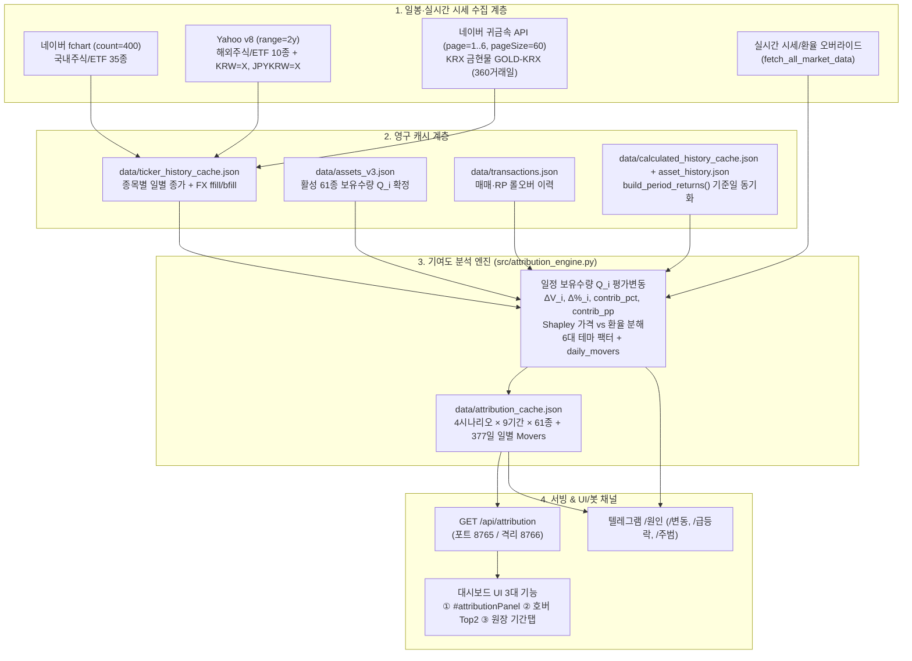
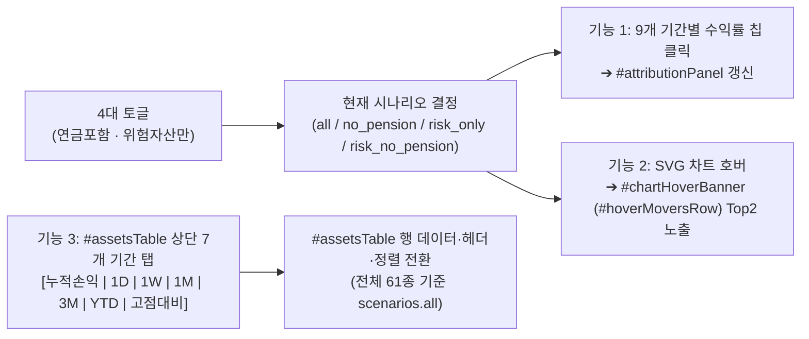

# 📊 계좌 총액 급등·급락 원인 자산 기여도 분석 설계 명세서 (`docs/attribution_analysis_spec.md`)

> **문서 식별자**: `docs/attribution_analysis_spec.md`  
> **문서 버전**: v1.0 (Phase 23 / T-28-1 SSoT)  
> **작성 일자**: 2026-11-15  
> **작성자**: 설계자 / 금융 분석가 (`architect`)  
> **대상 워크트리**: `C:\cowork\myasset-attribution` (`feat/attribution`)  
> **수신자**: 비서 (Main Orchestrator), 개발자 (`developer`), 품질 검증가 (`qa-verifier`)  
> **관련 구현 대상 (후속 태스크)**:
> - `src/attribution_engine.py` (신규 — 기여도·팩터·일별 Top Movers 산출 엔진)
> - `src/auto_backfill.py` (개선 — `GOLD-KRX` 페이지네이션 및 `data/ticker_history_cache.json` 영구화 연동)
> - `src/live_price_server.py` (확장 — `/api/attribution`, 텔레그램 `/원인` 명령어, `PORT`/`DISABLE_TG_POLL`/`NO_BROWSER` 격리 환경변수)
> - `data/ticker_history_cache.json`, `data/attribution_cache.json` (신규 캐시 데이터)
> - `build_web_index.py` → `web/index.html` (대시보드 UI 3대 기능 구현 및 컴파일)
> - `docs/telegram_command_spec.md` (참고 연계 — `?` 도움말 표 `/원인` 항목 추가)

---

## 📌 목차 (Table of Contents)
1. [개요 및 문제 정의](#1-개요-및-문제-정의)
2. [보유 종목별 기간 기여도(Attribution) 수학적 산출 공식](#2-보유-종목별-기간-기여도attribution-수학적-산출-공식)
   - 2.1 [활성 자산 판별 및 4대 시나리오 필터링 기준](#21-활성-자산-판별-및-4대-시나리오-필터링-기준)
   - 2.2 [티커·자산 유형별 일별 가격 $P_i(d)$ 및 환율 $FX_i(d)$ 매핑 규칙](#22-티커자산-유형별-일별-가격-p_id-및-환율-fx_id-매핑-규칙)
   - 2.3 [일정 보유수량($Q_i$) 기준 평가변동액·등락률·기여비중 및 가격/환율 분해 공식](#23-일정-보유수량q_i-기준-평가변동액등락률기여비중-및-가격환율-분해-공식)
   - 2.4 [매매·RP 롤오버 왜곡 방지 3중 메커니즘 및 `recent_trades` 안내 규칙](#24-매매rp-롤오버-왜곡-방지-3중-메커니즘-및-recent_trades-안내-규칙)
3. [6대 테마/매크로 팩터 분류 매핑(`factors`)](#3-6대-테마매크로-팩터-분류-매핑factors)
   - 3.1 [팩터 분류 체계 및 우선순위 판별 규칙 (MECE)](#31-팩터-분류-체계-및-우선순위-판별-규칙-mece)
   - 3.2 [61종 활성 자산 전수 팩터 배정표 및 무누락·무중복 검증](#32-61종-활성-자산-전수-팩터-배정표-및-무누락무중복-검증)
   - 3.3 [6대 팩터 변동액 합산 항등식 (환율 팩터 분리)](#33-6대-팩터-변동액-합산-항등식-환율-팩터-분리)
4. [커버리지, 날짜 정합성 및 백엔드 캐시/API 스키마](#4-커버리지-날짜-정합성-및-백엔드-캐시api-스키마)
   - 4.1 [기간 기준일($d_{\text{start}}$, $d_{\text{end}}$) 정합성 규칙 (`build_period_returns` 일치)](#41-기간-기준일d_start-d_end-정합성-규칙-build_period_returns-일치)
   - 4.2 [`data/ticker_history_cache.json` 스키마](#42-dataticker_history_cachejson-스키마)
   - 4.3 [`data/attribution_cache.json` 및 `GET /api/attribution` JSON 스키마](#43-dataattribution_cachejson-및-get-apiattribution-json-스키마)
   - 4.4 [격리 실행 환경변수 규격 (`PORT`, `DISABLE_TG_POLL`, `NO_BROWSER`)](#44-격리-실행-환경변수-규격-port-disable_tg_poll-no_browser)
5. [대시보드 웹 UI 3대 기능 상세 사양](#5-대시보드-웹-ui-3대-기능-상세-사양)
   - 5.1 [기능 1: 9개 기간별 수익률 칩 연동 & 「기간별 급등·급락 원인 분석 (`#attributionPanel`)」](#51-기능-1-9개-기간별-수익률-칩-연동--기간별-급등급락-원인-분석-attributionpanel)
   - 5.2 [기능 2: SVG 시계열 차트 호버(`#chartHoverBanner`) 당일 Top 2 급등·급락 노출](#52-기능-2-svg-시계열-차트-호버charthoverbanner-당일-top-2-급등급락-노출)
   - 5.3 [기능 3: 보유 자산 원장 테이블(`#assetsTable`) 상단 기간 전환 탭 및 정렬·표시 규칙](#53-기능-3-보유-자산-원장-테이블assetstable-상단-기간-전환-탭-및-정렬표시-규칙)
6. [텔레그램 봇 `/원인` 명령어 상세 사양](#6-텔레그램-봇-원인-명령어-상세-사양)
   - 6.1 [명령어 별칭, 기간 인자 및 시나리오 파싱 규칙](#61-명령어-별칭-기간-인자-및-시나리오-파싱-규칙)
   - 6.2 [기본 `/원인` 호출 출력 포맷 (`1D`, `1W`, `고점대비(MDD)` 종합 요약)](#62-기본-원인-호출-출력-포맷-1d-1w-고점대비mdd-종합-요약)
   - 6.3 [특정 기간 호출 출력 포맷 (`/원인 1M`, `/원인 YTD`, `/원인 고점` 등)](#63-특정-기간-호출-출력-포맷-원인-1m-원인-ytd-원인-고점-등)
   - 6.4 [`?` 단축어 도움말 시트 업데이트 규격](#64--단축어-도움말-시트-업데이트-규격)
7. [테스트 및 수용 기준 (Acceptance Criteria)](#7-테스트-및-수용-기준-acceptance-criteria)

---

## 1. 개요 및 문제 정의

### 1.1 현재 아키텍처의 공백
기존 자산 관제탑(`v5.2`)은 `src/auto_backfill.py`와 `src/history_metrics.py`를 통해 4대 시나리오(`all`, `no_pension`, `risk_only`, `risk_no_pension`)의 일별 총 순자산(`daily_nav`)과 9대 기간 수익률(`1D`, `1W`, `1M`, `3M`, `6M`, `YTD`, `1Y`, `peak_drawdown`, `trough_gain`)을 산출하고 있으나, **총액만 집계할 뿐 "무엇 때문에 계좌가 급등하거나 급락했는지"를 분해하지 못하는 구조적 공백**이 존재합니다.

1. **개별 일봉 데이터 비영구화**: `auto_backfill.py`가 네이버/야후에서 종목별 일봉 종가를 수집한 뒤 합산 `daily_nav`만 저장하고 종목별 시계열을 폐기함.
2. **KRX 금현물(`GOLD-KRX`) 장기 시세 단절**: `fetch_naver_gold_daily()`가 `pageSize` 미지정으로 최근 **10거래일**만 반환하여, `1M`·`3M`·`YTD`·`peak_drawdown` 구간에서 금 현물(₩7,942만, 비중 약 7.5%)의 변동이 `0원`으로 왜곡됨 (`page=1..6&pageSize=60` 페이지네이션 시 **360거래일** 확보 가능).
3. **현금성 카테고리 내 시장형 ETF 취급 불일치**: `live_price_server.py`는 `488770`(KODEX 머니마켓액티브), `449170`(TIGER KOFR금리액티브), `0048J0`(KODEX 미국머니마켓액티브), `BOXX`를 실시간 시장가로 평가하지만, `auto_backfill.py` L295에서는 `category == "현금성자산"` 조건 때문에 정적 고정가로 처리하여 장단기 시계열·환율 반영에 괴리가 발생함.
4. **매매·RP 롤오버 오탐 위험**: `2026-11-06` `AST-037`(KODEX 반도체레버리지 56주 매도 ➔ `AST-064` CMA 입금) 및 `2026-11-10` `AST-057`/`AST-058`(7일 외화RP 만기 해지 $17,192.52 ➔ `AST-059` 수시 외화RP 재매수) 등 내부 이체·만기 롤오버를 단순 시점별 잔고 차이로 계산할 경우, 해지 자산이 `-100%` 급락 주범으로, 재매수 RP가 `+390%` 급등 견인주로 오탐됨.

### 1.2 전체 아키텍처 흐름



---

## 2. 보유 종목별 기간 기여도(Attribution) 수학적 산출 공식

### 2.1 활성 자산 판별 및 4대 시나리오 필터링 기준

1. **활성 자산 판별 (`is_active_asset(a)`)**:
   - `data/assets_v3.json` 전체 64개 레코드 중 전량 매도·만기 해지 완료된 잔고 0원 자산을 제외하고, 현재 실질 보유 중인 **61종 활성 자산**만 분석 모수 $\mathcal{A}_{\text{active}}$로 편입한다. (기존 `live_price_server.py` L1205 및 `build_web_index.py` L4597과 100% 동치)
   $$\text{is\_active}(a) \iff \bigl(\text{float}(a.\text{quantity} \lor 0) > 0\bigr) \;\lor\; \bigl(\text{float}(a.\text{valuation\_krw} \lor 0) > 0\bigr)$$
   - **제외 대상(비활성 3종)**:
     - `AST-037`: `KODEX 반도체레버리지` (`494310`, `quantity=0, valuation_krw=0`, 2026-11-06 전량 매도)
     - `AST-057`: `USD 일반RP(7일, 3.50%) #1` (`RP-USD-7D-1`, `quantity=0, valuation_krw=0`, 2026-11-10 만기 해지)
     - `AST-058`: `USD 일반RP(7일, 3.50%) #2` (`RP-USD-7D-2`, `quantity=0, valuation_krw=0`, 2026-11-10 만기 해지)

2. **4대 토글 시나리오별 모수 집합 $\mathcal{A}_S$** (`src/history_metrics.py`의 `is_risk_asset(a)` 기준 준수):

| 시나리오 키 | 대시보드 토글 상태 | 필터 조건 | 활성 종목 수 | 원장 평가액 합계 (`assets_v3.json`) |
| :--- | :--- | :--- | :---: | :---: |
| `all` | 연금포함=ON, 위험자산만=OFF | $\mathcal{A}_{\text{active}}$ 전체 | **61종** | ₩1,059,211,259 |
| `no_pension` | 연금포함=OFF, 위험자산만=OFF | `a.category != "연금"` | **45종** | ₩968,914,845 |
| `risk_only` | 연금포함=ON, 위험자산만=ON | `is_risk_asset(a) == True` | **40종** | ₩625,963,496 |
| `risk_no_pension` | 연금포함=OFF, 위험자산만=ON | `a.category != "연금" and is_risk_asset(a)` | **29종** | ₩553,085,677 |

> [!NOTE]
> `build_web_index.py` 일부 코드에서 사용된 별칭 `risk_all`은 API 수신 시 정규 키 `risk_only`로 자동 매핑(alias resolution)한다.

---

### 2.2 티커·자산 유형별 일별 가격 $P_i(d)$ 및 환율 $FX_i(d)$ 매핑 규칙

활성 자산 61종은 시장 가격 추적 여부에 따라 **시장가 거래 자산 49종(고유 티커 46개)**과 **고정가 현금·예금·RP 12종(원화 8종, 외화 4종)**으로 분류된다. 모든 날짜 $d \in [d_{\min}, d_{\max}]$에 대해 아래와 같이 일별 가격 $P_i(d)$와 적용 환율 $FX_i(d)$를 매핑한다.

| 유형 코드 | 대상 자산 및 판별 조건 | 데이터 소스 및 수집 규격 | 일별 가격 $P_i(d)$ 및 환율 $FX_i(d)$ 규칙 |
| :--- | :--- | :--- | :--- |
| **`KR_EQUITY_ETF`** | **국내 주식·국내 상장 ETF (38개 행 / 35개 고유 티커)**<br/>`not ticker.startswith(("DEP-","CASH-","RP-"))` AND `currency == "KRW"` AND `ticker != "GOLD-KRX"`<br/>※ **주의**: `category == "현금성자산"` 또는 `"연금"` 내 상장 ETF(`488770`, `449170`, `0048J0`, `329750`, `453850`)도 반드시 시장 종가로 추적 | 네이버 금융 일봉 XML<br/>`fchart.stock.naver.com/sise.nhn?symbol={t}&timeframe=day&count=400&requestType=0` | • $P_i(d) = P_{\text{Naver}}(t_i, d)\;[\text{KRW}]$<br/>• $FX_i(d) \equiv 1.0$<br/>• 휴장일은 직전 영업일 `ffill`, 신규상장(`0126Z0` 2025-11-24 등) 상장 전 일자는 최초 거래일 종가 `bfill` |
| **`US_EQUITY_ETF`** | **미국 상장 주식·ETF (6종)**<br/>`currency == "USD"` AND `not ticker.startswith(("DEP-","CASH-","RP-"))`<br/>(`BOXX`, `TSLA`, `KORU`, `RAM`, `SMR`, `UEC`) | Yahoo Finance v8 Chart API<br/>`interval=1d&range=2y`<br/>+ `KRW=X` (`range=2y`) | • $P_i(d) = P_{\text{Yahoo}}(t_i, d)\;[\text{USD}]$<br/>• $FX_i(d) = FX_{\text{USD/KRW}}(d)$ (`KRW=X`)<br/>• `RAM`(2026-06-24 상장) 등 상장 전 구간은 최초 종가 `bfill` + `is_bfill_estimated=True` 표시 |
| **`JP_EQUITY_ETF`** | **일본 상장 주식·ETF (4종)**<br/>(`currency == "JPY"` OR `ticker.endswith(".T")`) AND `not ticker.startswith(("DEP-","CASH-","RP-"))`<br/>(`8001.T`, `7003.T`, `6954.T`, `282A.T`) | Yahoo Finance v8 Chart API<br/>`interval=1d&range=2y`<br/>+ `JPYKRW=X` (`range=2y`) | • $P_i(d) = P_{\text{Yahoo}}(t_i, d)\;[\text{JPY}]$<br/>• $FX_i(d) = FX_{\text{JPY/KRW}}(d)$ (`JPYKRW=X`, 1엔당 원화 `~8.34~9.0`)<br/>• **방어 규칙**: `if rate > 100: rate = rate / 100.0` (100엔 단위 반환 오차 방지; 절대 기존 `get_7d_category_weights`의 `/100` 무조건 나눗셈 오차를 답습하지 말 것) |
| **`GOLD_KRX`** | **KRX 금현물 (1종)**<br/>`ticker == "GOLD-KRX"` (`AST-053` 금 99.99_1kg 470g) | 네이버 귀금속 API 페이지네이션<br/>`reutersCode=M04020000&page={1..6}&pageSize=60` (360거래일 확보) | • $P_i(d) = P_{\text{KRX-Gold}}(d)\;[\text{KRW/g}]$<br/>• $FX_i(d) \equiv 1.0$ |
| **`FX_FIXED_CASH`** | **외화 고정가 현금·RP·예수금 (4종)**<br/>`ticker.startswith(("DEP-","CASH-","RP-"))` AND `currency in ("USD","JPY")`<br/>(`AST-056` 토스 엔화, `AST-059` USD 수시RP, `AST-061` 키움 JPY예수금, `AST-063` 키움 USD예수금) | `KRW=X` / `JPYKRW=X` (`range=2y`) | • $P_i(d) \equiv 1.0$ (외화 원금 단가 고정)<br/>• $FX_i(d) = FX_{\text{USD/KRW}}(d)$ 또는 $FX_{\text{JPY/KRW}}(d)$<br/>• 결과: 가격 변동 $0$원, **순수 환차손익(`fx_delta_krw`)만 반영** |
| **`KRW_FIXED_CASH`** | **원화 고정가 현금·예금·RP·예수금 (8종)**<br/>`currency == "KRW"` AND (`not ticker` OR `ticker.startswith(("DEP-","CASH-","RP-"))`)<br/>(`AST-001`, `010`, `017`, `038`, `055`, `060`, `062`, `064`) | 원장 `assets_v3.json` | • $V_i(d) \equiv \text{round}(a.\text{valuation\_krw})$ (상수)<br/>• $\Delta V_i = 0$, $\text{price\_delta\_krw} = 0$, $\text{fx\_delta\_krw} = 0$ |
| **`UNMAPPED_FALLBACK`** | **티커 미매핑 / API 수집 실패 자산**<br/>상장 티커이나 수집 시계열이 완전히 비어있는 경우 | 기존 `ticker_history_cache.json` → 원장 `valuation_krw` 폴백 | • 캐시 내 마지막 유효 시계열 우선 사용<br/>• 캐시 부재 시 $V_i(d) \equiv \text{round}(a.\text{valuation\_krw})$, `price_source="static_fallback"`, `is_estimated=True` 표기 |

#### 최종일(`d_end == today_str`) 실시간 시세 오버라이드 규칙
- `today_str`(= KST 당일) 시점의 분석 시 `fetch_all_market_data()`의 유효 실시간 시세(`prices[t]["price"]`, `fx["USDKRW"]`, `fx["JPYKRW"]`)가 존재하면 $P_i(\text{today\_str})$와 $FX_i(\text{today\_str})$를 실시간 값으로 오버라이드한다.
- 주말·장전·휴장일 등 당일 체결가가 없는 경우 `ffill` 규칙에 의해 직전 최종 거래일 종가가 그대로 유지된다.

#### 결측 일자 채움(Forward-Fill / Backward-Fill) 규칙
전체 달력 일자 $d \in [d_{\min}, d_{\max}]$에 대해 각 티커 $t$의 원천 거래일 집합 $\mathcal{D}_t$가 주어졌을 때:
$$P_t^{\text{filled}}(d) = \begin{cases} P_t(d), & d \in \mathcal{D}_t \\ P_t(\max\{d' \in \mathcal{D}_t \mid d' < d\}), & d > \min(\mathcal{D}_t) \text{ (Forward-Fill)} \\ P_t(\min(\mathcal{D}_t)), & d < \min(\mathcal{D}_t) \text{ (Backward-Fill, 신규상장 등)} \end{cases}$$

---

### 2.3 일정 보유수량($Q_i$) 기준 평가변동액·등락률·기여비중 및 가격/환율 분해 공식

모든 활성 자산 $i \in \mathcal{A}_{\text{active}}$에 대해 **현재 원장 보유수량 $Q_i = \text{float}(a_i.\text{quantity})$를 분석 기간 $[d_{\text{start}}, d_{\text{end}}]$ 전 구간에 고정**하여 평가한다.

1. **일자별 원화 평가액 $V_i(d)$** (정수 원화 반올림):
   $$V_i^{\text{raw}}(d) = \begin{cases} \text{float}(a_i.\text{valuation\_krw}), & \text{if } i \in \text{KRW\_FIXED\_CASH} \lor \text{UNMAPPED\_FALLBACK} \\ Q_i \cdot 1.0 \cdot FX_i(d), & \text{if } i \in \text{FX\_FIXED\_CASH} \\ Q_i \cdot P_i(d) \cdot FX_i(d), & \text{otherwise} \end{cases}$$
   $$V_i(d) = \text{int}(\text{round}(V_i^{\text{raw}}(d)))$$

2. **기간별 평가변동액 ($\Delta V_i$) 및 등락률 ($\Delta\%_i$)**:
   $$\Delta V_i = V_i(d_{\text{end}}) - V_i(d_{\text{start}}) \quad [\text{KRW, int}]$$
   $$\Delta\%_i = \begin{cases} \text{round}\!\left(\frac{\Delta V_i}{V_i(d_{\text{start}})} \times 100,\; 2\right), & \text{if } V_i(d_{\text{start}}) > 0 \\ 0.0, & \text{otherwise} \end{cases}$$
   - 원통화 기준 주가 등락률(`local_return_pct`)도 병행 산출한다:
     $$\Delta\%_i^{\text{local}} = \begin{cases} \text{round}\!\left(\frac{P_i(d_{\text{end}}) - P_i(d_{\text{start}})}{P_i(d_{\text{start}})} \times 100,\; 2\right), & \text{if } P_i(d_{\text{start}}) > 0 \\ 0.0, & \text{otherwise} \end{cases}$$

3. **시나리오 모수 합산 변동액 ($\Delta V_{\text{attr}}$) 및 일정수량 수익률 ($\text{attr\_return\_pct}$)**:
   $$V_{\text{attr}}(d) = \sum_{i \in \mathcal{A}_S} V_i(d), \qquad \Delta V_{\text{attr}} = \sum_{i \in \mathcal{A}_S} \Delta V_i = V_{\text{attr}}(d_{\text{end}}) - V_{\text{attr}}(d_{\text{start}})$$
   $$\text{attr\_return\_pct} = \begin{cases} \text{round}\!\left(\frac{\Delta V_{\text{attr}}}{V_{\text{attr}}(d_{\text{start}})} \times 100,\; 2\right), & \text{if } V_{\text{attr}}(d_{\text{start}}) > 0 \\ 0.0, & \text{otherwise} \end{cases}$$

4. **기여 비중 (`contrib_pct`) 및 포트폴리오 수익률 기여도 (`contrib_pp`)**:
   - **기여 비중 (`contrib_pct`)** — 전체 변동 중 해당 자산이 차지한 비중 (부호는 자산의 상승/하락 방향과 일치하도록 분모에 $|\Delta V_{\text{attr}}|$ 사용):
     $$\text{contrib\_pct}_i = \begin{cases} \text{round}\!\left(\frac{\Delta V_i}{|\Delta V_{\text{attr}}|} \times 100,\; 2\right), & \text{if } |\Delta V_{\text{attr}}| > 0 \\ 0.0, & \text{if } \Delta V_{\text{attr}} == 0 \end{cases}$$
     - **불변 항등식**: $\Delta V_{\text{attr}} > 0 \implies \sum_i \text{contrib\_pct}_i \approx +100.0\%$, $\Delta V_{\text{attr}} < 0 \implies \sum_i \text{contrib\_pct}_i \approx -100.0\%$. (음수 부호는 하락 기여, 양수 부호는 상승 기여로 직관적 일관성 보장)
   - **포트폴리오 수익률 기여도 (`contrib_pp`, `%p`)** — 기초 포트폴리오 가치 $V_{\text{attr}}(d_{\text{start}})$ 대비 수익률 기여 포인트:
     $$\text{contrib\_pp}_i = \begin{cases} \text{round}\!\left(\frac{\Delta V_i}{V_{\text{attr}}(d_{\text{start}})} \times 100,\; 2\right), & \text{if } V_{\text{attr}}(d_{\text{start}}) > 0 \\ 0.0, & \text{otherwise} \end{cases}$$
     - **불변 항등식**: $\sum_i \text{contrib\_pp}_i \approx \text{attr\_return\_pct}$.
   - **보합장(`1D` 등) 왜곡 방지 표기 규칙**: $|\Delta V_{\text{attr}}| < \max(100{,}000,\; 0.0005 \times V_{\text{attr}}(d_{\text{start}}))$ (총 변동률 $0.05\%$ 미만 극소 변동일)인 경우, 리더와 드래거가 서로 상쇄되어 `contrib_pct`가 $\pm 500\%$ 이상으로 과장될 수 있으므로 API는 `is_near_flat_net: true` 플래그를 반환하고, UI/텔레그램은 `contrib_pct` 대신 **`contrib_pp` (`%p`)**를 주 지표로 표시한다.

5. **가격 효과 (`price_delta_krw`) vs 환율 효과 (`fx_delta_krw`) 분해 공식 (Shapley 대칭 중간값 분해)**:
   교차항(Cross-term) 잔차를 남기지 않고 순서 비의존적(Order-Independent)으로 분해하기 위해 Shapley 대칭 중간값(Symmetric Midpoint) 공식을 적용한다.
   - **유형별 분해식**:
     1. 원화 자산 ($FX_i(d_{\text{start}}) = FX_i(d_{\text{end}}) = 1.0$):
        $$\text{price\_delta\_krw}_i = \Delta V_i, \qquad \text{fx\_delta\_krw}_i = 0$$
     2. 외화 고정가 현금·RP (`FX_FIXED_CASH`, $P_i \equiv 1.0$):
        $$\text{price\_delta\_krw}_i = 0, \qquad \text{fx\_delta\_krw}_i = \Delta V_i$$
     3. 외화 시장가 자산 (`US_EQUITY_ETF`, `JP_EQUITY_ETF`):
        $$\text{raw\_fx\_delta}_i = Q_i \cdot \frac{P_i(d_{\text{start}}) + P_i(d_{\text{end}})}{2} \cdot \bigl(FX_i(d_{\text{end}}) - FX_i(d_{\text{start}})\bigr)$$
        $$\text{fx\_delta\_krw}_i = \text{int}(\text{round}(\text{raw\_fx\_delta}_i))$$
        $$\text{price\_delta\_krw}_i = \Delta V_i - \text{fx\_delta\_krw}_i$$
   - **대수적 무오차 증명**:
     $$Q_i(P_1 - P_0)\frac{FX_0 + FX_1}{2} + Q_i\frac{P_0 + P_1}{2}(FX_1 - FX_0) = Q_i(P_1 FX_1 - P_0 FX_0) = \Delta V_i^{\text{raw}}$$
     정수 원화 단계에서 `price_delta_krw_i = ΔV_i - fx_delta_krw_i`로 잔여 보정하므로 **모든 자산에 대해 `price_delta_krw_i + fx_delta_krw_i == delta_krw_i`가 1원 오차도 없이 100% 성립**한다.

---

### 2.4 매매·RP 롤오버 왜곡 방지 3중 메커니즘 및 `recent_trades` 안내 규칙

실제 `data/transactions.json`에는 최근 2건의 주요 리밸런싱 이벤트가 기록되어 있다:
1. **`2026-11-06` 반도체 레버리지 전량 매도 (`TX-20261106-001`)**: `AST-037` (`KODEX 반도체레버리지`, `494310`) 56주 @ 31,100원 매도(1,741,600원, 실현손익 **-6,343,875원** / `-78.46%`) ➔ `AST-064` (`나무 CMA 예수금`) +1,741,600원 입금.
2. **`2026-11-10` 외화RP 만기 롤오버 (`TX-20261110-001`~`004`)**: `AST-057` ($11,588.77) + `AST-058` ($5,603.75) 7일 만기 해지 ➔ `AST-059` (`USD 일반RP(수시)`) $5,000 + $12,192 = $17,192 재매수(보유량 $4,400 ➔ $21,592) 및 단수 이자 `$0.52` ➔ `AST-063` 입금.

이들 내부 자산 교환이 거짓 급락/급등 주범으로 오탐되는 현상을 원천 차단하기 위해 **3중 방어 메커니즘**을 적용한다.

1. **방어층 1 — 비활성 청산 자산 제외 & 현재 수량 $Q_i$ 고정 역산**:
   - 전량 청산된 `AST-037`, `AST-057`, `AST-058`은 `quantity == 0 and valuation_krw == 0`이므로 분석 모수에서 제외되어 `-100%` 거짓 하락 주범에 절대 등장하지 않는다.
   - 자금을 수취한 `AST-064`(나무 CMA `1,741,600원`)는 시작일 $d_{\text{start}}$부터 `1,741,600원`으로 고정되므로 $\Delta V = \mathbf{0\text{원}}$, `AST-059`(수시 USD RP `$21,592`)는 시작일부터 `$21,592`로 고정되므로 $\text{price\_delta\_krw} = \mathbf{0\text{원}}$이며 순수 환율 변동(`fx_delta_krw`)만 반영된다. (`$17,192` 이체액이 거짓 급등 1위로 오탐되지 않음!)

2. **방어층 2 — 시계열 NAV 변동과 기여도 합계 간 잔차(`residual_krw`) 명시 분리**:
   - `calculated_history_cache.json` + `asset_history.json` 기반의 하이브리드 총액 변동 `nav_delta_krw = NAV_hybrid(d_end) - NAV_hybrid(d_start)`에는 과거 시점의 매도 전 수량, 실현손익(-634만 원), RP 이자(+$11.52) 및 백필/스냅샷 정적 처리 차이가 포함된다.
   - 엔진은 이를 임의로 자산에 할당해 왜곡하지 않고, 아래와 같이 **두 지표를 투명하게 분리**한다:
     - `nav_delta_krw`: 하이브리드 시계열 실제 계좌 총액 변동 (`build_period_returns()` 기준)
     - `attr_delta_krw`: 현재 보유 포트폴리오 시세·환율 기여합 ($\sum_{i \in \mathcal{A}_S} \Delta V_i$)
     - `residual_krw = nav_delta_krw - attr_delta_krw` (매매/롤오버·과거 스냅샷 기준차)

3. **방어층 3 — `recent_trades` 자동 스캔 및 내부 이체 안내 규칙**:
   - 각 기간 $[d_{\text{start}}, d_{\text{end}}]$ 내에 체결된 `data/transactions.json` (`status == "APPLIED"`) 레코드를 필터링한다. (`tx_date = timestamp[:10]`, `d_start <= tx_date <= d_end`)
   - **내부 이체 / 롤오버 자동 판정 규칙**:
     - 동일 `tx_date`에 `SELL`과 `BUY`가 모두 존재하거나, `asset_id`/`ticker`가 `RP-`·`CASH-`로 매수 연동된 거래, 또는 `SELL` 대금이 예수금(`AST-064` 등)으로 유입(`cash_adjusted == True`)된 거래는 `is_internal_rollover: true`로 태깅한다.
     - UI(`#attrTradeNotice`) 및 텔레그램(`/원인`) 하단에 별도 참고 알림으로 노출:
       - `2026-11-10`: `USD 7일 만기 RP 2건(AST-057/058) → 수시 RP(AST-059) $17,192 롤오버 (내부 이체로 시세 급등락에서 제외됨)`
       - `2026-11-06`: `KODEX 반도체레버리지(AST-037) 전량 매도(₩1,741,600, 실현 -₩6,343,875) → 나무 CMA(AST-064) 입금 (현재 보유 기준 기여도에서 제외됨)`

---

## 3. 6대 테마/매크로 팩터 분류 매핑(`factors`)

### 3.1 팩터 분류 체계 및 우선순위 판별 규칙 (MECE)

모든 활성 자산 61종은 **누락(0건) 및 중복(0건)** 없이 **5대 자산군 팩터(①~⑤)** 중 **정확히 1개**에 배정되며, 외화(`USD`/`JPY`) 직접 보유 자산의 환차손익은 **⑥ 환율 효과 (`fx`)** 팩터로 분리 집계된다.

판별은 반드시 아래 **우선순위(1 → 5)** 순으로 평가하여 중복 매칭을 방지한다:

| 우선순위 | `factor_id` | 팩터명 (한글) | 아이콘 | 판별 규칙 (코드 레벨 조건) |
| :-: | :--- | :--- | :---: | :--- |
| **1** | `bond_cash` | **채권·금리형 자산** | 🏦 | `not ticker` OR `ticker.startswith(("DEP-","CASH-","RP-"))` OR `category in ("현금성자산","예금")` OR `ticker in ("488770","449170","0048J0","329750","453850","BOXX")` |
| **2** | `gold_alt` | **금 현물·대체자산** | 🪙 | `ticker in ("GOLD-KRX","160580","138910")` OR `category == "원자재"` |
| **3** | `jp_global` | **일본·글로벌 증시** | 🌏 | `currency == "JPY"` OR `ticker.endswith(".T")` OR `ticker == "371460"` OR `"중국" in tags` |
| **4** | `us_equity` | **미국 빅테크·지수** | 🇺🇸 | `ticker in ("390390","487230","381170","379810","379780","245340","269540","TSLA","RAM","SMR","UEC")` OR (`currency == "USD"` AND `ticker != "KORU"`) OR `"미국주식" in tags` |
| **5** | `kr_equity` | **국내 반도체·IT/주도주** | 🇰🇷 | `category == "국내주식"` OR `ticker == "KORU"` OR `"국내주식" in tags` OR `ticker == "396500"` (위 1~4 미매칭 잔여 국내/한국지수 자산) |
| **별도 오버레이** | `fx` | **환율 효과 (USD/JPY FX)** | 💱 | **모든 `currency in ("USD", "JPY")` 자산(14종)의 `fx_delta_krw` 합산** (`is_fx_overlay: true`) |

> [!IMPORTANT]
> **경계 종목 분류 근거 명시**:
> - `AST-049` (`KORU`): 미국 증시에 USD로 상장되어 있으나 기초 지수가 **MSCI Korea 25/50 (3X)**이므로, 기초 가격 변동(`price_delta_krw`)은 **① 국내 반도체·IT/주도주 (`kr_equity`)**에 귀속시키고, 달러 환율 변동(`fx_delta_krw`)은 **⑥ 환율 효과 (`fx`)**에 귀속시킨다 (`build_web_index.py` L4023 국가 분류와 일관).
> - `AST-050` (`RAM`), `AST-052` (`SMR`), `AST-054` (`UEC`): 미국 상장 테마 ETF·주식으로서 **② 미국 빅테크·지수 (`us_equity`)**에 배정한다.
> - `AST-014` (`371460`, TIGER 차이나전기차SOLACTIVE): 일본·중국 등 비미국 글로벌 증시 축인 **③ 일본·글로벌 증시 (`jp_global`)**에 배정한다.
> - `AST-007` (`329750`), `AST-008/021/028` (`0048J0`), `AST-013` (`453850`), `AST-044` (`BOXX`): 모두 금리형·채권형 자산이므로 **⑤ 채권·금리형 자산 (`bond_cash`)**에 배정한다. (이 중 `0048J0` 등 KRX 원화 상장 언헤지 달러 ETF는 거래소 종가 자체에 환율이 내재되어 있으므로 `price_delta_krw`에 반영되며, 직접 외화 표시 자산 14종만 `fx` 팩터로 분리된다.)

---

### 3.2 61종 활성 자산 전수 팩터 배정표 및 무누락·무중복 검증

실제 `data/assets_v3.json` 기준 **61종 전수 분류 검증 결과** (`23 + 11 + 5 + 2 + 20 = 61종`, 미분류 `0종`, 원장 평가액 합계 **₩1,059,211,259 100% 일치**):

| `factor_id` | 팩터명 | 종목 수 | 원장 평가액 합계 (KRW) | 포함 자산 ID 및 티커 목록 |
| :--- | :--- | :---: | :---: | :--- |
| `kr_equity` | ① 국내 반도체·IT/주도주 | **23종** | ₩533,694,196 | `AST-002`(`396500`), `005`(`396500`), `018`(`005930`), `022`(`000660`), `023`(`005380`), `024`(`006400`), `025`(`078600`), `026`(`487240`), `027`(`278530`), `029`(`035420`), `030`(`195870`), `031`(`000270`), `032`(`051600`), `033`(`207940`), `034`(`192650`), `035`(`030190`), `036`(`329180`), `039`(`243840`), `040`(`0126Z0`), `041`(`475400`), `042`(`131970`), `043`(`489790`), `049`(`KORU`) |
| `us_equity` | ② 미국 빅테크·지수 | **11종** | ₩60,145,902 | `AST-003`(`390390`), `004`(`487230`), `006`(`381170`), `011`(`379810`), `012`(`379780`), `015`(`245340`), `016`(`269540`), `045`(`TSLA`), `050`(`RAM`), `052`(`SMR`), `054`(`UEC`) |
| `jp_global` | ③ 일본·글로벌 증시 | **5종** | ₩27,817,321 | `AST-014`(`371460`), `046`(`8001.T`), `047`(`7003.T`), `048`(`6954.T`), `051`(`282A.T`) |
| `gold_alt` | ④ 금 현물·대체자산 | **2종** | ₩83,721,977 | `AST-009`(`160580`), `053`(`GOLD-KRX`) |
| `bond_cash` | ⑤ 채권·금리형 자산 | **20종** | ₩353,831,863 | `AST-001`(`DEP-MG-2027`), `007`(`329750`), `008`(`0048J0`), `010`(`CASH-KRW-KB`), `013`(`453850`), `017`(`CASH-KRW-SAMIRP`), `019`(`488770`), `020`(`449170`), `021`(`0048J0`), `028`(`0048J0`), `038`(`CASH-KRW-SAMGEN`), `044`(`BOXX`), `055`(`CASH-KRW-NAMUGOLD`), `056`(`CASH-JPY-TOSS`), `059`(`RP-USD-ONDEMAND`), `060`(`RP-KRW-ISA-7D`), `061`(`CASH-JPY-KIWOVS`), `062`(`CASH-KRW-KIWOVS`), `063`(`CASH-USD-KIWOVS`), `064`(`CASH-KRW-NAMUCMA`) |
| `fx` | ⑥ 환율 효과 (USD/JPY FX) | *(14종 오버레이)* | *(직접 외화 노출: ₩136,949,670)* | USD 8종 (`BOXX`, `TSLA`, `KORU`, `RAM`, `SMR`, `UEC`, `RP-USD-ONDEMAND`, `CASH-USD-KIWOVS`), JPY 6종 (`8001.T`, `7003.T`, `6954.T`, `282A.T`, `CASH-JPY-TOSS`, `CASH-JPY-KIWOVS`) → **총 14종** |
| **합계 (①~⑤)** | — | **61종** | **₩1,059,211,259** | **누락 0종, 중복 0종** |

*(주: 위 표의 USD 8종 + JPY 6종 = 총 14종. 원화 환산 총액은 `assets_v3.json` 기준 `1,059,211,259원`이며 라이브 시세 적용 시 시세에 따라 변동)*

---

### 3.3 6대 팩터 변동액 합산 항등식 (환율 팩터 분리)

팩터별 변동액 `factors[f].delta_krw`는 다음과 같이 정의한다:
- **$f \in \{1..5\}$ (`kr_equity`, `us_equity`, `jp_global`, `gold_alt`, `bond_cash`)**:
  $$\text{delta\_krw}_f = \sum_{i \in \mathcal{A}_S \cap \mathcal{F}_f} \text{price\_delta\_krw}_i$$
- **$f = 6$ (`fx`, 환율 효과)**:
  $$\text{delta\_krw}_{\text{fx}} = \sum_{i \in \mathcal{A}_S,\; \text{currency}_i \in \{\text{USD}, \text{JPY}\}} \text{fx\_delta\_krw}_i$$
  (내부 세부 정보로 `usd_fx_delta_krw` 및 `jpy_fx_delta_krw`도 함께 제공)

**수학적 완전 가법 항등식 (Zero Double-Counting)**:
$$\sum_{f=1}^{6} \text{delta\_krw}_f = \sum_{i \in \mathcal{A}_S} \bigl(\text{price\_delta\_krw}_i + \text{fx\_delta\_krw}_i\bigr) = \sum_{i \in \mathcal{A}_S} \Delta V_i = \Delta V_{\text{attr}}$$
이로써 6대 팩터 바 차트의 변동액 합과 기여 비중(`contrib_pct`) 합계는 **모든 시나리오 × 모든 기간에서 포트폴리오 전체 기여합과 1원 오차 없이 정확히 일치**한다.

---

## 4. 커버리지, 날짜 정합성 및 백엔드 캐시/API 스키마

### 4.1 기간 기준일($d_{\text{start}}$, $d_{\text{end}}$) 정합성 규칙 (`build_period_returns` 일치)

`src/history_metrics.py`의 `build_period_returns(nav_dict, cur_v, ytd_b, scenario_name)`과 **100% 동일한 날짜 매칭 규칙**을 사용한다.

1. **하이브리드 시계열 키 추출**:
   - `generate_hybrid_history()`와 동일하게 `calculated_history_cache.json`의 시나리오별 `daily_nav`에 `asset_history.json` (`d >= "2026-11-03"`) 및 오늘자(`today_str`) 라이브 NAV를 병합한 날짜 리스트 `dates = sorted(nav_dict.keys())`를 구성한다.
   - `d_end = dates[-1]` (예: `2026-11-15`).
2. **9개 기간별 `d_start` 선정 규칙**:
   - `1D`, `1W`, `1M`, `3M`, `6M`, `1Y` (`days_map = {"1D": 1, "1W": 7, "1M": 30, "3M": 90, "6M": 180, "1Y": 365}`):
     $$tgt = (d_{\text{end}} - \Delta\text{days}), \qquad d_{\text{start}} = \max\{d \in \text{dates} \mid d \le tgt\} \quad (\text{없으면 } \text{dates}[0])$$
   - `YTD`: `"2026-01-02"` (존재하지 않으면 `"2026-01-02"` 이하 직전 날짜 또는 `dates[0]`, 즉 `ytd_base_nav`와 동일 키).
   - `peak_drawdown`: 365일 윈도우 `[d_end - 365d, d_end]` 내 `nav_dict[d]` 최댓값 발생일 (`2026-06-02`).
   - `trough_gain`: 365일 윈도우 `[d_end - 365d, d_end]` 내 `nav_dict[d]` 최솟값 발생일 (`2025-11-21`).
3. **주말·휴장일 보합(`is_market_closed_day`) 감지 규칙**:
   - 특히 `1D`에서 `d_end`와 `d_start`가 모두 토·일·공휴일이라 모든 시장가 티커의 $P_t(d_{\text{end}}) == P_t(d_{\text{start}})$ 이고 환율도 변동 없는 경우(`abs(attr_delta_krw) == 0`):
     - `is_market_closed_day = True`
     - `fallback_trading_date`: 최근 실제 시장 가격 변동이 발생한 마지막 거래일(예: `2026-11-13`)을 함께 반환하여 UI 배지 및 텔레그램 `/원인 1D`에서 안내할 수 있게 한다.

---

### 4.2 `data/ticker_history_cache.json` 스키마

`src/auto_backfill.py` 또는 `src/attribution_engine.py`가 병렬 일봉 수집 시 원자적(`.tmp` → `os.replace`)으로 갱신하는 종목별 일별 종가 SSoT 캐시.

```json
{
  "schema_version": "1.0",
  "updated_at": "2026-11-15T11:50:00+09:00",
  "date_range": {
    "min_date": "2025-11-04",
    "max_date": "2026-11-15"
  },
  "fx": {
    "KRW=X": {
      "source": "yahoo_v8",
      "currency": "KRW",
      "scale": "1USD",
      "raw_dates_count": 524,
      "prices": { "2025-11-04": 1385.20, "2026-11-13": 1336.20, "2026-11-15": 1336.20 }
    },
    "JPYKRW=X": {
      "source": "yahoo_v8",
      "currency": "KRW",
      "scale": "1JPY",
      "raw_dates_count": 523,
      "prices": { "2025-11-04": 9.0100, "2026-11-13": 8.3430, "2026-11-15": 8.3430 }
    }
  },
  "tickers": {
    "005930": {
      "source": "naver_fchart",
      "currency": "KRW",
      "first_real_date": "2025-03-26",
      "last_real_date": "2026-11-13",
      "raw_dates_count": 400,
      "prices": { "2025-11-04": 117385.0, "2026-11-13": 209000.0 }
    },
    "GOLD-KRX": {
      "source": "naver_metals_paginated",
      "currency": "KRW",
      "first_real_date": "2025-05-26",
      "last_real_date": "2026-11-13",
      "raw_dates_count": 360,
      "prices": { "2025-11-04": 182100.0, "2026-11-13": 168200.0 }
    },
    "RAM": {
      "source": "yahoo_v8",
      "currency": "USD",
      "first_real_date": "2026-06-24",
      "last_real_date": "2026-11-13",
      "raw_dates_count": 101,
      "prices": { "2026-06-24": 24.50, "2026-11-13": 7.62 }
    }
  },
  "coverage": {
    "total_active_assets": 61,
    "market_traded_assets": 49,
    "fixed_price_assets": 12,
    "unique_market_tickers": 46,
    "mapped_tickers_count": 46,
    "missing_tickers": [],
    "coverage_pct": 100.0
  }
}
```

> [!TIP]
> `prices` 딕셔너리에는 원천 거래일(`raw`)뿐만 아니라 `date_range` 내 전 달력 일자에 대해 `ffill` + `bfill` 처리된 키를 저장하거나, 엔진 로드 시 메모리에서 O(1) 해시맵으로 `ffill`/`bfill`을 전개하여 어느 날짜를 조회해도 `KeyError`가 발생하지 않도록 한다. (일봉 캐시 크기를 줄이려면 `prices`에는 `2025-11-04 ~ max_date` 구간의 원천 + 영업일 키 또는 전 일자 채움 키를 저장해도 약 48개 × 377일 ≈ 350KB에 불과하다.)

---

### 4.3 `data/attribution_cache.json` 및 `GET /api/attribution` JSON 스키마

#### 파일 저장 위치 및 API 엔드포인트
- **캐시 파일**: `data/attribution_cache.json`
- **엔드포인트**: `GET /api/attribution`
- **쿼리 파라미터**:
  - `scenario` (선택): `all` | `no_pension` | `risk_only` | `risk_no_pension` | `full` (기본값 `full` — 4개 시나리오 전체 반환, `risk_all`은 `risk_only`로 정규화)
  - `period` (선택): `1D` | `1W` | `1M` | `3M` | `6M` | `YTD` | `1Y` | `peak_drawdown` | `trough_gain` (단일 기간만 경량 조회 시 사용)
  - `include_daily` (선택): `1` (기본) | `0` (`daily_movers` 제외 경량 응답)
  - `refresh` (선택): `0` (기본, TTL 300초 이내 메모리/파일 캐시) | `1` (강제 재계산 및 `attribution_cache.json` 갱신)

#### JSON 스키마 (Full Payload)

```json
{
  "schema_version": "1.0",
  "status": "success",
  "as_of": "2026-11-15",
  "updated_at": "2026-11-15T11:50:00+09:00",
  "coverage": {
    "total_active_assets": 61,
    "market_traded_assets": 49,
    "fixed_price_assets": 12,
    "mapped_tickers_count": 46,
    "missing_tickers": [],
    "coverage_pct": 100.0
  },
  "scenarios": {
    "all": {
      "scenario": "all",
      "label": "연금포함 전체",
      "asset_count": 61,
      "periods": {
        "1M": {
          "period": "1M",
          "label": "최근 1개월",
          "d_start": "2026-10-16",
          "d_end": "2026-11-15",
          "is_market_closed_day": false,
          "fallback_trading_date": "2026-11-13",
          "nav_start_hybrid": 1069176590,
          "nav_end_hybrid": 1026357745,
          "nav_delta_krw": -42818845,
          "period_return_pct": -4.00,
          "attr_start_krw": 1072572835,
          "attr_end_krw": 1025907180,
          "attr_delta_krw": -46665655,
          "attr_return_pct": -4.35,
          "residual_krw": 3846810,
          "total_price_delta_krw": -45812000,
          "total_fx_delta_krw": -853655,
          "is_near_flat_net": false,
          "auto_summary": "최근 1개월(10/16~11/15) 계좌는 -4,667만 원(-4.35%) 하락했으며, 삼성전자(-1,040만 원, 기여 -22.3%)·현대차(-535만 원, -11.5%)·금 99.99_1kg(-517만 원, -11.1%)이 하락을 주도했습니다.",
          "top_draggers": [
            {
              "asset_id": "AST-018",
              "name": "삼성전자",
              "ticker": "005930",
              "category": "국내주식",
              "currency": "KRW",
              "factor_id": "kr_equity",
              "factor_label": "국내 반도체·IT/주도주",
              "quantity": 1300.0,
              "price_start": 217000.0,
              "price_end": 209000.0,
              "fx_start": 1.0,
              "fx_end": 1.0,
              "valuation_start_krw": 282100000,
              "valuation_end_krw": 271700000,
              "delta_krw": -10400000,
              "delta_pct": -3.69,
              "local_return_pct": -3.69,
              "price_delta_krw": -10400000,
              "fx_delta_krw": 0,
              "contrib_pct": -22.29,
              "contrib_pp": -0.97,
              "price_source": "naver_fchart",
              "is_bfill_estimated": false
            }
          ],
          "top_leaders": [
            {
              "asset_id": "AST-045",
              "name": "Tesla Inc (TSLA)",
              "ticker": "TSLA",
              "category": "해외주식",
              "currency": "USD",
              "factor_id": "us_equity",
              "factor_label": "미국 빅테크·지수",
              "quantity": 30.0,
              "price_start": 355.10,
              "price_end": 390.22,
              "fx_start": 1345.0,
              "fx_end": 1336.2,
              "valuation_start_krw": 14328285,
              "valuation_end_krw": 15641557,
              "delta_krw": 1313272,
              "delta_pct": 9.17,
              "local_return_pct": 9.89,
              "price_delta_krw": 1411874,
              "fx_delta_krw": -98602,
              "contrib_pct": 2.81,
              "contrib_pp": 0.12,
              "price_source": "yahoo_v8",
              "is_bfill_estimated": false
            }
          ],
          "factors": [
            {
              "factor_id": "kr_equity",
              "label": "국내 반도체·IT/주도주",
              "icon": "🇰🇷",
              "asset_count": 23,
              "exposure_krw": 506800000,
              "delta_krw": -37200000,
              "contrib_pct": -79.72,
              "contrib_pp": -3.47,
              "is_fx_overlay": false
            },
            {
              "factor_id": "fx",
              "label": "환율 효과 (USD/JPY FX)",
              "icon": "💱",
              "asset_count": 14,
              "exposure_krw": 141200000,
              "delta_krw": -853655,
              "usd_fx_delta_krw": -410000,
              "jpy_fx_delta_krw": -443655,
              "contrib_pct": -1.83,
              "contrib_pp": -0.08,
              "is_fx_overlay": true
            }
          ],
          "recent_trades": [
            {
              "tx_id": "TX-20261110-001",
              "date": "2026-11-10",
              "asset_id": "AST-057",
              "asset_name": "USD 일반RP(7일, 3.50%) #1",
              "trade_type": "SELL",
              "total_amount_krw": 15540541,
              "realized_profit_krw": 10420,
              "is_internal_rollover": true,
              "note": "7일 만기 해지 ➔ 수시 RP(AST-059) 롤오버 (내부 자금 이동으로 시세 급등락 제외)"
            }
          ],
          "by_asset": {
            "AST-001": { "...": "동일 AssetAttributionItem 스키마" },
            "AST-018": { "...": "동일 AssetAttributionItem 스키마" }
          }
        }
      },
      "daily_movers": {
        "2026-11-13": {
          "date": "2026-11-13",
          "prev_date": "2026-11-12",
          "is_flat_day": false,
          "day_delta_krw": 1738345,
          "day_return_pct": 0.17,
          "top_leaders": [
            { "asset_id": "AST-018", "name": "삼성전자", "ticker": "005930", "delta_krw": 3250000, "delta_pct": 1.21 }
          ],
          "top_draggers": [
            { "asset_id": "AST-022", "name": "SK하이닉스", "ticker": "000660", "delta_krw": -224000, "delta_pct": -0.64 }
          ]
        },
        "2026-11-15": {
          "date": "2026-11-15",
          "prev_date": "2026-11-14",
          "is_flat_day": true,
          "day_delta_krw": 0,
          "day_return_pct": 0.0,
          "top_leaders": [],
          "top_draggers": [],
          "note": "휴장일 (시세 변동 없음)"
        }
      }
    },
    "no_pension": { "...": "45종 동일 구조" },
    "risk_only": { "...": "40종 동일 구조" },
    "risk_no_pension": { "...": "29종 동일 구조" }
  }
}
```

> [!NOTE]
> `GET /api/attribution?scenario=all&period=1M`처럼 단일 시나리오·단일 기간만 요청 시에는 `status`, `as_of`, `updated_at`, `coverage`, `scenario`, `period`, `data`(해당 `periods[period]` 객체)를 반환하고, 파라미터 생략 시 `scenarios` 전체를 반환하여 웹 대시보드가 1회 페치로 모든 토글·칩·차트 호버를 무지연으로 렌더링할 수 있도록 한다.

---

### 4.4 격리 실행 환경변수 규격 (`PORT`, `DISABLE_TG_POLL`, `NO_BROWSER`)

기존 운영 중인 `c:\cowork\myasset` (`8765` 포트 및 `@sjstck_bot` 운영 폴링)과 충돌하지 않도록 `src/live_price_server.py`는 아래 환경변수를 지원해야 한다:

| 환경변수 | 기본값 | 격리 테스트(`8766`) 설정 | 동작 규칙 |
| :--- | :---: | :---: | :--- |
| `PORT` | `"8765"` | `"8766"` | `PORT = int(os.environ.get("PORT", "8765"))`로 바인딩 포트 제어 |
| `DISABLE_TG_POLL` | `"0"` | `"1"` | `"1"` 또는 `"true"`일 때 `telegram_polling_worker` 데몬 스레드 미기동 (`_telegram_status["status"] = "polling_disabled"`) |
| `NO_BROWSER` | `"0"` | `"1"` | `"1"` 또는 `"true"`일 때 `webbrowser.open(...)` 스레드 미실행 |

---

## 5. 대시보드 웹 UI 3대 기능 상세 사양

`build_web_index.py`를 통해 컴파일되는 `web/index.html` 및 루트 `index.html`에 다음 3대 기능을 구현한다. (기존 다크/라이트 테마 CSS 변수, 375px 모바일 무가로스크롤, 4대 토글 상태 유지, 기존 `T-10`/`T-17` DOM ID 100% 보존)



### 5.1 기능 1: 9개 기간별 수익률 칩 연동 & 「기간별 급등·급락 원인 분석 (`#attributionPanel`)」

1. **9개 `.period-chip` 클릭 연동**:
   - Hero 영역 `.period-chips-row` 내 9개 칩 (`1Y`, `YTD`, `6M`, `3M`, `1M`, `1W`, `1D`, `고점대비`, `저점대비`) 및 `#periodReturnsRiskBox` 내 서브 9개 칩 각각에 `data-period="..."`, `role="button"`, `tabindex="0"`, `onclick="selectAttributionPeriod('...')"` 속성을 부여한다.
   - 선택된 칩에는 `.attr-active` 클래스(인디고/스카이 하이라이트 테두리 + 미세 글로우)를 부여하고, `#attributionPanel` 헤더의 9개 퀵 필터 필(pill)과 양방향 동기화한다.
   - 초기 로드 시 기본 선택 기간은 `"1W"`(또는 `"1D"`, 단 주말·휴장일이면 `"1W"` 또는 `"1D"` + 직전 거래일 안내 중 일관성 있게 기본 `"1D"` 선택 및 `is_market_closed_day` 시 `"직전 거래일 YYYY-MM-DD 기준"` 안내 배지 + 원클릭 `[최근 1주(1W) 보기]` 링크 제공).
   - 4대 토글(`toggleIncludePension`, `toggleOnlyRiskAssets`) 변경 시 `renderAttributionPanel()`을 즉시 재호출하여 선택된 시나리오(`all`, `no_pension`, `risk_only`, `risk_no_pension`)에 맞게 패널을 동기화한다.

2. **`#attributionPanel` DOM 구조 및 배치**:
   - **배치 위치**: Hero 요약 카드(`.hero-card`) 직하단, YTD SVG 차트(`.chart-panel-ytd`) 직상단 (칩 클릭 시 스크롤 없이 즉시 원인 분석 확인 가능).
   - **필수 DOM ID 및 역할**:
     - `#attributionPanel` (`<section class="attribution-panel card-panel" id="attributionPanel">`): 전체 컨테이너
     - `#attrHeaderMeta`: 시나리오 배지(`연금포함 전체`), 기간 범위(`2026-10-16 ~ 2026-11-15`), 시계열 변동액 vs 일정수량 변동액 요약 배지
     - `#attrPeriodPills`: 9개 기간 전환 필 버튼 그룹 (`.attr-period-pill`)
     - `#attrAutoSummary`: 자동 생성 한국어 원인 요약 문장 + (해당 시) 휴장일 안내 / 매매 잔차 설명 배지
     - `#attrDraggersList`: **`📉 주요 하락 주범 (Top 5 Draggers)`** 카드 (가로 비례 진행 바 `--profit-negative`, 종목명/티커, 등락률, 변동액 KRW, 기여 `%` 또는 `%p`, 외화 종목 시 `가격/환율` 분해 서브라인)
     - `#attrLeadersList`: **`📈 주요 상승 견인 (Top 5 Leaders)`** 카드 (가로 비례 진행 바 `--profit-positive`, 동일 구성)
     - `#attrFactorsGrid`: **`🧩 6대 테마·매크로 팩터 기여도`** (6개 팩터 바/칩: `🇰🇷 국내 반도체·IT/주도주`, `🇺🇸 미국 빅테크·지수`, `🌏 일본·글로벌 증시`, `🪙 금 현물·대체자산`, `🏦 채권·금리형 자산`, `💱 환율 효과 (USD/JPY FX)` — 양수/음수 색상 막대, 변동액 및 기여 비중 표시)
     - `#attrTradeNotice`: **`ℹ️ 기간 내 매매·리밸런싱 이력 (왜곡 방지 적용됨)`** 알림 박스 (`recent_trades.length > 0`일 때만 노출)
   - **막대 너비 스케일링**: Top 5 Draggers / Leaders 가로 막대는 각 그룹(또는 전체 Top) 최대 절대 변동폭 `maxAbs = Math.max(...items.map(x => Math.abs(x.delta_krw)), 1)` 대비 `(Math.abs(item.delta_krw) / maxAbs * 100).toFixed(1)%`로 렌더링한다.

---

### 5.2 기능 2: SVG 시계열 차트 호버(`#chartHoverBanner`) 당일 Top 2 급등·급락 노출

1. **기존 DOM 보존 & `#hoverMoversRow` 추가**:
   - `#chartHoverBanner` 내 기존 1행 요소(`#hoverDate`, `#hoverNav`, `#hoverReturn`, `#hoverSnapshotBadge`)는 ID와 포맷을 그대로 유지한다.
   - `#chartHoverBanner` 내부 하단(또는 2행 flex row)에 **`<div class="hover-movers-row" id="hoverMoversRow">`**를 추가한다.
   - 레이아웃 시프트(Jitter) 방지를 위해 `.hover-movers-row`에 `min-height: 24px; display: flex; flex-wrap: wrap; align-items: center; gap: 10px;`를 지정한다.
2. **호버 데이터 조회 및 표시 규칙 (`updateHoverBanner(p)`)**:
   - `const dm = getDailyMover(p.date)` (현재 활성 시나리오의 `daily_movers[p.date]`).
   - **거래일 (`dm && !dm.is_flat_day`)**:
     - 전일비: `전일비 +₩1,738,345 (+0.17%)`
     - `📈 상승 Top 2`: 예) `삼성전자 +325만(+1.2%) · 현대차 +49만(+1.5%)` (최대 2종목, 칩 스타일)
     - `📉 하락 Top 2`: 예) `SK하이닉스 -22만(-0.6%) · 대주전자 -18만(-0.9%)` (최대 2종목, 칩 스타일)
   - **주말·휴장일 (`dm && dm.is_flat_day`)**:
     - `⏸️ 휴장일 (시세 변동 없음 · 직전 거래일 종가 유지)` 표시.
   - **데이터 미존재 시 폴백**: `당일 종목별 기여 데이터 없음` (에러 없이 안전 처리).
   - 마우스가 SVG 영역을 벗어나면(`onmouseleave`) 기존과 동일하게 `chartPoints[chartPoints.length - 1]`(최신일) 상태로 복귀한다.

---

### 5.3 기능 3: 보유 자산 원장 테이블(`#assetsTable`) 상단 기간 전환 탭 및 정렬·표시 규칙

1. **상단 기간 전환 탭 (`#assetsTablePeriodTabs`)**:
   - `#assetsTable` 섹션 헤더(종목 검색 `#tableSearch` 좌측 또는 상단 줄)에 **7개 탭 버튼** 배치:

| 탭 라벨 | `data-term` | 참조 데이터 소스 |
| :--- | :---: | :--- |
| `누적 손익(기본)` | `cumulative` | `a.profit_krw`, `a.return_rate` (기존과 100% 동일) |
| `1D 오늘` | `1D` | `attributionData.scenarios.all.periods["1D"].by_asset[a.id]` |
| `1W 1주` | `1W` | `attributionData.scenarios.all.periods["1W"].by_asset[a.id]` |
| `1M 1개월` | `1M` | `attributionData.scenarios.all.periods["1M"].by_asset[a.id]` |
| `3M 3개월` | `3M` | `attributionData.scenarios.all.periods["3M"].by_asset[a.id]` |
| `YTD` | `YTD` | `attributionData.scenarios.all.periods["YTD"].by_asset[a.id]` |
| `고점대비(MDD)` | `peak_drawdown` | `attributionData.scenarios.all.periods["peak_drawdown"].by_asset[a.id]` |

2. **컬럼 헤더 및 셀 표시 전환 규칙**:
   - `assetsTable`는 기존 원칙(`build_web_index.py` L4596)에 따라 항상 활성 61종 전체를 표시하므로, 기간 탭 전환 시에도 **`scenarios.all`** 기준으로 61종 모두의 기간 변동액을 조회한다.
   - 탭 전환 시 테이블 `<thead>`의 10번째·11번째 헤더 텍스트(`#thProfitLabel`, `#thReturnLabel`)를 동적으로 변경한다 (기존 `sortTable('profit_krw')` / `sortTable('return_rate')` `onclick` 핸들러 및 `#sort_profit_krw`, `#sort_return_rate` 아이콘 ID는 보존):
     - `cumulative`: `평가손익(KRW)` / `수익률`
     - 기간 선택 시 (예 `1M`): `1M 변동액(KRW)` / `1M 등락률` (또는 `고점대비 변동액(KRW)` / `고점대비 등락률`)
   - 셀 값 표시:
     - `profit_krw` 셀: `attrRow.delta_krw` (예: `-₩ 10,400,000`, 외화 자산이고 `fx_delta_krw != 0`이면 작은 보조 텍스트 `환율 -₩9.9만` 병기).
     - `return_rate` 셀: `attrRow.delta_pct` (예: `-3.69%`) + 작은 보조 텍스트 `기여 -0.97%p`.
3. **정렬(`sortTable`) 및 검색(`filterAssetsTable`) 연동**:
   - `sortTable('profit_krw')`: `currentTablePeriod === "cumulative"`면 `a.profit_krw`, 기간 탭이면 `getAssetAttr(a.id, currentTablePeriod)?.delta_krw ?? 0`으로 숫자 정렬.
   - `sortTable('return_rate')`: `currentTablePeriod === "cumulative"`면 `a.return_rate`, 기간 탭이면 `getAssetAttr(a.id, currentTablePeriod)?.delta_pct ?? 0`으로 숫자 정렬.
   - `DEFAULT_ATTRIBUTION_CACHE`: `build_web_index.py` 컴파일 시 `data/attribution_cache.json`이 존재하면 `DEFAULT_ATTRIBUTION_CACHE`로 내장하고, 서버 실행 중에는 `GET /api/attribution`을 비동기 페치하여 `attributionData`를 최신화한다.

---

## 6. 텔레그램 봇 `/원인` 명령어 상세 사양

`src/live_price_server.py`의 `generate_telegram_summary(query_text, force_refresh=True)`에 `/원인` 명령어 블록을 추가한다. `docs/telegram_command_spec.md`의 모바일 최적화 규칙(한 줄 배너, `format_korean_money()`, HTML `parse_mode`, `html.escape()`, 약 25~30줄 이내)을 100% 준수한다.

### 6.1 명령어 별칭, 기간 인자 및 시나리오 파싱 규칙

1. **트리거 키워드 (선행 `/` 유무 및 대소문자 무시)**:
   - `원인`, `변동`, `급등락`, `주범`, `attribution`, `movers`
   - 예: `/원인`, `원인`, `/변동`, `/급등락 1M`, `/주범 고점`
2. **기간 인자 매핑 (`tokens[1:]`)**:

| 입력 인자 키워드 | 매핑 기간 키 | 표출 모드 |
| :--- | :---: | :--- |
| *(인자 없음)* | `SUMMARY` (`1D`, `1W`, `peak_drawdown`) | **3대 구간 종합 요약 모드** |
| `1d`, `오늘`, `일간`, `전일`, `당일` | `1D` | `1D` 상세 (주말·휴장일 시 직전 거래일 Top 3 병기) |
| `1w`, `1주`, `주간`, `최근1주`, `일주일` | `1W` | `1W` 상세 |
| `1m`, `1개월`, `월간`, `한달`, `한달간` | `1M` | `1M` 상세 |
| `3m`, `3개월`, `분기` | `3M` | `3M` 상세 |
| `6m`, `6개월`, `반기` | `6M` | `6M` 상세 |
| `ytd`, `연초`, `올해`, `연중` | `YTD` | `YTD` 상세 |
| `1y`, `1년`, `년간`, `연간` | `1Y` | `1Y` 상세 |
| `고점`, `고점대비`, `mdd`, `peak`, `최고점` | `peak_drawdown` | `peak_drawdown` 상세 |
| `저점`, `저점대비`, `반등`, `trough`, `최저점` | `trough_gain` | `trough_gain` 상세 |

3. **선택 시나리오 인자**:
   - 기본 시나리오는 `all` (연금포함 전체 61종).
   - 인자 토큰에 `연금제외` 포함 시 `no_pension`, `위험` 포함 시 `risk_only` (둘 다 포함 시 `risk_no_pension`).

---

### 6.2 기본 `/원인` 호출 출력 포맷 (`1D`, `1W`, `고점대비(MDD)` 종합 요약)

*(아래 출력은 HTML 템플릿 및 포맷 규격 예시이며, 실제 금액·등락률·기여도는 실행 시점의 `attribution_cache.json` 및 실시간 시세에 따라 동적으로 산출된다.)*

```html
⚡ 11:50 시세 반영 (성공 48건)
🔍 <b>[계좌 급등·급락 원인 종합 브리핑]</b> <i>2026-11-15</i>

📅 <b>1. 오늘 (1D)</b> : <b>₩0</b> (0.00%, 주말 휴장)
  • 직전 거래일(11/13): <b>+₩174만</b> (+0.17%)
  • ▲ 삼성전자 +₩325만(+1.2%) │ 현대차 +₩49만(+1.5%)
  • ▼ SK하이닉스 -₩22만(-0.6%) │ 대주전자 -₩18만(-0.9%)

🗓️ <b>2. 최근 1주 (1W, 11/08~11/15)</b> : <b>+₩2,742만</b> (<b>+2.75%</b>)
  • 🚀 견인: 삼성전자 <b>+₩2,015만</b>(+8.0%) │ 대주전자 <b>+₩333만</b>(+17.2%)
  • 🔻 하락: 금 99.99 <b>-₩399만</b>(-4.8%) │ 현대차 <b>-₩129만</b>(-3.7%)

📉 <b>3. 고점대비 (MDD, 06/02~)</b> : NAV <b>-30.19%</b> (시세 <b>-₩4억 8,334만</b>, -32.03%)
  • 🔻 주범 Top 3:
    1) 삼성전자: <b>-₩1억 9,695만</b> (-42.0%, 기여 -40.7%)
    2) 현대차: <b>-₩5,640만</b> (-62.9%, 기여 -11.7%)
    3) SK하이닉스: <b>-₩3,156만</b> (-47.8%, 기여 -6.5%)

ℹ️ <i>11/10 외화RP 롤오버($17,192)·11/06 반도체레버리지 매도는 내부 이체로 제외됨</i>
💡 <i>상세: /원인 1D · /원인 1W · /원인 1M · /원인 YTD · /원인 고점</i>
```

---

### 6.3 특정 기간 호출 출력 포맷 (`/원인 1M`, `/원인 YTD`, `/원인 고점` 등)

*(아래 수치는 출력 포맷 예시이며, 실제 계산 시 `summary.attr_delta_krw` / `attr_return_pct` / `nav_return_pct`를 그대로 바인딩한다.)*

```html
⚡ 11:50 시세 반영 (성공 48건)
🔍 <b>[최근 1개월(1M) 변동 원인 분석]</b> <i>10/16 ~ 11/15</i>

📌 <b>핵심 요약</b> (연금포함 전체 61종)
• 시세·환율 변동합: <b>-₩4,667만</b> (<b>-4.35%</b>)
• 시계열 NAV 변동: -₩4,282만 (<b>-4.00%</b>, 매매·스냅샷 차 +₩385만)

🔻 <b>주요 하락 주범 Top 5</b>
1. <b>삼성전자</b>: <b>-₩1,040만</b> (-3.69%, 기여 -22.3%)
2. <b>현대차</b>: <b>-₩535만</b> (-13.85%, 기여 -11.5%)
3. <b>금 99.99_1kg</b>: <b>-₩517만</b> (-6.14%, 기여 -11.1%)
4. <b>대주전자재료</b>: <b>-₩378만</b> (-14.31%, 기여 -8.1%)
5. <b>KODEX AI전력핵심설비</b>: <b>-₩358만</b> (-17.12%, 기여 -7.7%)

🚀 <b>주요 상승 견인 Top 5</b>
1. <b>Tesla Inc (TSLA)</b>: <b>+₩131만</b> (+9.17%, 기여 +2.8%)
2. <b>삼성바이오로직스</b>: <b>+₩60만</b> (+9.30%, 기여 +1.3%)
3. <b>ITOCHU CORP</b>: <b>+₩38만</b> (+3.93%, 기여 +0.8%)

🧩 <b>6대 테마 팩터 기여</b>
• 🇰🇷 국내 반도체·IT/주도주: <b>-₩3,720만</b> (-79.7%)
• 🪙 금 현물·대체자산: <b>-₩530만</b> (-11.4%)
• 🇺🇸 미국 빅테크·지수: <b>-₩280만</b> (-6.0%)
• 💱 환율 효과 (USD/JPY): <b>-₩85만</b> (-1.8%)

ℹ️ <i>기간 내 내부 이체(11/10 외화RP 롤오버, 11/06 레버리지 매도) 제외 완료</i>
```

---

### 6.4 `?` 단축어 도움말 시트 업데이트 규격

`src/live_price_server.py` L1174의 `?` / `도움` / `help` 응답 내 **`📊 종합 브리핑`** 블록에 `/원인` 안내를 1줄 추가한다 (모바일 1화면 유지):

```html
📊 <b>종합 브리핑</b>
• <code>/자산</code> 또는 <code>/요약</code> : 전체 순자산 & 7일 추세
• <code>/수익률</code> : 7대 기간별 수익률 & 상하위 종목
• <code>/원인</code> : 급등·급락 원인 종목 & 6대 팩터 분석 (<code>/원인 1M</code>, <code>/원인 고점</code>)
• <code>/비중</code> : 대분류·위험도·테마별 비중 분석
```

---

## 7. 테스트 및 수용 기준 (Acceptance Criteria)

`qa-verifier`가 **T-28-4** 단계에서 검증해야 할 전수 체크리스트 (모두 100% PASS 필수):

### 7.1 워크트리 및 격리 서버 무결성
1. **격리 준수**: `c:\cowork\myasset` (`main`, `8765` 포트 운영 서버) 파일 수정 `0건`, 프로세스 간섭 `0건`.
2. **포트/폴링 격리 기동**: `PORT=8766 DISABLE_TG_POLL=1 NO_BROWSER=1` 설정으로 `src/live_price_server.py` 기동 시 8766 포트 정상 바인딩, Telegram `getUpdates` 스레드 미실행, 브라우저 미실행, `GET http://127.0.0.1:8766/api/health` HTTP 200 반환.

### 7.2 수학적 정합성 및 왜곡 방지 불변식 (`tests/test_attribution_qa.py`)
1. **활성 자산 모수 일치**: `all == 61`, `no_pension == 45`, `risk_only == 40`, `risk_no_pension == 29` (해지 자산 `AST-037`, `AST-057`, `AST-058` 완전 배제).
2. **가법 합산 항등식 (4 시나리오 × 9 기간 = 36조합)**:
   - $\sum_{i \in S} \Delta V_i == \text{attr\_delta\_krw} == \text{attr\_end\_krw} - \text{attr\_start\_krw}$ (정수 1원 오차 허용 `0원`).
3. **가격/환율 분해 항등식 (전 종목)**:
   - $\text{price\_delta\_krw}_i + \text{fx\_delta\_krw}_i == \Delta V_i$ (정수 0원 오차).
   - KRW 자산: `fx_delta_krw == 0`.
   - 외화 고정가 현금/RP (`AST-056`, `AST-059`, `AST-061`, `AST-063`): `price_delta_krw == 0`, `fx_delta_krw == delta_krw`.
4. **6대 팩터 완전 배정 및 합산 항등식**:
   - 61종 활성 자산이 ①~⑤ 팩터에 **누락 0건, 중복 0건**으로 매핑됨.
   - $\sum_{f=1}^{6} \text{factors}[f].\text{delta\_krw} == \text{attr\_delta\_krw}$ (정수 0원 오차).
5. **기여 비중 합산 검사**:
   - $|\Delta V_{\text{attr}}| > 0$인 모든 기간에서 $\left|\sum_i \text{contrib\_pct}_i - (\text{sign}(\Delta V_{\text{attr}}) \times 100.0)\right| \le 0.5$ (반올림 누적 허용 오차 이내), $\left|\sum_i \text{contrib\_pp}_i - \text{attr\_return\_pct}\right| \le 0.2$.
6. **날짜 정합성**:
   - 4 시나리오 × 9 기간 각각의 `d_start`, `d_end`, `period_return_pct`가 `build_period_returns()` 산출 결과와 100% 일치 (`YTD`: `2026-01-02`, `peak_drawdown`: `2026-06-02`, `trough_gain`: `2025-11-21`).
7. **거래/롤오버 오탐 방지 검증**:
   - `1W`, `1M`, `YTD`, `peak_drawdown`의 `top_draggers`/`top_leaders` 및 `by_asset`에 `AST-037`, `AST-057`, `AST-058` 미포함.
   - `AST-064` (`나무 CMA 예수금`) `delta_krw == 0`, `AST-059` (`USD 일반RP(수시)`) `price_delta_krw == 0`.
   - `1M` / `YTD` `recent_trades` 배열에 `2026-11-06` 및 `2026-11-10` 거래가 `is_internal_rollover: true`와 함께 포함.
8. **커버리지 검증**:
   - `ticker_history_cache.json` 내 `GOLD-KRX` 300거래일 이상 확보(360일), `coverage_pct == 100.0`, `missing_tickers == []`.

### 7.3 API · UI · 텔레그램 E2E 검증 (`tests/verify_attribution_ui.js` & `tests/test_attribution_qa.py`)
1. **API 계약**:
   - `GET /api/attribution` (200 OK, `scenarios` 4개 키 & 각 9개 기간 키 & `daily_movers` 존재).
   - `GET /api/attribution?scenario=no_pension&period=1M` 단건 조회 정상 응답.
2. **대시보드 UI 3종 검증 (`web/index.html`)**:
   - `node --check` 기반 컴파일된 `<script>` JS 구문 에러 0건.
   - **기능 1**: `.period-chip` 9종 클릭 시 `#attributionPanel` 내용·기간 배지·Top 5 Draggers/Leaders·6대 팩터 바가 해당 기간으로 갱신되고, 4대 토글 변경 시 즉시 연동.
   - **기능 2**: `renderYtdSvgChart()` 호버 이벤트(`2026-11-13` 등) 트리거 시 `#chartHoverBanner` 내 `#hoverMoversRow`에 당일 Top 2 상승/하락 종목이 표시되고, 주말 날짜 호버 시 휴장일 안내 표시(레이아웃 깨짐 0건).
   - **기능 3**: `#assetsTablePeriodTabs` 7개 탭(`cumulative`, `1D`, `1W`, `1M`, `3M`, `YTD`, `peak_drawdown`) 전환 시 테이블 헤더 텍스트(`변동액(KRW)`/`등락률`) 및 셀 값이 갱신되며 `sortTable('profit_krw')` / `sortTable('return_rate')` 내림차순·오름차순 정렬이 정상 동작함.
   - **모바일 뷰포트(375px)**: `document.documentElement.scrollWidth <= window.innerWidth` (가로 스크롤 0).
3. **텔레그램 `/원인` 명령어 검증**:
   - `/원인`, `/변동`, `/급등락`, `/주범`, `원인` 별칭 및 `/원인 1D`, `/원인 1W`, `/원인 1M`, `/원인 YTD`, `/원인 고점` 호출 시 예외 없이 HTML 포맷 정상 생성, 억/만 단위(`₩`) 표기, 35줄 이내 모바일 가독성 유지.
   - `?` / `/help` 출력 결과에 `/원인` 안내 문구 포함.
