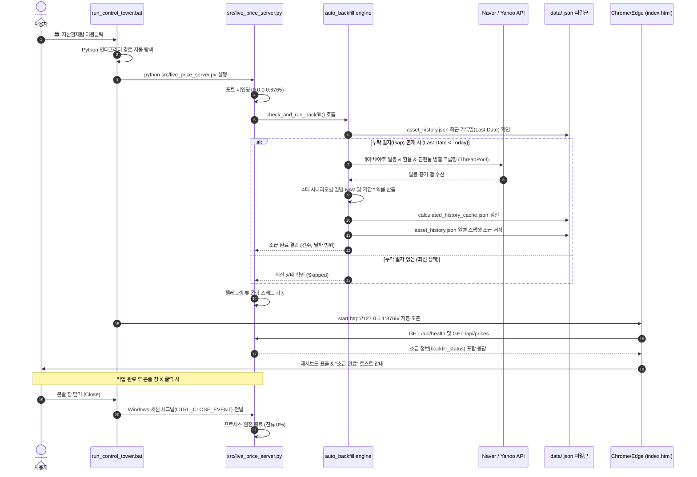

# Phase 18: 과거 시세 자동 소급(Auto-Backfill) 및 원클릭 런처 설계 명세서
> **문서 식별자**: `docs/auto_backfill_launcher_spec.md`  
> **버전**: v1.0 (Phase 18 SSoT)  
> **작성자**: 설계자 / 금융 분석가 (`architect`)  
> **작성일**: 2026-11-08  
> **대상 독자**: `developer`, `qa-verifier`, 메인 오케스트레이터(`비서`)  

---

## 1. 개요 및 목적 (Context & Motivation)

### 1.1 배경 및 사용자 페인포인트
1. **명령어 기반 구동의 불편함**:
   - 현재 자산 관제탑 서버는 사용자가 PowerShell/CMD를 열고 `python src/live_price_server.py`를 직접 타이핑하거나 VS Code 터미널에서 구동해야 하는 번거로움이 존재함.
   - 금융 자산 대시보드는 일반 사용자(비개발자) 관점에서 **바탕화면 아이콘 더블클릭 1회(1-Click)**로 즉시 실행되고 웹 브라우저가 자동 호출되어야 함.
2. **서버 동작 인지 및 잔류 프로세스 방지**:
   - 상시 24시간 백그라운드 데몬으로 돌릴 경우 메모리 누수 및 의도치 않은 리소스 점유가 우려됨.
   - 사용자가 원할 때 켜고, 콘솔 창을 닫으면 서버가 즉시 100% 완전 종료(잔류 프로세스 0%)되어야 하며, 콘솔 화면에 서버 가동 상태가 명확히 보여야 함.
3. **미접속 기간 시세 공백(Gap) 발생 문제**:
   - 사용자가 며칠 동안(예: 주말, 출장, 휴가) 관제탑을 켜지 않다가 오랜만에 실행했을 때, 마지막 기록일(예: 11월 4일)과 오늘(예: 11월 8일) 사이에 일별 NAV 및 스냅샷 누락이 발생함.
   - 이전에는 수동으로 `scripts/calculate_pension_history.py`를 실행해야 누락 구간이 계산되었음.
   - 이제는 **서버가 켜지는 즉시 공백 기간을 자동 감지하여 네이버/야후 일봉 API로 종가를 긁어와 4대 시나리오 NAV를 소급 계산(Auto-Backfill)**하고 원장 및 캐시에 채워 넣어야 함.

### 1.2 핵심 설계 목표
- **Zero-Command One-Click Launcher**: 바탕화면 바로가기 또는 배치파일(`run_control_tower.bat`) 1회 클릭으로 Python 환경 자동 탐색, 서버 기동, 브라우저 자동 오픈 원스톱 수행.
- **Fail-Safe Process Lifecycle**: 콘솔 창 종료 시 자식/부모 프로세스 완전 종료(Orphaned process 방지).
- **Seamless Auto-Backfill Engine**: 서버 초기화 단계에서 공백 일자(Gap)를 감지하고, 네이버/야후 일봉 데이터를 병렬 수집하여 `data/asset_history.json` 및 `data/calculated_history_cache.json`을 단일 진실 공급원(SSoT) 공식에 맞춰 자동 갱신.
- **Visual Feedback on Dashboard**: 웹 헤더(`#serverStatusDot`)의 상태 전환 및 자동 소급 완료 토스트/배지 표출.

---

## 2. 시스템 아키텍처 및 라이프사이클

### 2.1 전체 시스템 시퀀스 다이어그램


---

## 3. 누락 일자 자동 감지 및 소급 수집 (Auto-Backfill) 상세 사양

### 3.1 누락 일자 자동 감지 (Gap Detection) 알고리즘
- **기준 날짜**:
  - $D_{today}$: 한국 표준시(KST) 기준 오늘 날짜 (`datetime.now(KST).strftime("%Y-%m-%d")`)
  - $D_{last}$: `data/asset_history.json` 배열 내 항목 중 가장 최근 `date` 값.
    - 만약 `asset_history.json`이 비어있거나 파일이 없으면 `data/calculated_history_cache.json`의 `daily_nav` 키 목록 중 최대 날짜를 취함.
    - 이마저도 없을 경우 시스템 기준일인 `2026-11-03`을 기본값으로 사용.
- **공백 구간 산정 공식**:
  $$Gap = [D_{last} + 1\text{일}, \dots, D_{today}]$$
  - 만약 $D_{last} == D_{today}$이면: 소급 대상 일자 목록은 공집합 $\emptyset$.
  - 만약 $D_{last} < D_{today}$이면: $D_{last} + 1\text{일}$부터 $D_{today}$까지의 모든 연속 날짜(평일 및 주말/공휴일 포함)가 소급 대상 리스트(`missing_dates`)가 됨.
  - 단, $D_{today}$ 당일은 장중 실시간 시세(`fetch_all_market_data()`)로 처리되므로, $D_{today} - 1\text{일}$까지를 과거 종가 소급으로 처리하고 $D_{today}$는 실시간 스냅샷 갱신(`upsert_daily_snapshot`)과 자연스럽게 연계함.

### 3.2 일봉 종가 병렬 수집 (Market Data Ingestion)
`scripts/calculate_pension_history.py`의 검증된 크롤링 엔진을 모듈화하여 재사용함:

1. **국내 주식/ETF (36개 종목)**:
   - 엔드포인트: `https://fchart.stock.naver.com/sise.nhn?symbol={ticker}&timeframe=day&count=300&requestType=0`
   - XML 파싱: `<item data="20261106|시가|고가|저가|종가|거래량" />`
   - 수집 타임아웃: 8초 (실패 시 1회 재시도)
2. **해외 주식/ETF 및 환율 (12개 종목)**:
   - 엔드포인트: `https://query1.finance.yahoo.com/v8/finance/chart/{ticker}?interval=1d&range=1y`
   - 해외 티커: `BOXX`, `TSLA`, `KORU`, `RAM`, `SMR`, `UEC`, `8001.T`, `7003.T`, `6954.T`, `282A.T`
   - 통화 환율: `KRW=X` (USD/KRW), `JPYKRW=X` (100엔당 원화 또는 1엔당 원화)
3. **KRX 금현물 (1개 종목)**:
   - 엔드포인트: `https://m.stock.naver.com/front-api/marketIndex/prices?category=metals&reutersCode=M04020000`
   - 티커 키: `GOLD-KRX` (1g당 단가)
4. **동시성 처리**:
   - `ThreadPoolExecutor(max_workers=16)`를 사용하여 전 종목을 비동기 병렬 요청 (전체 완료 시간 약 1.5~2.5초 소요).

### 3.3 휴일 처리 및 Forward Fill (ffill) 규칙
- 주말(토, 일) 및 한국/미국 공휴일에는 주식 시장이 열리지 않음.
- **Forward Fill 원칙**:
  - 특정 날짜 $d$에 대해 해당 종목의 일봉 종가 $P_i(d)$가 수집되지 않은 경우, $d$ 이전의 가장 최근 영업일 종가 $P_i(d_{prev})$를 그대로 전진 채움(ffill)함.
  - 예: 2026-11-07(토), 2026-11-08(일)의 종가는 2026-11-06(금) 종가로 유지됨.
- **예금 / 현금성 / CMA / RP 자산**:
  - 시장 시세 변동이 없으므로 원장(`data/assets_v3.json`)의 `valuation_krw`를 일관되게 적용.

### 3.4 4대 시나리오별 NAV 및 수익률 산출 공식
자산 분류의 단일 진실 공급원(`src/history_metrics.py`)을 100% 참조하여 계산함:

| 시나리오 | 구분 | 포함 자산 수 | 분류 기준 (SSoT) | NAV 산출식 |
| :--- | :--- | :---: | :--- | :--- |
| **Scenario 1** | 연금 제외 전체 | 47종 | `category != '연금'` | $NAV_{S1}(d) = \sum_{a \notin Pension} Value_a(d)$ |
| **Scenario 2** | 연금 포함 전체 | 63종 | 전 자산 (`All`) | $NAV_{S2}(d) = \sum_{a \in All} Value_a(d)$ |
| **Scenario 3** | 연금 제외 위험자산 | 30종 | `category != '연금' and is_risk_asset(a)` | $NAV_{S3}(d) = \sum_{a \notin Pension \land a \in Risk} Value_a(d)$ |
| **Scenario 4** | 연금 포함 위험자산 | 41종 | `is_risk_asset(a)` | $NAV_{S4}(d) = \sum_{a \in Risk} Value_a(d)$ |

- **자산별 평가금액 $Value_a(d)$ 계산 상세**:
  - 국내 주식/ETF: $Quantity_a \times Price_{a}(d)$
  - 미국 주식/ETF (USD): $Quantity_a \times Price_{a, USD}(d) \times Rate_{KRW=X}(d)$
  - 일본 주식 (JPY): $Quantity_a \times Price_{a, JPY}(d) \times Rate_{JPYKRW=X}(d)$
  - KRX 금현물: $Quantity_a \times Price_{GOLD-KRX}(d)$
  - 현금/예금/RP: 원장 평가금액 $ValuationKRW_a$
- **기간별 수익률 (Period Returns) 산출**:
  - 기준일: 소급 대상일 $d$
  - 기간: 1D(전일비), 1W(7일전비), 1M(30일전비), 3M(90일전비), 6M(180일전비), YTD(2026-01-02 대비), 1Y(365일전비)
  - 공식: $Return_{period} = \frac{NAV(d) - NAV(d - \Delta t)}{NAV(d - \Delta t)} \times 100$

### 3.5 파일 갱신 및 멱등성(Idempotency) 보장 규칙
1. **`data/calculated_history_cache.json` 갱신**:
   - `daily_nav`, `daily_nav_no_pension`, `daily_nav_risk`, `daily_nav_no_pension_risk` 각 딕셔너리에 누락 일자 날짜 키-값을 병합(`update`).
   - `updated_at`: $D_{today}$로 갱신.
2. **`data/asset_history.json` 갱신**:
   - 각 누락 일자 $d$에 대해 아래 구조의 스냅샷 객체 생성:
     ```json
     {
       "date": "2026-11-05",
       "total_krw": 1067200000,
       "buy_krw": 840561600,
       "profit_krw": 226638400,
       "return_pct": 14.52,
       "cost_return_pct": 26.96,
       "period_returns": { ... },
       "is_real_snapshot": false,
       "is_backfilled": true,
       "updated_at": "2026-11-08T15:30:00+09:00",
       "total_krw_no_pension": 976445456,
       "buy_krw_no_pension": 768469326,
       "total_krw_risk": 633111532,
       "buy_krw_risk": 433339472,
       "total_krw_no_pension_risk": 558328737,
       "buy_krw_no_pension_risk": 379349052,
       "period_returns_risk": { ... },
       "period_returns_no_pension_risk": { ... },
       "period_returns_no_pension": { ... }
     }
     ```
   - **멱등성 보장**:
     - 기존 배열에 이미 동일한 `date`가 존재하고 `is_real_snapshot == true`인 레코드는 **절대 덮어쓰지 않음**(실제 당시 저장된 스냅샷 보존).
     - 누락된 날짜만 배열에 신규 추가(append)하고, `date` 기준 오름차순으로 정렬하여 저장.

---

## 4. 원클릭 런처 (`run_control_tower.bat`) 설계

### 4.1 배치 스크립트 구조 (`run_control_tower.bat`)
Windows cmd.exe 환경에서 구동되는 표준 배치파일 설계 사양:

```bat
@echo off
chcp 65001 > nul
title 🏛️ 자산 관제탑 (Asset Control Tower v4.8) - Live Server

echo ======================================================================
echo           🏛️ 자산 관제탑 (Asset Control Tower v4.8)
echo ======================================================================
echo   [시스템 준비 중] Python 실행 환경을 감지하고 있습니다...

:: 1. Python 인터프리터 자동 탐색
set PYTHON_EXE=
if exist "C:\Users\pobco\.local\bin\python3.12.exe" (
    set "PYTHON_EXE=C:\Users\pobco\.local\bin\python3.12.exe"
) else (
    where python >nul 2>nul
    if %errorlevel% equ 0 (
        set "PYTHON_EXE=python"
    ) else (
        where py >nul 2>nul
        if %errorlevel% equ 0 (
            set "PYTHON_EXE=py -3"
        )
    )
)

if "%PYTHON_EXE%"=="" (
    echo [오류] Python 인터프리터를 찾을 수 없습니다.
    echo Python 3.10 이상이 설치되어 있는지 확인해 주십시오.
    pause
    exit /b 1
)

echo   [환경 감지 완료] %PYTHON_EXE%
echo   [서버 구동 시작] 웹 서버 및 실시간 시세 / 자동 소급 엔진을 시작합니다.
echo   [안내] 이 콘솔 창을 닫으면 서버가 완전히 종료됩니다.
echo ======================================================================

:: 2. 브라우저 자동 오픈 (비동기 1.5초 딜레이 실행)
start "" cmd /c "timeout /t 2 /nobreak > nul && start http://127.0.0.1:8765/"

:: 3. 포그라운드 서버 실행 (창 종료 시 하위 프로세스 동시 종료)
cd /d "%~dp0"
"%PYTHON_EXE%" src/live_price_server.py

:: 4. 종료 후 일시정지 (오류 발생 시 화면 유지)
if %errorlevel% neq 0 (
    echo.
    echo [경고] 서버가 비정상 종료되었습니다. 에러 메시지를 확인하십시오.
    pause
)
```

### 4.2 프로세스 수명주기 및 메모리 누수 방지 원칙
1. **포그라운드(Blocking) 구동**:
   - `python src/live_price_server.py`를 `start /b`나 백그라운드로 실행하지 않고 배치파일 메인 프로세스에서 직접 포그라운드로 블로킹 실행함.
   - 이로 인해 사용자가 콘솔 창 상단의 `X` 버튼을 누르면 Windows 콘솔 세션 매니저가 부모 `cmd.exe` 및 자식 `python.exe`에 `CTRL_CLOSE_EVENT`를 전달하여 프로세스 트리가 즉시 소멸됨.
2. **단일 인스턴스 검사(Mutex or Port Check)**:
   - 서버 기동 시 포트 8765가 이미 점유 중인 경우 "이미 자산 관제탑 서버가 실행 중입니다."라는 명확한 콘솔 경고를 띄우고 즉시 브라우저 창만 새로 띄우고 종료하는 안전장치를 내장함.

### 4.3 바탕화면 바로가기 생성 (`create_shortcut.ps1`)
바탕화면에 한글 이모지가 포함된 예쁜 바로가기 아이콘을 생성하는 파워셸 스크립트 제공:
- 바로가기 파일명: `[바탕화면]\🏛️ 자산관제탑.lnk`
- TargetPath: `C:\cowork\myasset\run_control_tower.bat`
- WorkingDirectory: `C:\cowork\myasset`
- IconLocation: `shell32.dll, 44` (황금색/방패/금융 빌딩 아이콘) 또는 커스텀 아이콘
- 원클릭 런처 첫 실행 시 바로가기가 없으면 자동으로 생성해주는 편의 로직 포함.

---

## 5. 대시보드 UI 연동 및 사용자 피드백 사양

### 5.1 헤더 서버 상태 인디케이터 (`#serverStatusDot`)
`web/index.html` 상단 헤더의 상태 도트 사양을 3단계 상태 머신으로 확장함:

| 상태 (State) | 도트 색상 | 툴팁 메시지 | 설명 |
| :--- | :--- | :--- | :--- |
| **ONLINE** | Emerald (`#10b981`) | `서버 정상 연결 (0.0.0.0:8765)` | 실시간 시세 API 및 텔레그램 정상 연결 |
| **BACKFILLING** | Sky Blue Pulse (`#0284c7`, 애니메이션) | `누락된 과거 시세 자동 소급 중...` | 서버 기동 직후 백필 작업 수행 중 |
| **OFFLINE / LOCAL** | Amber (`#f59e0b`) | `로컬 오프라인 모드 (서버 미가동)` | 서버 미구동 시 로컬 캐시 백업 표출 |

### 5.2 신규 API 엔드포인트 사양 (`/api/backfill/status`)
- **경로**: `GET /api/backfill/status`
- **반환 JSON 예시**:
  ```json
  {
    "status": "success",
    "backfill_executed": true,
    "gap_detected": true,
    "missing_days_count": 3,
    "missing_dates": ["2026-11-05", "2026-11-06", "2026-11-07"],
    "last_recorded_date": "2026-11-04",
    "today": "2026-11-08",
    "message": "3일간 누락된 과거 시세가 자동으로 소급 계산되어 반영되었습니다.",
    "completed_at": "2026-11-08T15:30:15+09:00"
  }
  ```
- 만약 누락 일자가 없었던 경우:
  ```json
  {
    "status": "success",
    "backfill_executed": false,
    "gap_detected": false,
    "missing_days_count": 0,
    "missing_dates": [],
    "last_recorded_date": "2026-11-08",
    "today": "2026-11-08",
    "message": "최신 시계열이 유지되고 있습니다."
  }
  ```

### 5.3 대시보드 Toast & Badge 표출 사양
- 대시보드가 로드되고 서버와 연결되었을 때(`checkLiveServerHealth`), 백필 수행 여부를 확인:
  - `gap_detected == true`인 경우:
    - 대시보드 우측 상단 Toast 알림 1회 표출:  
      `📢 [자동 소급 완료] 3일간 누락된 과거 시세(11/05~11/07)가 자동 반영되었습니다!` (5초간 유지)
    - 시계열 차트 카드 헤더 옆에 임시 배지 표출:  
      `<span class="badge badge-emerald">✨ 시계열 자동 소급 완료</span>`

---

## 6. 에이전트별 구현 및 검증 체크리스트

### 6.1 개발자 (`developer`) 구현 체크리스트
- [ ] **`src/auto_backfill.py` 모듈 신설 또는 `src/live_price_server.py` 통합**:
  - `check_and_run_backfill()` 함수 작성 (마지막 일자 비교, Gap 감지)
  - `ThreadPoolExecutor` 기반 네이버/야후 일봉 수집 및 4대 시나리오 NAV 산출 로직 구현
  - `src/history_metrics.py`의 `is_risk_asset` 단일 진실 공급원(SSoT) 철저 준수
  - `data/asset_history.json` 및 `data/calculated_history_cache.json` 갱신 및 파일 쓰기 원자성 보장
- [ ] **서버 기동 루틴 연동 (`src/live_price_server.py`)**:
  - `run_server()` 시작 시 포트 바인딩 직후 동기 또는 논블로킹 백그라운드로 `check_and_run_backfill()` 호출
  - `/api/backfill/status` 핸들러 등록
  - 콘솔 배너에 소급 진행 및 완료 요약 로그 출력
- [ ] **원클릭 런처 파일군 제작**:
  - 프로젝트 루트에 `run_control_tower.bat` 작성 (UTF-8 인코딩, chcp 65001)
  - 바탕화면 바로가기 생성 스크립트 `scripts/create_desktop_shortcut.ps1` 작성
- [ ] **프론트엔드 연동 (`web/index.html`)**:
  - 서버 상태 도트(`#serverStatusDot`) 소급 상태 처리
  - 소급 완료 시 자동 토스트(`showToast`) 호출 로직 추가

### 6.2 품질 검증가 (`qa-verifier`) 검증 체크리스트
- [ ] **누락 구간 시뮬레이션 (Gap Backfill Test)**:
  - `data/asset_history.json`에서 최근 2일 치 데이터를 임시 백업 후 제거.
  - 서버 기동 시 `auto_backfill` 엔진이 공백을 정확히 감지하고 네이버/야후 종가를 크롤링하여 정확한 날짜의 스냅샷을 재구성하는지 확인.
- [ ] **4대 시나리오 NAV 무결성 검증**:
  - 소급 생성된 날짜의 `total_krw`, `total_krw_no_pension`, `total_krw_risk`, `total_krw_no_pension_risk`가 원장(`assets_v3.json`)의 주식 수량 $\times$ 일봉 종가와 100% 일치하는지 단언(Assert).
- [ ] **기존 스냅샷 멱등성 및 훼손 방지 검증**:
  - 이미 존재하는 과거 `is_real_snapshot: true` 데이터의 수치와 필드가 덮어쓰여 변형되지 않는지 SHA256/Diff 비교.
- [ ] **원클릭 런처 수명주기 및 잔류 프로세스 검증**:
  - `run_control_tower.bat` 실행 시 브라우저가 자동 열리고 `http://127.0.0.1:8765/`가 정상 로딩되는지 확인.
  - 콘솔 창의 `X`를 닫았을 때 `Get-Process python` 검사 결과 해당 프로세스가 0개(완전 종료)인지 확인.
- [ ] **재기동 시 무공백(Skip) 확인**:
  - 백필이 완료된 직후 다시 런처를 실행했을 때 "히스토리가 최신 상태입니다. (Skipped)"가 출력되며 불필요한 크롤링 없이 0.1초 만에 준비 완료되는지 확인.

---

## 7. 설계 요약 및 결론

본 명세서는 사용자가 커맨드라인 환경을 전혀 의식하지 않고 **바탕화면 아이콘 더블클릭 단 1회**로 자산 관제탑을 가동할 수 있는 완벽한 사용자 경험(UX)을 구축하며, 며칠간 프로그램을 켜지 않더라도 발생하는 시계열 공백을 **인공지능 관제탑이 스스로 감지하고 자동 소급 복구**하는 자율 치유(Self-Healing) 아키텍처를 완성합니다.

`developer`는 본 명세서의 알고리즘과 인터페이스 사양을 100% 준수하여 구현을 진행해 주시기 바랍니다.
