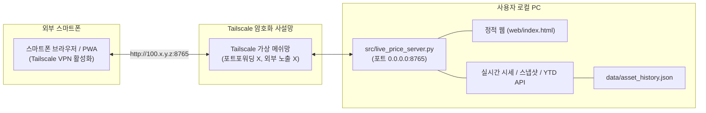

# 자산 관리 프로그램 개발 컨셉 및 설계 명세 (`concept_design.md`)

> **문서 버전**: v3.2.1 (갱신주기 화면 표시 확정, YTD 역산+실제이력 하이브리드 누적 확정, Tailscale 단일포트 원격 접속 확정)  
> **최종 수정일**: 2026-11-04  
> **작성자**: `architect` (설계자 / 금융 분석가)  
> **단일 진실 공급원(SSoT)**: 본 문서는 `developer`(구현)와 `qa-verifier`(검증)가 참조하는 자산 관리 프로그램의 최상위 기능 및 개념 설계서입니다.

---

## 1. 프로그램 목적 및 핵심 컨셉

### 1.1 배경 및 문제 정의
- **복합 자산 포트폴리오(63개 실자산)의 다차원 관리 한계**:
  - 실제 포트폴리오(`data/금융자산_261103.csv`)는 국내주식(삼성전자 등), 해외주식(미국 TSLA, 일본 이토추상사 등), 절세연금(IRP, 신연금저축), 중개형ISA, 새마을금고 예금, 외화RP, 금현물, 엔화(JPY) 통장 등 63개의 이종 자산이 다수 금융기관에 분산되어 있음.
  - 단순 대분류(주식 vs 채권)만으로는 **통화별(KRW/USD/JPY) 익스포저, 국가별 리스크(KR/US/JP/CN), 위험자산과 안전자산의 실질 비율, 만기 유동성 집중도**를 종합 파악하기 불가능함.
- **모바일 원격 접속 및 외부 접근성 요구**:
  - 외출·출퇴근 시 스마트폰에서 데스크톱 PC와 동일한 실시간 시세와 자산 변동을 안전하게 조회하고 제어할 수 있는 네트워크 체계 확정 필요.
- **과거 성과 추적 및 기간별 수익률 가시성 부재**:
  - 현재 시점의 평가액뿐만 아니라 1일(1D), 1주일(1W), 1개월(1M), 3개월(3M), 6개월(6M), 연초 대비(YTD), 1년(1Y) 동안 내 자산이 얼마나 불어났는지 직관적으로 확인하고자 하는 사용자 니즈 대두.
- **공개 웹 배포 시 개인 자산 노출 위험**:
  - 외부 공개 호스팅에 금융 데이터가 노출되지 않도록, 폐쇄형 사설 보안망(Tailscale) 및 제로 데이터 원칙 필수.

### 1.2 핵심 컨셉: "다차원 시각화 & 초간편 모바일 관제탑 (Multi-Dimensional FinTech Cockpit)"
- **1. 단일 진실 공급원 (Google Sheets as SSoT Ledger)**:
  - 20개 표준 컬럼 체계(A~T열)로 63개 자산 원장을 통합 관리.
  - **원장 동기화 주기 확정**: 초기 접속 즉시 + 1시간 백그라운드 자동 + 수동 클릭/SMS 입력 즉시 동기화.
- **2. 다차원 자산비율 분석 엔진 (Multi-Dimensional Asset Allocation Engine)**:
  - 8대 기본 차원(대분류, 위험/안전자산, 통화별, 국가별, 만기/유동성, 금융사/계좌, 세제혜택, 테마/섹터) 및 **사용자 정의 동적 기준 추가 기능**을 제공하여 입체적 포트폴리오 분석 실현.
- **3. 트렌디한 핀테크 감성의 UI/UX (Linear + Toss + Stripe Style) & Zero Horizontal Scroll**:
  - 컬럼 통폐합('금융회사 / 계좌') 및 불필요 데이터 정돈으로 데스크톱/모바일 전 환경 가로 스크롤 완전 제거.
  - 팝업 외부 오버레이/ESC 닫힘, 상장 자산 한정 외부 금융 링크, 컴팩트 컬럼 정렬 지원.
- **4. YTD 자산 수익률 차트 & 1D~1Y 수익률 (하이브리드 누적 확정)**:
  - **오늘 이전**: 과거 1년 일봉/환율 시계열 역산 시뮬레이션으로 YTD 및 기간별 지표 즉시 산출.
  - **오늘 이후**: 일자별 실제 총 순자산 변동 스냅샷을 영구 누적 기록(`data/asset_history.json`)하여 100% 실자산 이력 구축.
- **5. 외부 스마트폰 원격 접속 확정 (방안 B: Tailscale 단일 포트 통합 서빙)**:
  - 로컬 PC 백그라운드의 `src/live_price_server.py`가 웹페이지와 실시간 시세/스냅샷 API를 `0.0.0.0:8765`에서 동시 서빙.
  - Tailscale 사설 가상망(`http://100.x.y.z:8765`)을 통해 포트포워딩이나 외부 노출 없는 무결점 보안 접속 달성.

---

## 2. 20개 표준 컬럼 원장 체계 (`docs/sheet_schema.md` 연동)

실제 63개 자산 원장(`data/금융자산_261103.csv`)과 1:1 대응하는 20개 표준 컬럼 체계입니다.

| 컬럼 | 한글 컬럼명 | 코드 필드 키 | 설명 |
| :-: | :--- | :--- | :--- |
| **A** | **대분류** | `category` | 자산 대분류 (`국내주식`, `해외주식`, `예금`, `연금`, `원자재`, `현금성자산` 등) |
| **B** | **금융기관** | `institution` | 보유 금융사 (`삼성증권`, `나무증권`, `키움증권`, `KB증권`, `새마을금고`, `토스뱅크`) |
| **C** | **계좌명** | `account_name` | 계좌 상품명 (`종합(주식보상S)`, `평생우대 [CMA]`, `중개형ISA`, `신연금저축`, `퇴직연금(IRP)`, `외화통장`) |
| **D** | **계좌번호** | `account_number` | 마스킹 또는 고유 계좌번호 |
| **E** | **자산구분** | `sub_type` | 세부 유형 (`국내주식`, `국내ETF`, `해외주식`, `해외ETF`, `정기예탁금`, `현금/예수금`, `RP`, `금현물`) |
| **F** | **종목명** | `asset_name` | 종목/자산 공식 명칭 (예: `삼성전자`, `KODEX 머니마켓액티브`, `BOXX`, `금 99.99_1kg`) |
| **G** | **티커** | `ticker` | 종목코드 또는 자산ID (`005930`, `457490`, `TSLA`, `8001.T`, `GOLD-KRX`, `DEP-MG-2027`) |
| **H** | **만기일** | `maturity_date` | 만기일자 (`YYYY-MM-DD`, 수시형, 미해당 `-`) |
| **I** | **적용금리** | `interest_rate` | 연이율 또는 과세구분 (`3.50%`, `3.35%`, `2.65%`, `일반과세`, `-`) |
| **J** | **거래통화** | `currency` | 원통화 단위 (`KRW`, `USD`, `JPY`) |
| **K** | **보유수량** | `quantity` | 주식 수량 또는 예치 원금/좌수 |
| **L** | **매수단가(원통화)** | `unit_price_origin` | 원통화 기준 1주당 매입단가 |
| **M** | **현재가(원통화)** | `current_price_origin`| 원통화 기준 실시간 현재가 |
| **N** | **평가금액(원통화)** | `valuation_origin` | `quantity * current_price_origin` |
| **O** | **평가손익(원통화)** | `profit_origin` | 원통화 기준 평가손익 |
| **P** | **수익률(%)** | `profit_rate` | 투자 수익률 ($\%$) |
| **Q** | **원화 매입금액** | `purchase_amount_krw`| 원화 환산 총 매입원금 |
| **R** | **원화 평가금액** | `valuation_krw` | 원화 환산 총 평가금액 (비중 계산의 기준치) |
| **S** | **원화 평가손익** | `profit_krw` | 원화 환산 총 평가손익 |
| **T** | **세부태그** | `tags` | 콤마 구분 다차원 분석 태그 (예: `"국내주식, 대형주, 반도체, IT, 안전자산"`) |

---

## 3. 다차원 자산비율 분석 기준 및 동적 확장 기능

### 3.1 8대 기본 분석 차원 (Default Dimensions)
1. **기본 대분류 (`Category`)**: `국내주식`, `해외주식`, `예금`, `연금`, `원자재`, `현금성자산`
2. **위험자산 vs 안전자산 (`Risk Profile`)**: 안전자산(예적금, RP, 단기채, MMF, 금현물, 국채) vs 위험자산(주식, 레버리지, 성장ETF)
3. **통화별 비중 (`Currency Exposure`)**: `KRW`, `USD`, `JPY` 비중 및 환율 변동성 방어력
4. **국가별 비중 (`Geographic Allocation`)**: `KR`, `US`, `JP`, `CN` 글로벌 분산도
5. **만기 및 유동성별 (`Liquidity & Maturity`)**: 수시입출금(파킹), 초단기(7일~1개월), 중장기(1년 이상), 상시주식형
6. **계좌 및 금융기관별 (`Institution & Account`)**: 금융사별 집중도 및 5,000만 원 예금자보호 한도 모니터링
7. **세제혜택 및 절세 계좌별 (`Tax Advantage`)**: 중개형ISA, 신연금저축, IRP, 일반과세
8. **테마 및 산업 섹터별 (`Thematic & Sector Breakdown`)**: 반도체, AI/전력인프라, 2차전지, 귀금속/원자재, 자동차/배당, 조선/방산/로봇, 바이오

### 3.2 사용자 정의 기준 동적 추가 기능 (`Custom Dynamic Dimension Engine`)
- 사용자가 웹 UI에서 `[+ 커스텀 분석 기준 추가]` 버튼을 통해 태그 조건(예: `워렌 버핏 포트폴리오`, `월배당 파이프라인`, `환헤지(H)`)을 등록하면 즉시 동적 탭/차트가 생성되어 실시간 피벗 분석 제공.

---

## 4. UI/UX 수정 및 갱신주기 화면 표시 명세 (v3.2.1 확정)

### 4.1 구글 스프레드시트 원장 및 실시간 시세 갱신주기 확정
- **1. 구글 스프레드시트 원장(보유 종목/수량/예금) 동기화 주기**:
  - 대시보드 초기 접속 시 즉시 동기화
  - 백그라운드 자동 동기화: **기본 1시간 주기**
  - 사용자 수동 조작: `[원장/시세 업데이트]` 버튼 클릭 또는 모바일 문자(SMS) 입력 시 즉시 갱신
- **2. 실시간 주가/환율/금 시세 크롤링 주기**:
  - 대시보드 활성 시: **15분 주기 자동 갱신**
  - 사용자 수동 조작: `[실시간 시세 업데이트]` 버튼 클릭 시 즉시 크롤링
  - *(참고: 구글 시트 내부 `=GOOGLEFINANCE()` 함수는 구글 정책상 15~20분 지연되므로 Python 백엔드의 직접 크롤링이 우선 적용됨)*
- **3. 대시보드 상단 바 갱신 정보 명시적 표기**:
  ```
  [시세 업데이트: 2026-11-04 22:15:30 (자동 15분 / 수동 즉시)]  |  [구글시트 원장 기준: 2026-11-04 (자동 1시간 / 문자입력 시 즉시)]
  ```

### 4.2 UI/UX 3대 핵심 수정 확정
1. **모달 팝업 외부(오버레이 배경) 클릭 및 ESC 키 즉시 닫힘**:
   - 상세 자산 드릴다운 모달, 커스텀 기준 추가 모달 등 모든 팝업 요소에 대해 바깥쪽 어두운 배경 클릭 또는 키보드 `ESC` 키 입력 시 즉시 닫힘 처리.
2. **현금성자산/예금 등 시세 무의미 자산 외부 링크 완전 제거**:
   - 실제 시장 시세 조회가 유효한 상장 주식/국내외 ETF, 해외 개별주식, KRX 금현물(`GOLD-KRX`)에 대해서만 네이버금융/야후파이낸스 링크 유지.
   - 예탁금, 통장 잔액, 예수금, RP 등은 일반 텍스트로만 렌더링.
3. **자산보유원장 테이블 컬럼 통합 및 가로 스크롤 완전 제거 (Zero Horizontal Scroll)**:
   - '금융회사'와 '계좌명'을 **'금융회사 / 계좌'** 단일 컬럼으로 병합.
   - 예금, 현금성자산, RP의 수량·단가·현재가는 하이픈(`'-'`) 공란 처리하여 모바일 세로 화면(390px) 및 데스크톱 브라우저에서 가로 스크롤 0px 달성.

---

## 5. YTD 자산 수익률 차트 & 기간별 수익률 지표 (하이브리드 확정)

### 5.1 총 순자산 KPI 블록 기간별 수익률(%) 인라인 표시
- 총 순자산 평가액 카드 우하단에 컴팩트한 인라인 태그로 과거 주요 구간 대비 수익률을 표시:
  - **지표 목록**: `1D` (전일비), `1W` (1주 전비), `1M` (1개월 전비), `3M` (3개월 전비), `6M` (6개월 전비), `YTD` (연초 대비), `1Y` (1년 전비).

### 5.2 YTD 차트 및 수익률 산출: '방식 1(과거 역산) + 오늘 이후 실제 기록' 하이브리드 확정
1. **기준일(오늘, 2026-11-04) 이전 구간**:
   - 현재 보유 63개 종목의 네이버/야후 과거 1년 일봉 종가 및 환율 시계열을 수집하여 **'보유 포트폴리오 구성 기준 과거 시세 역산(방식 1)'**으로 1D/1W/1M/3M/6M/YTD/1Y 및 YTD 일별 추이 곡선을 즉시 자동 생성.
2. **오늘(2026-11-04) 이후 구간**:
   - 백그라운드 Python 서버(`src/live_price_server.py`)가 시세 갱신 시 및 일자별로 실제 총 순자산(신규 입출금, 매매, 예금 변동, 실시간 시세 반영)을 로컬 영구 파일(`data/asset_history.json`)에 날짜별로 영구 기록(Upsert).
   - 이를 통해 **오늘 이후부터는 100% 실제 자산 변동 이력이 누적되는 완전한 하이브리드 시계열 체계** 확립.

---

## 6. 외부 스마트폰 접속 아키텍처: '방안 B - Tailscale' 최종 확정

사용자의 외부 스마트폰 원격 접속 방안으로 **'방안 B - Tailscale(테일스케일)'이 최종 확정**되었습니다.



### 6.1 Tailscale 확정 구조 및 동작 메커니즘
1. **단일 포트 통합 서빙 (`0.0.0.0:8765`)**:
   - 로컬 PC 백그라운드에서 실행되는 `src/live_price_server.py`가 대시보드 웹페이지(`web/index.html`) 서빙과 실시간 시세 크롤링, 자산 히스토리 기록, SMS 파싱 API를 포트 `8765` 단 하나에서 통합 제공.
2. **무설정 고보안 접속**:
   - 공유기 포트포워딩, DDNS 설정, 도메인 구매 없이 스마트폰과 PC에 Tailscale 앱을 켜두기만 하면 끝.
   - 전용 사설 보안 IP(`http://100.x.y.z:8765`)를 통해 외부 제3자의 접근을 100% 차단한 상태에서 안전하게 접속.
3. **완벽한 백그라운드 상시 연동**:
   - 스마트폰에서 접속하는 즉시 로컬 PC의 Python 엔진이 가동되어 15분 주기 실시간 시세 크롤링과 `data/asset_history.json` 자동 누적 기록을 수행.

---

## 7. 다음 단계 개발 가이드 (developer 및 qa-verifier 연계)

- **`developer` (`t8`)**:
  - `docs/technical_spec.md`에 상단 바 갱신주기 텍스트 표시, `data/asset_history.json` 영구 기록 스키마, `src/live_price_server.py`의 `0.0.0.0:8765` 단일 포트 서빙 및 Tailscale 접속 가이드를 명시합니다.
- **`qa-verifier` (`t10`)**:
  - `docs/feasibility_review.md`에 15분/1시간 갱신주기 작동 검증, 오늘 이전 역산 데이터와 오늘 이후 `asset_history.json` 적재 정합성 검증, Tailscale 환경에서의 모바일 접속 안정성을 검증합니다.
