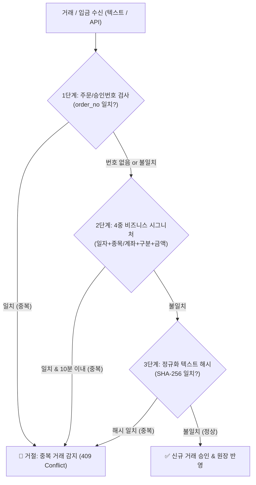
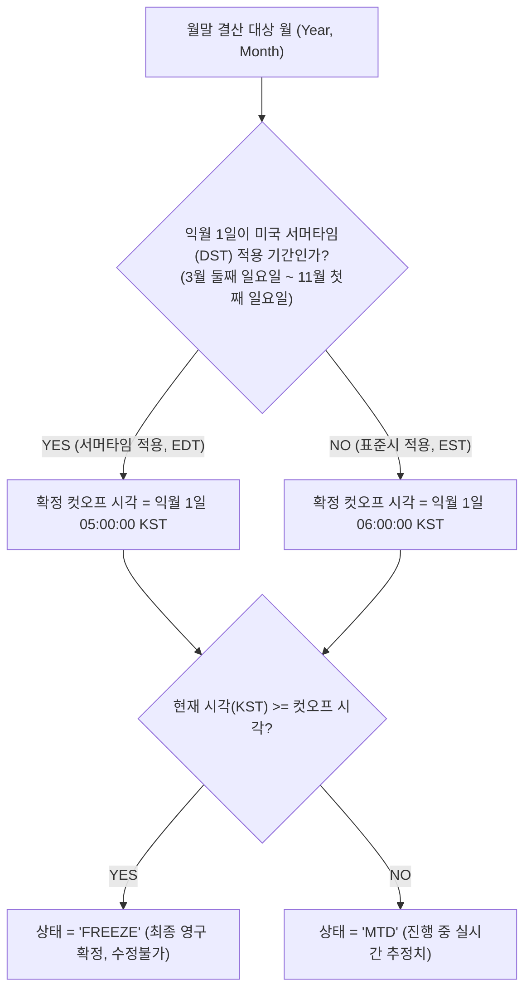

# Phase 20: 총 납입원금 관리 체계 및 월별 레포트 확정 시스템 설계 명세서
> **문서 식별자**: `docs/monthly_report_and_capital_spec.md`  
> **버전**: v1.0 (Phase 20 SSoT)  
> **작성자**: 설계자 / 금융 분석가 (`architect`)  
> **작성일**: 2026-11-08  
> **대상 독자**: `developer`, `qa-verifier`, 메인 오케스트레이터(`비서`)  

---

## 1. 개요 및 설계 배경 (Context & Problem Statement)

### 1.1 현행 원금 산출의 구조적 결함 (Cost Basis vs. Net Invested Capital)
현재 자산 관제탑 시스템은 포트폴리오의 '총 매입원금(`buy_krw`)'을 각 자산의 보유 매입단가 $\times$ 수량의 합계(Cost Basis) 방식으로만 집계하고 있습니다.
이로 인해 다음과 같은 **중대한 금융 왜곡 현상**이 발생합니다:

1. **손절 매도 시 총 납입원금이 증발하는 왜곡**:
   - 2026-11-06 발생한 `KODEX 반도체레버리지` 손절 매도(체결액 174만 원, 매수원가 808만 원, 실현손실 -634만 원) 시, 주식의 매수원가는 장부에서 빠지고 현금에는 매도 체결액(174만 원)만 들어옵니다.
   - 그 결과, 외부로 1원도 유출되지 않았음에도 시스템의 `buy_krw`가 **840,561,600원에서 834,217,725원으로 6,343,875원 감소**했습니다.
   - 투자자가 실제로 주머니에서 꺼내 투입한 **총 납입원금(Cumulative Net Capital)**은 변함없이 **840,561,600원**이어야 합니다. 매매는 단지 '주식 자산'이 '현금 자산'으로 전환된 내부 교환(Asset Allocation Switch)일 뿐입니다.
2. **위험자산 모드에서의 실현손익 단절**:
   - 위험자산만 보기 모드에서 보유 종목을 손절/익절하고 나면, 해당 종목이 원장에서 제거되어 과거 손실(-634만 원)이나 이익이 위험자산 수익률 지표에서 완전히 사라져 버립니다.
   - 따라서 위험자산 모드에서는 '살아있는 종목의 매입원가(Cost Basis)'와 함께 '과거 실현손익(Realized P&L)'을 합산 반영한 **실질 누적 성과 지표**가 제공되어야 합니다.
3. **월간 성과(Monthly Report) 평가 체계 부재**:
   - 투자자는 "이번 달에 내가 돈을 얼마 벌었고, 급여에서 얼마를 추가 납입했는가?"를 명확한 월별 레포트 형태로 조회할 수 있어야 합니다.
   - 미국 주식/ETF 비중이 높은 포트폴리오 특성상, 월말 결산은 한국시간 말일 밤이 아닌 **미국 증시 폐장 시점(익월 1일 오전 06:00 KST / 서머타임 05:00 KST)**에 공식 동결(Freeze)되어야 합니다.

---

## 2. 총 납입원금(Cumulative Net Capital) 산출 체계

### 2.1 자본금의 2대 축 분리 정의

| 지표명 (Variable) | 금융적 정의 (Definition) | 변동 유발 이벤트 (Trigger Events) | 주식 손절/매도 시 |
| :--- | :--- | :--- | :---: |
| **총 납입원금**<br>(`cumulative_net_capital`) | 투자자가 외부에서 가계 포트폴리오로 순수 투입한 누적 현금 자본 | ① 초기 기준 자본금 확정<br>② 급여/상여 추가 입금 (`DEPOSIT`)<br>③ 생활비/원금 인출 (`WITHDRAW`) | **불변 (보존)** |
| **보유자산 매입원가**<br>(`cost_basis_holdings`) | 현재 포트폴리오에 존재하는 개별 자산들의 원장 상 매입가 합계 | 종목 매수, 매도, 가격 변동, 배당 입금 등 포트폴리오 내부 거래 전반 | **손익만큼 변동** |

### 2.2 2026-11-03 기준 초기 납입원금 확정치 (SSoT Baseline)
2026년 11월 3일 기준 구글 스프레드시트 및 원장 감사에서 검증된 초기 자본금을 시스템 영구 불변 기준점으로 고정합니다:
- **전체 자산 (Scenario 2) 초기 납입원금**: **`840,561,600원`**
- **연금 제외 (Scenario 1) 초기 납입원금**: **`768,469,326원`**
- **연금 자산 초기 납입원금**: **`72,092,274원`** ($840,561,600 - 768,469,326$)

### 2.3 주식 손절/매도 시 납입원금 불변 원칙
- **원칙**: 포트폴리오 내부에서 발생하는 모든 매매(BUY, SELL)는 포트폴리오의 **총 납입원금에 일체 영향을 주지 않는다.**
- **사례 검증 (11/6 KODEX 반도체레버리지 손절)**:
  - 매도 체결액: +1,741,600원 (예수금 유입)
  - 매수원가 소멸: -8,085,475원 (주식 차감)
  - 실현손익: -6,343,875원
  - **총 납입원금 평가**:
    - 변동 전: 840,561,600원
    - 변동 후: **840,561,600원 (100% 동일 유지)**
  - **포트폴리오 전체 실질 수익금**:
    $$Profit_{portfolio} = NAV_{total} - CumulativeNetCapital$$
    - 2026-11-08 기준: $997,998,655 - 840,561,600 = +157,437,055\text{원}$

### 2.4 순납입원금 장부(`data/capital_ledger.json`) 사양
추가 납입(`DEPOSIT`) 및 인출(`WITHDRAW`) 이력을 투명하게 관리하기 위해 별도의 자본금 원장을 운영합니다.

```json
{
  "baseline_date": "2026-11-03",
  "baseline_capital": {
    "total": 840561600,
    "no_pension": 768469326,
    "pension": 72092274
  },
  "inflows": [
    {
      "id": "CAP-20261125-001",
      "timestamp": "2026-11-25 10:00:00",
      "type": "DEPOSIT",
      "amount_krw": 3000000,
      "category": "연금제외",
      "institution": "키움증권",
      "account_name": "위탁종합",
      "memo": "11월 급여 투자금 추가 납입",
      "channel": "manual"
    }
  ],
  "cumulative_capital": {
    "total": 843561600,
    "no_pension": 771469326,
    "pension": 72092274,
    "last_updated": "2026-11-25 10:00:00"
  }
}
```

---

## 3. 위험자산만 보기 모드 산출 체계

### 3.1 위험자산 모드의 금융적 특수성
위험자산(Risk Assets)은 독립된 가계 계좌가 아니며, 전체 자산 중 일부를 시장 위험에 노출시킨 '자산 배분(Asset Allocation)' 영역입니다. 따라서 위험자산만을 필터링할 때는 다음 두 지표가 명확히 구분되어야 합니다.

### 3.2 표시 지표 및 계산 공식

```mermaid
flowchart LR
    subgraph CurrentHoldings ["현재 보유 위험자산 (Active)"]
        NAV_Risk ["위험자산 평가액 (NAV_risk)"]
        Cost_Risk ["보유종목 매입가 (CostBasis_risk)"]
        Unrealized ["미실현 손익 = NAV_risk - CostBasis_risk"]
    end

    subgraph PastTrades ["과거 청산 내역 (Closed)"]
        Realized ["누적 실현손익 (Realized_risk)<br>(예: 11/6 손절 -634만 원)"]
    end

    Unrealized --> EconomicProfit ["실질 누적 수익금<br>Profit_risk = Unrealized + Realized"]
    Realized --> EconomicProfit
```

1. **표시 원금 (`Cost Basis`)**:
   - 현재 살아있는 위험자산들의 순수 매입가 합계.
   $$CostBasis_{risk} = \sum_{a \in RiskHoldings} BuyKRW_a$$
   - (참고: 2026-11-08 기준 연금포함 위험자산 매입원가는 425,253,997원)
2. **실질 누적 수익금 (`Economic Profit of Risk Assets`)**:
   - 현재 보유 종목의 미실현 평가손익에 과거 실현손익(익절/손절)을 합산.
   $$Profit_{risk}^{net} = (NAV_{risk} - CostBasis_{risk}) + \sum_{tx \in RiskTrades} RealizedProfit_{tx}$$
   - 11/6 KODEX 반도체레버리지 실현손실(-6,343,875원)이 온전히 반영되어 투자자의 실제 손익 체감과 일치함.
3. **실질 누적 수익률 (`Economic Return %`)**:
   - 위험자산 누적 운용 성과율:
   $$Return_{risk}^{net} = \frac{Profit_{risk}^{net}}{CostBasis_{risk} + \max(0, -\sum RealizedProfit_{tx})} \times 100$$
   *(분모는 손실로 인해 축소된 원금을 보정하여 왜곡을 방지하는 자본투입 기준)*

---

## 4. 거래 및 입금 3단계 중복 방지 필터링 (Deduplication Engine)

### 4.1 필터링 아키텍처 개요
텔레그램 봇 알림톡 복사-붙여넣기, 브라우저 새로고침, 네트워크 재전송 등으로 인한 거래 및 입금 데이터의 중복 등록을 100% 원천 차단하기 위한 3계층 방어막을 구축합니다.



### 4.2 단계별 상세 알고리즘

#### 1단계: 주문번호/승인번호 엄격 대조 (Unique Order ID Check)
- **추출 대상**: 금융사 알림톡 내 `주문번호`, `체결번호`, `승인번호`, `거래번호` 정규식 추출.
  - 패턴: `r"주문번호\s*:\s*([0-9A-Za-z]+)"` 등
- **검사 로직**:
  - `data/transactions.json` 및 `data/capital_ledger.json` 내 기존 레코드의 `order_no`와 1:1 대조.
  - 동일한 주문번호가 존재할 경우 즉시 중복 확정 및 차단.

#### 2단계: 4중 비즈니스 시그니처 검사 (Composite Business Signature)
주문번호가 누락된 입출금(`DEPOSIT`/`WITHDRAW`)이나 자유 텍스트 입력 시 적용:
- **시그니처 생성 식**:
  $$Sig = (Date_{YYYY-MM-DD}, Identifier, TradeType, AmountOrQty)$$
  - `Identifier`: 종목코드(티커) 또는 대상 계좌명
  - `TradeType`: `BUY` | `SELL` | `DEPOSIT` | `WITHDRAW`
  - `AmountOrQty`: 수량 또는 체결금액 (소수점 반올림)
- **검사 로직**:
  - 기존 등록된 거래 중 동일 시그니처가 존재하고, 발생 시각 차이가 **10분(600초) 이내**인 경우 고의/실수 중복 등록으로 판정하여 차단.

#### 3단계: 정규화 원문 텍스트 해시 검사 (Normalized Raw SHA-256)
- **정규화 규칙**:
  - 모든 공백, 탭, 개행문자 제거 (`re.sub(r"\s+", "", text)`)
  - 대문자 변환 (`.upper()`)
- **해시 생성**:
  $$Hash = \text{SHA-256}(NormalizedText)$$
- **검사 로직**:
  - 최근 30일간 등록된 모든 트랜잭션의 원문 해시 테이블(`raw_hash`)과 대조. 동일 해시 존재 시 차단.

### 4.3 중복 감지 시 응답 및 사용자 피드백 사양
- **HTTP API 응답**:
  ```json
  {
    "status": "duplicate_rejected",
    "error_code": "DUPLICATE_TRANSACTION",
    "message": "이미 등록된 거래 내역입니다. (주문번호: 0004477613 / 기등록일시: 2026-11-06 23:48:22)",
    "duplicate_level": "STEP_1_ORDER_NO",
    "matched_tx_id": "TX-20261106-001"
  }
  ```
- **텔레그램 답장**:
  `⚠️ [중복 등록 방지] 이미 반영된 체결 내역입니다. (TX-20261106-001, 주문번호 0004477613)`
- **대시보드 UI**:
  `showToast("⚠️ 이미 반영된 거래/입금 내역입니다.", "warning")`

---

## 5. 미국 시장 마감 연동 월말 자산가 확정(Freeze) 알고리즘

### 5.1 월말 결산 시점의 시차 딜레마
- 포트폴리오 내 `BOXX`, `TSLA`, `KORU`, `RAM`, `SMR`, `UEC` 등 미국 상장 주식/ETF가 존재함.
- 한국 시각 말일 23:59:59 시점에는 뉴욕증권거래소(NYSE)가 오전 09:59 또는 10:59로 **한창 정규장 거래 중**입니다.
- 따라서 한국 시간 말일 밤에 월말 결산을 내리면 미국 자산의 당월 최종 종가가 왜곡됩니다.

### 5.2 미국 폐장 시각 및 서머타임 판정 규칙



- **미국 서머타임(Daylight Saving Time, DST) 공식 규칙**:
  - 시작: 3월 둘째 주 일요일 02:00 EST $\rightarrow$ 03:00 EDT
  - 종료: 11월 첫째 주 일요일 02:00 EDT $\rightarrow$ 01:00 EST
- **확정 컷오프 시각 ($T_{freeze}$)**:
  - **서머타임 적용 월**: 익월 1일 **05:00:00 KST**
  - **표준시(겨울) 적용 월**: 익월 1일 **06:00:00 KST**
  - *(예: 2026년 11월 말 결산 시점인 2026년 12월 1일은 미국 표준시(EST) 기간이므로 **12월 1일 오전 06:00 KST**에 11월 결산이 공식 Freeze됨)*

### 5.3 MTD(진행 중) vs Freeze(영구 확정) 분기 규칙
- **`MTD` (Month-To-Date)**:
  - 현재 시각 $< T_{freeze}$
  - 현재 실시간 시세와 스냅샷을 기반으로 실시간 집계되며, 매초 변동 가능.
- **`FREEZE` (Final Closed)**:
  - 현재 시각 $\ge T_{freeze}$
  - 해당 월의 $T_{freeze}$ 시점의 일봉 종가 및 NAV를 `data/monthly_reports_archive.json`에 영구 고정 기록.
  - 이후 시세 변동이나 과거 데이터 재수집에 의해 해당 월 수치가 소급 변동되지 않음.

---

## 6. '월별 레포트' 팝업 모달 UI 및 API 엔드포인트 명세

### 6.1 사용자 인터페이스 (UI/UX) 배치 사양

1. **진입 버튼 배치**:
   - 대시보드 메인 상단 '총 자산 현황' 카드 우측 액션 영역에 버튼 배치.
   - 버튼 마크업: `<button id="btnMonthlyReport" class="btn btn-secondary btn-sm">📊 월별 레포트</button>`
2. **모달 팝업 구조 (`#monthlyReportModal`)**:
   - 모달 헤더: `🏛️ 월별 자산 운용 성과 레포트 (Monthly Performance Report)`
   - 상단 요약 카드 3종:
     - 누적 총 납입원금 ($CumulativeNetCapital$)
     - 누적 실현/평가 총 손익 ($TotalProfit$)
     - 연평균 복리 수익률 / 누적 총 수익률
   - 본문 테이블: 반응형 데이터 그리드 (좌우 스크롤 지원)
   - 모달 닫기 버튼: 우측 상단 `X` 및 모달 바깥 배경 클릭 시 닫기.

### 6.2 모달 테이블 컬럼 명세

| No | 컬럼명 | 필드 키 | 포맷 예시 | 비고 및 수식 |
| :-: | :--- | :--- | :--- | :--- |
| 1 | **기준월** | `month` | `2026-11` | YYYY-MM |
| 2 | **상태** | `status` | `<span class="badge badge-blue">진행중(MTD)</span>` | `FREEZE` (확정) / `MTD` (진행중) |
| 3 | **월말 평가액** | `nav_end` | `997,998,655원` | 해당 월 마감 시점의 포트폴리오 NAV |
| 4 | **총 납입원금** | `capital_end` | `840,561,600원` | 누적 납입원금 (손절 매도 무관 보존) |
| 5 | **당월 순입금** | `net_inflow` | `+3,000,000원` | 당월 추가 납입액 - 인출액 |
| 6 | **월간 손익금** | `monthly_profit` | `+14,520,000원` | $NAV_{end} - NAV_{start} - NetInflow$ |
| 7 | **월간 수익률** | `monthly_return_pct` | `+1.47%` | Modified Dietz 공식 적용 |
| 8 | **누적 수익률** | `cumulative_return_pct` | `+18.73%` | $(NAV_{end} - Capital_{end}) / Capital_{end} \times 100$ |
| 9 | **자산 비중** | `asset_allocation` | 주식 56% / 현금 24% / 금 12% / 채권 8% | 대분류별 비중 요약 |

### 6.3 API 엔드포인트 명세 (`GET /api/reports/monthly`)

- **요청**: `GET /api/reports/monthly?scenario=all` (파라미터: `all`, `no_pension`, `risk_all`, `risk_no_pension`)
- **응답 본문 (JSON)**:
```json
{
  "status": "success",
  "generated_at": "2026-11-08T23:50:00+09:00",
  "current_capital": {
    "total": 840561600,
    "no_pension": 768469326,
    "pension": 72092274
  },
  "summary": {
    "total_nav": 997998655,
    "cumulative_profit": 157437055,
    "cumulative_return_pct": 18.73
  },
  "reports": [
    {
      "month": "2026-11",
      "status": "MTD",
      "is_frozen": false,
      "freeze_deadline": "2026-12-01T06:00:00+09:00",
      "nav_start": 1060050090,
      "nav_end": 997998655,
      "capital_end": 840561600,
      "net_inflow": 0,
      "monthly_profit": -62051435,
      "monthly_return_pct": -5.85,
      "cumulative_return_pct": 18.73,
      "allocation": {
        "stock_pct": 56.1,
        "cash_pct": 23.8,
        "gold_pct": 12.1,
        "bond_fixed_pct": 8.0
      }
    }
  ]
}
```

---

## 7. developer 및 qa-verifier 구현/검증 체크리스트

### 7.1 개발자 (`developer`) 구현 체크리스트
- [ ] **자본금 원장 모듈 구축 (`src/capital_manager.py`)**:
  - `data/capital_ledger.json` 초기화 (2026-11-03 기준 840,561,600원 확정치 등록)
  - `get_cumulative_capital(date_str, category)` 조회 함수 구현
  - `add_capital_flow(flow_type, amount, date_str, ...)` 추가 납입/인출 기록 함수 구현
- [ ] **3단계 중복 방지 필터 (`src/trade_deduplicator.py` 또는 `trade_parser.py`)**:
  - 1단계: `order_no` 정규식 추출 및 기존 DB 중복 매칭
  - 2단계: `(date, id, type, amount)` 4중 시그니처 10분 윈도우 검사
  - 3단계: `re.sub(r'\s+', '', raw_text)` SHA-256 해시 검사
  - 중복 발생 시 `DUPLICATE_TRANSACTION` 예외 및 상세 안내 반환
- [ ] **월말 확정 엔진 및 API (`src/monthly_reporter.py` 및 `live_price_server.py`)**:
  - 미국 서머타임 판정 함수(`is_us_dst(date)`) 및 컷오프(05:00 / 06:00 KST) 계산식 구현
  - `GET /api/reports/monthly` 엔드포인트 핸들러 등록
- [ ] **대시보드 UI 연동 (`web/index.html`)**:
  - `[📊 월별 레포트]` 버튼 및 모달 마크업 추가
  - 모달 열기 시 `/api/reports/monthly` 호출 및 테이블 렌더링 스크립트 작성
  - MTD vs FREEZE 뱃지 스타일링 적용

### 7.2 품질 검증가 (`qa-verifier`) 검증 체크리스트
- [ ] **손절 매도 시 원금 보존 단언 검증 (Invariant Assertion)**:
  - 11/6 반도체레버리지 -634만 원 손절 거래가 반영된 상태에서도 총 납입원금이 정확히 `840,561,600원`으로 유지되는지 검증.
- [ ] **중복 방지 필터 3계층 스트레스 테스트**:
  - 동일한 알림톡 원문을 연속 2회 전송 시 2회차 요청이 100% 차단되는지 확인.
  - 주문번호가 없는 일반 입금 메시지를 1분 간격으로 재전송 시 2단계/3단계 필터에서 차단되는지 확인.
- [ ] **미국장 마감 Freeze 분기 정합성 테스트**:
  - 2026-11-30 23:59:59 시점 모킹 시 `status == 'MTD'` 유지 확인.
  - 2026-12-01 06:00:01 시점 모킹 시 `status == 'FREEZE'`로 전환 및 수치 고정 확인.
- [ ] **월별 레포트 UI 팝업 및 반응형 검증**:
  - 버튼 클릭 시 모달이 정상 팝업되고 데이터가 표출되는지 브라우저 환경 검증.
  - ESC 키 및 배경 클릭 시 모달이 정상 닫히는지 확인.

---

## 8. 결론

본 명세서는 단순 평가금액 추적을 넘어, **순자본 투입액(Net Invested Capital)과 시장 평가액(NAV)을 분리**하여 투자자의 실제 누적 성과를 왜곡 없이 정밀 측정하는 금융공학적 기틀을 완성합니다.

`developer`는 본 명세서의 정의와 수식을 엄격히 준수하여 구현을 진행해 주시기 바랍니다.
