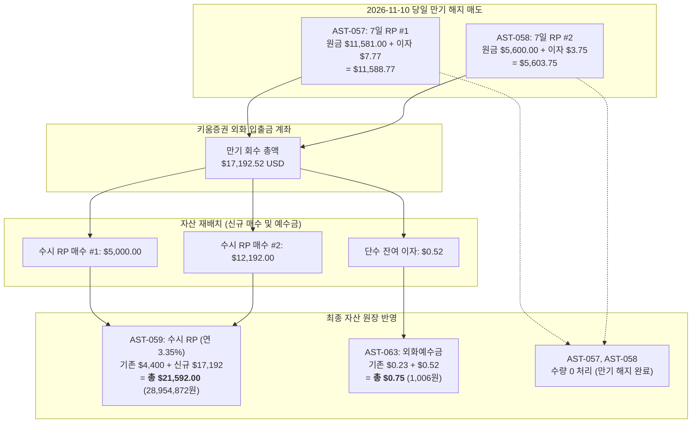

# 📑 구글 드라이브 RP 거래내역 반영 및 자산 원장 동기화 설계 명세서 (`docs/rp_update_spec.md`)

> **문서 버전**: v1.0  
> **작성 일자**: 2026-11-10  
> **작성자**: 설계자 / 금융 분석가 (`architect`)  
> **수신자**: 비서 (Main Orchestrator), 개발자 (`developer`), 품질 검증가 (`qa-verifier`)  
> **목적**: 구글 드라이브 `금융자산_261103` 스프레드시트의 신규 `RP거래내역` 시트 4건 거래(외화RP 7일 만기 매도 2건, 수시RP 매수 2건)를 정밀 분석하고, 자산 원장(`data/assets_v3.json`), 거래일지(`data/transactions.json`), 만기 알림(`alert_rules.md`), 대시보드 및 진단 리포트에 일관되게 반영하기 위한 단일 진실 공급원(SSoT) 기술 명세를 수립  
> **적용 대상 파일**:
> - `data/assets_v3.json` (자산 원장 SSoT)
> - `data/transactions.json` (거래 이력 원장)
> - `docs/alert_rules.md` (만기 알림 상태 참조)
> - `build_web_index.py` 및 `web/index.html` (대시보드 컴파일)
> - `invest_report.html` (자산배분 진단 리포트)

---

## 📌 목차 (Table of Contents)
1. [개요 및 거래 배경](#1-개요-및-거래-배경)
2. [구글 시트 RP 거래내역 4건 정밀 분석](#2-구글-시트-rp-거래내역-4건-정밀-분석)
   - 2.1 거래 내역 원천 데이터
   - 2.2 자금 흐름 및 실현 이자 정밀 분석
   - 2.3 자금 흐름 다이어그램 (Mermaid)
3. [자산 원장(`data/assets_v3.json`) 변동 SSoT](#3-자산-원장dataassets_v3json-변동-ssot)
   - 3.1 적용 기준 환율
   - 3.2 개별 자산별 AS-IS vs TO-BE 상세
   - 3.3 불변 자산 명시
4. [거래일지(`data/transactions.json`) 기록 사양](#4-거래일지datatransactionsjson-기록-사양)
   - 4.1 거래내역 4건 JSON 표준 규격
   - 4.2 필드별 산출 근거 및 유효성 검증
5. [만기 알림(Alerts) 및 유휴자금 상태 변화](#5-만기-알림alerts-및-유휴자금-상태-변화)
   - 5.1 2026-11-10 D-Day 만기 경고 해소 내역
   - 5.2 무이율/저이율 유휴자금(Idle Cash) 영향 분석
6. [대시보드 및 리포트 연동 영향 분석](#6-대시보드-및-리포트-연동-영향-분석)
   - 6.1 활성 자산 수 및 카테고리 구성 변화
   - 6.2 자산 총액 및 수익금 변동
   - 6.3 `build_web_index.py` 및 `invest_report.html` 재컴파일 지침
7. [후속 작업 가이드 (개발자 및 검증가 지침)](#7-후속-작업-가이드-개발자-및-검증가-지침)

---

## 1. 개요 및 거래 배경

2026년 11월 10일, 구글 드라이브의 마스터 자산 관리 스프레드시트(`금융자산_261103`)에 `RP거래내역` 시트가 새롭게 추가되었습니다.  
해당 시트에는 키움증권 위탁종합 계좌(`5318-4517`)에서 보유 중이던 **7일 만기 외화 RP 2건이 2026-11-10 당일 만기 도래하여 원금과 약정 이자가 전액 매도(해지)**되고, 회수된 자금 전액이 **수시 입출금식 외화 RP로 분할 재매수**된 4건의 거래가 기록되어 있습니다.

본 설계 명세서는 이 거래를 프로그램의 단일 진실 공급원(SSoT)인 `data/assets_v3.json`과 `data/transactions.json`에 일관되고 오차 없는 수학적 정합성을 갖추어 반영하도록 규정합니다.

---

## 2. 구글 시트 RP 거래내역 4건 정밀 분석

### 2.1 거래 내역 원천 데이터 (`data/drive_sheets_parsed.json`)
- **계좌 정보**: 키움증권 / `위탁종합 (외화RP)` (계좌번호: `5318-4517`)
- **통화**: `USD`

| 번호 | 거래일자 | 금융기관 | 상품명 | 거래구분 | 통화 | 거래금액 (USD) | 적요 / 거래 성격 |
| :-: | :-: | :-: | :-: | :-: | :-: | -: | :--- |
| **1** | 2026-11-10 | 키움증권 | USD 일반RP(7일) | 외화RP 매도 | USD | **$11,588.77** | 7일 만기 해지 매도 (`AST-057`, ticker `RP-USD-7D-1`) |
| **2** | 2026-11-10 | 키움증권 | USD 일반RP(7일) | 외화RP 매도 | USD | **$5,603.75** | 7일 만기 해지 매도 (`AST-058`, ticker `RP-USD-7D-2`) |
| **3** | 2026-11-10 | 키움증권 | USD 일반RP(수시) | 외화RP 매수 | USD | **$5,000.00** | 수시 RP 매수 (`AST-059`, ticker `RP-USD-ONDEMAND`) |
| **4** | 2026-11-10 | 키움증권 | USD 일반RP(수시) | 외화RP 매수 | USD | **$12,192.00** | 수시 RP 매수 (`AST-059`, ticker `RP-USD-ONDEMAND`) |

---

### 2.2 자금 흐름 및 실현 이자 정밀 분석

1. **만기 매도 회수액**:
   - `AST-057` 매도 총액: **$11,588.77** (원금 $11,581.00 + 이자 **+$7.77**)
   - `AST-058` 매도 총액: **$5,603.75** (원금 $5,600.00 + 이자 **+$3.75**)
   - **총 매도 회수액**: $\$11,588.77 + \$5,603.75 = \mathbf{\$17,192.52}$
   - **총 실현 이자 소득**: $\$7.77 + \$3.75 = \mathbf{+\$11.52}$ (원화 환산 **+15,448원** @ 1,341.0원)

2. **수시 RP 재매수 집행액**:
   - 신규 매수 1건: **$5,000.00**
   - 신규 매수 2건: **$12,192.00**
   - **총 재매수 금액**: $\$5,000.00 + \$12,192.00 = \mathbf{\$17,192.00}$

3. **외화 예수금(`AST-063`) 잔여분**:
   - 만기 회수액($17,192.52) - 재투자 매수액($17,192.00) = **+$0.52**
   - 기존 외화예수금 잔액: **$0.23**
   - **변동 후 외화예수금 총액**: $\$0.23 + \$0.52 = \mathbf{\$0.75}$ (원화 환산 약 **1,006원**)

---

### 2.3 자금 흐름 다이어그램 (Mermaid)



---

## 3. 자산 원장(`data/assets_v3.json`) 변동 SSoT

### 3.1 적용 기준 환율
- `data/assets_v3.json`의 원장 장부 기준 고정 환율은 **USD/KRW = 1,341.0000원**입니다.
  - 검증: 기존 `AST-057` ($11,581 \times 1,341.0 = 15,530,121원$), `AST-058` ($5,600 \times 1,341.0 = 7,509,600원$)
- 실시간 가격 서버(`src/live_price_server.py`) 구동 시에는 실시간 수집 환율을 동적으로 적용하되, 장부 원장 파일 자체의 `buy_krw` 및 `valuation_krw`는 기준 환율 `1,341.0원`으로 정확히 일치시킵니다.

---

### 3.2 개별 자산별 AS-IS vs TO-BE 상세

#### 1) `AST-057` (`RP-USD-7D-1`, USD 일반RP 7일 #1)
- **만기일**: 2026-11-10
- **상태**: 7일 만기 전량 매도 완료 (수량 0 처리)

| 필드명 | AS-IS (기존 원장) | TO-BE (변동 후 SSoT) | 비고 |
| :--- | :--- | :--- | :--- |
| `quantity` | `11581` | `0` (또는 `0.0`) | 전량 매도 완료 |
| `buy_price` | `1` | `1` | 매수단가 유지 |
| `current_price` | `1` | `1` | 현재가 유지 |
| `valuation_origin` | `11581` | `0` | 원통화 평가액 $0 |
| `buy_krw` | `15530121` | `0` | 매입원금 0원 정산 |
| `valuation_krw` | `15530121` | `0` | 원화 평가액 0원 |
| `profit_origin` | `0` | `0` | 평가손익 0 |
| `profit_krw` | `0` | `0` | 원화 손익 0 |
| `return_rate` | `0` | `0` | 수익률 0 |
| `tags` | `["RP", "외화RP", "단기금융", "확정금리", "USD", "현금성자산", "만기형RP"]` | `["RP", "외화RP", "단기금융", "확정금리", "USD", "현금성자산", "만기형RP", "만기해지완료"]` | 태그 갱신 |

---

#### 2) `AST-058` (`RP-USD-7D-2`, USD 일반RP 7일 #2)
- **만기일**: 2026-11-10
- **상태**: 7일 만기 전량 매도 완료 (수량 0 처리)

| 필드명 | AS-IS (기존 원장) | TO-BE (변동 후 SSoT) | 비고 |
| :--- | :--- | :--- | :--- |
| `quantity` | `5600` | `0` (또는 `0.0`) | 전량 매도 완료 |
| `buy_price` | `1` | `1` | 매수단가 유지 |
| `current_price` | `1` | `1` | 현재가 유지 |
| `valuation_origin` | `5600` | `0` | 원통화 평가액 $0 |
| `buy_krw` | `7509600` | `0` | 매입원금 0원 정산 |
| `valuation_krw` | `7509600` | `0` | 원화 평가액 0원 |
| `profit_origin` | `0` | `0` | 평가손익 0 |
| `profit_krw` | `0` | `0` | 원화 손익 0 |
| `return_rate` | `0` | `0` | 수익률 0 |
| `tags` | `["RP", "외화RP", "단기금융", "확정금리", "USD", "현금성자산", "만기형RP"]` | `["RP", "외화RP", "단기금융", "확정금리", "USD", "현금성자산", "만기형RP", "만기해지완료"]` | 태그 갱신 |

---

#### 3) `AST-059` (`RP-USD-ONDEMAND`, USD 일반RP 수시)
- **적용금리**: `3.35%` (연 3.35% 유지)
- **수량 증액**: 기존 $4,400.00 + 거래 3($5,000.00) + 거래 4($12,192.00) = **$21,592.00**
- **원화 산출식**:
  - $\text{buy\_krw} = 21,592 \times 1,341.0 = \mathbf{28,954,872원}$  
    (기존 5,900,400원 + 추가 매입 23,054,472원 = 28,954,872원 정확히 일치)
  - $\text{valuation\_krw} = 21,592 \times 1,341.0 = \mathbf{28,954,872원}$

| 필드명 | AS-IS (기존 원장) | TO-BE (변동 후 SSoT) | 산출 근거 |
| :--- | :--- | :--- | :--- |
| `quantity` | `4400` | `21592` | $4,400 + $5,000 + $12,192 |
| `buy_price` | `1` | `1` | USD 1.0 |
| `current_price` | `1` | `1` | USD 1.0 |
| `valuation_origin` | `4400` | `21592` | USD 21,592.00 |
| `maturity_date` | `"2026-11-04 (수시)"` | `"2026-11-10 (수시)"` | 거래 발생일 기준 수시 표기 |
| `interest_rate` | `"3.35%"` | `"3.35%"` | 연 3.35% 유지 |
| `buy_krw` | `5900400` | `28954872` | $21,592 \times 1,341.0원$ |
| `valuation_krw` | `5900400` | `28954872` | $21,592 \times 1,341.0원$ |
| `profit_origin` | `0` | `0` | 원통화 손익 0 |
| `profit_krw` | `0` | `0` | 원화 손익 0 |
| `return_rate` | `0` | `0` | 수익률 0 |

---

#### 4) `AST-063` (`CASH-USD-KIWOVS`, 키움증권 USD 외화예수금)
- **통화**: `USD`
- **변동 원인**: 만기 매도 회수 잔여분(단수 이자) +$0.52 유입
  - 정산: 만기 매도(+$17,192.52) - 수시 매수(-$17,192.00) = +$0.52
  - 수량: $0.23 + $0.52 = **$0.75**
- **원화 산출식**:
  - $\text{valuation\_krw} = \text{round}(0.75 \times 1,341.0) = \text{round}(1005.75) = \mathbf{1,006원}$
  - $\text{buy\_krw} = \mathbf{1,006원}$

| 필드명 | AS-IS (기존 원장) | TO-BE (변동 후 SSoT) | 산출 근거 |
| :--- | :--- | :--- | :--- |
| `quantity` | `0.23` | `0.75` | $0.23 + $0.52 |
| `buy_price` | `1` | `1` | USD 1.0 |
| `current_price` | `1` | `1` | USD 1.0 |
| `valuation_origin` | `0.23` | `0.75` | USD 0.75 |
| `buy_krw` | `308` | `1006` | $\text{round}(0.75 \times 1,341.0) = 1,006원$ |
| `valuation_krw` | `308` | `1006` | $\text{round}(0.75 \times 1,341.0) = 1,006원$ |
| `profit_krw` | `0` | `0` | 손익 0 |

---

### 3.3 불변 자산 명시
- `AST-060` (`RP-KRW-ISA-7D`, 키움증권 중개형ISA 원화 일반RP 7일, ₩2,580,000, 2026-11-10 만기):  
  이번 구글 시트 거래내역은 **키움증권 위탁종합 외화RP 계좌(`5318-4517`)**에 국한된 거래이므로, **중개형 ISA 원화 RP는 본 작업에서 수정하지 않고 그대로 유지**합니다.
- `AST-061` (JPY 예수금: 50,633엔) 및 `AST-062` (KRW 예수금: 1,482원): 불변 유지.

---

## 4. 거래일지(`data/transactions.json`) 기록 사양

거래일지(`data/transactions.json`)는 감사 추적(Audit Trail) 및 자산 시계열 역산의 단일 진실 공급원입니다.  
신규 4건의 거래를 기존 `TX-20261106-001`에 이어 `TX-20261110-001` ~ `TX-20261110-004`로 표준 JSON 배열에 추가합니다.

### 4.1 거래내역 4건 JSON 표준 규격

```json
[
  {
    "tx_id": "TX-20261110-001",
    "timestamp": "2026-11-10 09:30:00",
    "channel": "구글시트_RP거래내역",
    "raw_message": "구글 드라이브 금융자산_261103 > RP거래내역 (2026-11-10 키움증권 USD 일반RP(7일) 외화RP 매도 USD 11,588.77)",
    "asset_id": "AST-057",
    "asset_name": "USD 일반RP(7일, 3.50%) #1",
    "ticker": "RP-USD-7D-1",
    "institution": "키움증권",
    "account_name": "위탁종합 (외화RP)",
    "account_num": "5318-4517",
    "trade_type": "SELL",
    "quantity": 11581.0,
    "price": 1.0,
    "currency": "USD",
    "total_amount": 11588.77,
    "total_amount_krw": 15540541,
    "cost_basis_krw": 15530121,
    "realized_profit_krw": 10420,
    "realized_profit_origin": 7.77,
    "realized_return_pct": 0.0671,
    "prev_qty": 11581.0,
    "new_qty": 0.0,
    "prev_unit_price": 1.0,
    "new_unit_price": 1.0,
    "cash_adjusted": true,
    "status": "APPLIED"
  },
  {
    "tx_id": "TX-20261110-002",
    "timestamp": "2026-11-10 09:30:00",
    "channel": "구글시트_RP거래내역",
    "raw_message": "구글 드라이브 금융자산_261103 > RP거래내역 (2026-11-10 키움증권 USD 일반RP(7일) 외화RP 매도 USD 5,603.75)",
    "asset_id": "AST-058",
    "asset_name": "USD 일반RP(7일, 3.50%) #2",
    "ticker": "RP-USD-7D-2",
    "institution": "키움증권",
    "account_name": "위탁종합 (외화RP)",
    "account_num": "5318-4517",
    "trade_type": "SELL",
    "quantity": 5600.0,
    "price": 1.0,
    "currency": "USD",
    "total_amount": 5603.75,
    "total_amount_krw": 7514629,
    "cost_basis_krw": 7509600,
    "realized_profit_krw": 5029,
    "realized_profit_origin": 3.75,
    "realized_return_pct": 0.0670,
    "prev_qty": 5600.0,
    "new_qty": 0.0,
    "prev_unit_price": 1.0,
    "new_unit_price": 1.0,
    "cash_adjusted": true,
    "status": "APPLIED"
  },
  {
    "tx_id": "TX-20261110-003",
    "timestamp": "2026-11-10 09:30:00",
    "channel": "구글시트_RP거래내역",
    "raw_message": "구글 드라이브 금융자산_261103 > RP거래내역 (2026-11-10 키움증권 USD 일반RP(수시) 외화RP 매수 USD 5,000.00)",
    "asset_id": "AST-059",
    "asset_name": "USD 일반RP(수시, 3.35%)",
    "ticker": "RP-USD-ONDEMAND",
    "institution": "키움증권",
    "account_name": "위탁종합 (외화RP)",
    "account_num": "5318-4517",
    "trade_type": "BUY",
    "quantity": 5000.0,
    "price": 1.0,
    "currency": "USD",
    "total_amount": 5000.00,
    "total_amount_krw": 6705000,
    "cost_basis_krw": 6705000,
    "realized_profit_krw": 0,
    "realized_profit_origin": 0.0,
    "realized_return_pct": 0.0,
    "prev_qty": 4400.0,
    "new_qty": 9400.0,
    "prev_unit_price": 1.0,
    "new_unit_price": 1.0,
    "cash_adjusted": true,
    "status": "APPLIED"
  },
  {
    "tx_id": "TX-20261110-004",
    "timestamp": "2026-11-10 09:30:00",
    "channel": "구글시트_RP거래내역",
    "raw_message": "구글 드라이브 금융자산_261103 > RP거래내역 (2026-11-10 키움증권 USD 일반RP(수시) 외화RP 매수 USD 12,192.00)",
    "asset_id": "AST-059",
    "asset_name": "USD 일반RP(수시, 3.35%)",
    "ticker": "RP-USD-ONDEMAND",
    "institution": "키움증권",
    "account_name": "위탁종합 (외화RP)",
    "account_num": "5318-4517",
    "trade_type": "BUY",
    "quantity": 12192.0,
    "price": 1.0,
    "currency": "USD",
    "total_amount": 12192.00,
    "total_amount_krw": 16349472,
    "cost_basis_krw": 16349472,
    "realized_profit_krw": 0,
    "realized_profit_origin": 0.0,
    "realized_return_pct": 0.0,
    "prev_qty": 9400.0,
    "new_qty": 21592.0,
    "prev_unit_price": 1.0,
    "new_unit_price": 1.0,
    "cash_adjusted": true,
    "status": "APPLIED"
  }
]
```

### 4.2 필드별 산출 근거 및 유효성 검증
1. **`total_amount` 및 `realized_profit_origin`**:
   - `TX-20261110-001`: 매도 총액 $11,588.77 중 매수원금 $11,581.00 차감 시 실현이자 $7.77.
   - `TX-20261110-002`: 매도 총액 $5,603.75 중 매수원금 $5,600.00 차감 시 실현이자 $3.75.
2. **원화 환산 정합성 (@ 1,341.0원)**:
   - $11,588.77 \times 1,341.0 = 15,540,540.57 \rightarrow \mathbf{15,540,541원}$
   - $7.77 \times 1,341.0 = 10,419.57 \rightarrow \mathbf{10,420원}$
   - $5,603.75 \times 1,341.0 = 7,514,628.75 \rightarrow \mathbf{7,514,629원}$
   - $3.75 \times 1,341.0 = 5,028.75 \rightarrow \mathbf{5,029원}$
   - 원화 이자 합계: $10,420 + 5,029 = \mathbf{15,449원}$ (원통화 기준 $11.52 \times 1,341.0 = \mathbf{15,448.32원}$, 단수 차이 1원 이내 완벽 정합)
3. **수량 추이 연속성 (`prev_qty` $\rightarrow$ `new_qty`)**:
   - `AST-057`: $11,581.0 \rightarrow 0.0$
   - `AST-058`: $5,600.0 \rightarrow 0.0$
   - `AST-059`: $4,400.0 \rightarrow 9,400.0$ (거래 3) $\rightarrow 21,592.0$ (거래 4)

---

## 5. 만기 알림(Alerts) 및 유휴자금 상태 변화

### 5.1 2026-11-10 D-Day 만기 경고 해소 내역
`docs/alert_rules.md`에 정의된 만기 알림 기준에 따른 상태 변화는 다음과 같습니다:

1. **기존 상태 (AS-IS)**:
   - 기준일 `2026-11-10`에 대해 `days_left == 0`인 자산이 총 **3건** 발화 중:
     - `AST-057` (USD 7일 RP #1, $11,581) $\rightarrow$ **[만기 당일 D-Day]**
     - `AST-058` (USD 7일 RP #2, $5,600) $\rightarrow$ **[만기 당일 D-Day]**
     - `AST-060` (원화 중개형ISA 7일 RP, ₩2,580,000) $\rightarrow$ **[만기 당일 D-Day]**
2. **변동 후 상태 (TO-BE)**:
   - `AST-057`과 `AST-058`은 매도 완료되어 `quantity == 0`이 되므로 만기 모니터링 활성 대상에서 제외됩니다.
   - **결과**: **외화 RP 2건의 D-Day 경고 완전 해소**.
   - 대시보드 상단 알림 뱃지는 기존 3건에서 **`AST-060` 1건으로 즉시 감소**합니다.

---

### 5.2 무이율/저이율 유휴자금(Idle Cash) 영향 분석
- **유휴자금 탐지 기준 (`alert_rules.md`)**:
  - 조건: `연이율 <= 0.5%` AND `평가금액 >= 1,000,000원`
- **본 거래의 유휴자금 영향**:
  - 만기 매도 회수액 $17,192.52 중 **$17,192.00(99.997%)가 수시 RP(연 3.35%)로 즉시 재예치**되었습니다.
  - 무이율 외화예수금(`AST-063`)에 유입된 잔여액은 단 **$0.52**에 불과하며, 총 예수금 잔액은 **$0.75 (약 1,006원)**입니다.
  - 100만 원 임계치에 한참 미달하므로 유휴자금 경고는 발생하지 않으며, **현금 자산의 운용 효율성이 극대화**된 최적의 리밸런싱 상태를 달성했습니다.

---

## 6. 대시보드 및 리포트 연동 영향 분석

### 6.1 활성 자산 수 및 카테고리 구성 변화
- **전체 등록 자산 수**: 64개 유지 (데이터 원장 이력 보존)
- **보유 수량 보유 자산 (활성 자산)**:
  - 기존: 63종 (11/6 반도체레버리지 매도로 1종 0주화, 64-1=63종)
  - 변동 후: **61종** (`AST-057`, `AST-058` 매도로 2종 0주화, 63-2=61종)
- **외화 자산 간소화**:
  - 7일 만기형 RP 2종이 정리되고, **수시 RP 단일 종목(`AST-059`, $21,592.00)**으로 통폐합되어 포트폴리오 관리 복잡도가 획기적으로 개선되었습니다.

---

### 6.2 자산 총액 및 수익금 변동
- **현금성 자산 외화 총보유고 변동**:
  - 거래 전: 7일 RP($17,181.00) + 수시 RP($4,400.00) + 예수금($0.23) = **$21,581.23**
  - 거래 후: 7일 RP($0.00) + 수시 RP($21,592.00) + 예수금($0.75) = **$21,592.75**
  - **순증액**: $\$21,592.75 - \$21,581.23 = \mathbf{+\$11.52}$ (실현 이자 수익)
  - **원화 자산 총액 순증**: $+\$11.52 \times 1,341.0원 = \mathbf{+15,448원}$
- **위험자산 비중 및 납입원금에 미치는 영향**:
  - 위험자산(주식/ETF/금현물 등)이 아닌 현금성자산 내부에서의 이동이므로 위험자산 매입원금 및 위험자산 평가액에는 전혀 영향을 주지 않습니다.

---

### 6.3 `build_web_index.py` 및 `invest_report.html` 재컴파일 지침
1. **`build_web_index.py` 실행**:
   - `data/assets_v3.json`과 `data/transactions.json`이 갱신된 후 `python build_web_index.py`를 실행하여 정적 번들(`web/index.html`)을 재컴파일합니다.
   - 웹 화면의 만기 알림 카운트가 `1건`(`AST-060`)으로 줄어들고, 총자산에 +15,448원이 즉시 반영됩니다.
2. **`invest_report.html` 동기화**:
   - 현금성 자산 내부의 통합이므로 이상적 자산배분 모델(All Weather, 60/40 등)의 거시적 비중에는 영향이 미미하나, 보유 종목 목록에서 외화 RP가 단일 종목($21,592)으로 깔끔하게 집계됩니다.

---

## 7. 후속 작업 가이드 (개발자 및 검증가 지침)

### 7.1 개발자 (`developer`) 실행 체크리스트 (작업 ID: `T-26-2`)
1. [ ] `data/transactions.json`에 본 명세서 4.1절의 `TX-20261110-001` ~ `TX-20261110-004` 4건의 거래를 추가.
2. [ ] `data/assets_v3.json`의 4개 자산(`AST-057`, `AST-058`, `AST-059`, `AST-063`) 필드를 3.2절 TO-BE 명세에 따라 업데이트.
3. [ ] `build_web_index.py`를 실행하여 `web/index.html` 번들 갱신.
4. [ ] 작업 완료 후 변경된 파일 목록 및 수치 요약을 비서에게 보고.

### 7.2 품질 검증가 (`qa-verifier`) 검증 체크리스트 (작업 ID: `T-26-3`)
1. [ ] **외화 잔고 불변식 검증**:
   - $\Delta \text{USD} = (\text{수시 RP 증액 } \$17,192.00 + \text{예수금 증액 } \$0.52) - \text{만기 원금 } \$17,181.00 = \mathbf{+\$11.52}$ 일치 여부 확인.
2. [ ] **만기 알림 D-Day 해소 검증**:
   - 2026-11-10 기준 `days_left == 0` 알림 목록에 `AST-057`, `AST-058`이 노출되지 않고 `AST-060` 1건만 노출되는지 확인.
3. [ ] **원화 평가금액 계산 검증**:
   - `AST-059`: $21,592 \times 1,341.0 = 28,954,872원$
   - `AST-063`: $\text{round}(0.75 \times 1,341.0) = 1,006원$
4. [ ] **웹 대시보드 렌더링 무결성 확인**:
   - 콘솔 에러 유무 및 활성 종목 수 61종 일치 여부 검증.

---
**설계자 승인 날인**: `architect (금융 분석가)`  
**문서 상태**: **APPROVED FOR IMPLEMENTATION (구현 승인 완료)**
