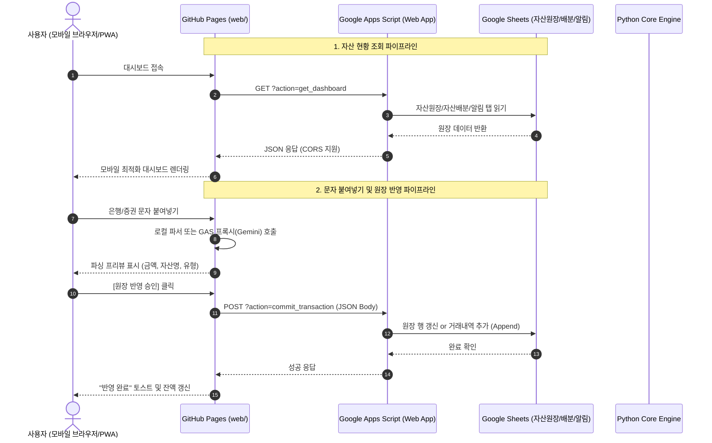
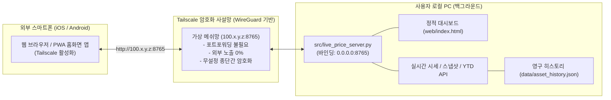

# 자산 관리 프로그램 기술 설계 명세서 (`technical_spec.md`)

> **문서 버전**: v3.2.1  
> **최종 수정일**: 2026-11-04  
> **작성자**: `developer` & `architect` (개발 및 설계 총괄)  
> **참조 문서**: `docs/concept_design.md`, `docs/sheet_schema.md`, `docs/alert_rules.md`, `docs/feasibility_review.md`  
> **주요 v3.2.1 확정 변경사항**: 
> 1. 구글 스프레드시트 원장 및 실시간 시세 갱신주기 명확화 & 상단 바 UI 표시 명세 (시세 15분 자동/수동 즉시, 원장 1시간 자동/문자입력 즉시)  
> 2. YTD 차트 & 1D~1Y 수익률 하이브리드 산출 확정: 오늘(2026-11-04) 이전은 1년 일봉 역산(방식 1), 오늘 이후는 `data/asset_history.json`에 실제 총자산 일별 영구 누적(Upsert)  
> 3. 외부 스마트폰 접속 아키텍처 '방안 B - Tailscale' 최종 확정: `src/live_price_server.py`가 웹페이지와 모든 API를 `0.0.0.0:8765` 단일 포트에서 통합 서빙하고 Tailscale 사설망으로 안전 접속  
> 4. v3.2 UI/UX 3대 수정 명세(모달 오버레이/ESC 닫힘, 비상장 자산 링크 제거, 금융회사/계좌 컬럼 통합 & 수량·단가 공란화를 통한 Zero 가로 스크롤) 유지

---

## 1. 개요 및 설계 원칙

본 문서는 `concept_design.md`에서 정의된 "스프레드시트 친화적 능동형 개인 자산 관제탑"을 파이썬(Python Core) 및 모바일 웹(PWA), 메신저(Telegram)로 확장하기 위한 상세 기술 아키텍처 및 인터페이스 명세서입니다.

### 1.1 핵심 설계 원칙
1. **금융 정밀도 보장 (Financial Precision)**:
   - 통화 금액 및 비중 연산 시 부동소수점 오차를 원천 차단하기 위해 모든 핵심 연산에 Python `decimal.Decimal`을 사용하며, 비중 합계 100.00% 무결성 보정 알고리즘을 적용합니다.
2. **서버리스 제로 인프라 비용 (Zero Server Cost Architecture)**:
   - 상시 가동 서버 없이 **GitHub Pages(정적 프론트엔드) + Google Apps Script(서버리스 API 브릿지) + Google Sheets(SSoT 원장)** 조합으로 24시간 가용성을 무비용으로 확보합니다.
3. **하이브리드 지능형 파싱 (Hybrid Intelligent Parsing)**:
   - 은행/증권 거래 문자 파싱 시, 속도와 비용 절감을 위해 **1차 고속 정규식(Regex)**을 수행하고, 복잡하거나 변칙적인 문맥은 **2차 Gemini API Structured Output**으로 Graceful Fallback하여 99% 이상의 파싱 정합성을 달성합니다.
4. **인간 참여형 검증 (Human-in-the-Loop Commit)**:
   - 거래 문자가 원장에 자동 직결되어 발생할 수 있는 데이터 오염을 방지하기 위해, 웹 UI 및 텔레그램 봇에서 **"파싱 프리뷰 확인 $\rightarrow$ 사용자 승인(Commit)"** 단계를 거칩니다.
5. **네트워크 효율성 및 쿼터 준수 (Batch Operations)**:
   - Google Sheets API 할당량(Quota) 초과 방지를 위한 2D Range Batch Update 및 지수 백오프(Exponential Backoff)를 강제합니다.

---

## 2. 확장 기술 스택 및 의존성

| 구분 | 기술 / 라이브러리 | 버전 | 용도 및 선정 사유 |
| :--- | :--- | :--- | :--- |
| **코어 런타임** | Python | `>= 3.10` | 백엔드 배치 엔진, CLI, 텔레그램 봇 구동 |
| **수치/금융 연산** | `decimal.Decimal` | 표준 라이브러리 | 화폐 단위 절사/반올림 정합성, 자산 비중 100% 무오차 보장 |
| **데이터 모델링** | `pydantic` | `>= 2.0` | 런타임 스키마 검증, 직렬화, Gemini Structured Output 스키마 생성 |
| **시트 연동** | `gspread` / `google-auth` | `>= 6.0` | Python 코어용 Google Sheets API v4 공식 연동 |
| **서버리스 브릿지**| Google Apps Script (GAS) | V8 Runtime | 정적 웹(GitHub Pages) $\leftrightarrow$ 구글 시트 간 REST API 브릿지 |
| **웹 프론트엔드** | HTML5 / Vanilla JS / CSS3 | Modern | 빌드 도구 없는 초경량 PWA, GitHub Pages 무료 호스팅 |
| **시장 데이터** | `yfinance` / `FinanceDataReader` | `>= 0.2.30` | 글로벌/국내 주식 실시간 시세 및 외환(USD/KRW) 수집 |
| **AI LLM 파서** | `google-genai` (Gemini API) | `>= 0.1.1` | 변칙 문자/알림톡 구조화 (Gemini 2.5/3.8 Flash, Structured Output) |
| **메신저 연동** | `python-telegram-bot` | `>= 20.0` | 거래 내역 문자 전송, 파싱 프리뷰 확인 및 인라인 승인 봇 |
| **테스트** | `pytest` / `pytest-mock` | `>= 7.4` | 파서 정규식 룰셋, 비중 계산, 만기 알림 회귀 테스트 |

---

## 3. 전체 시스템 디렉토리 구조 (v2.0)

```
herdr_test/
├── config/
│   └── default_config.json        # 기본 알림 임계치, 파킹통장 금리, 시트 매핑
├── data/
│   ├── cache/                    # 시장 시세/환율 로컬 임시 캐시
│   └── mock/                     # 모의 테스트용 시트/시세/문자 데이터셋
│       ├── mock_assets.json
│       ├── mock_market_prices.json
│       └── mock_sms_samples.json # 국내 은행/증권사 문자 테스트 케이스
├── docs/                         # SSoT 명세 문서군
│   ├── alert_rules.md
│   ├── concept_design.md
│   ├── feasibility_review.md
│   ├── sheet_schema.md
│   ├── task_board.md
│   └── technical_spec.md         # (본 문서 v2.0)
├── gas/                          # Google Apps Script 브릿지
│   └── Code.gs                   # Web App 엔드포인트 (doGet, doPost, CORS 처리)
├── src/                          # Python 코어 백엔드 & 봇
│   ├── __init__.py
│   ├── main.py                   # CLI 진입점, 배치 및 모니터링 구동
│   ├── config.py                 # 환경변수(.env) 및 런타임 설정
│   ├── models/                   # Pydantic 도메인 데이터 모델
│   │   ├── asset.py              # Asset, AssetCategory, Currency
│   │   ├── alert.py              # Alert, AlertType, AlertSeverity
│   │   ├── allocation.py         # CategoryAllocation, PortfolioAllocation
│   │   └── transaction.py        # ParsedTransaction, TransactionType (v2.0 신규)
│   ├── adapters/                 # 외부 I/O 계층
│   │   ├── base.py               # 추상 인터페이스 정의
│   │   ├── google_sheets.py      # gspread 배치 연동
│   │   ├── market_data.py        # yfinance/FDR 시세 수집 및 3단계 Fallback
│   │   ├── mock_adapter.py       # 로컬 독립 테스트용 어댑터
│   │   └── telegram_bot.py       # 텔레그램 봇 어댑터 (Polling/Webhook) (v2.0 신규)
│   ├── parsers/                  # 문자/알림톡 하이브리드 파서 계층 (v2.0 신규)
│   │   ├── __init__.py
│   │   ├── base_parser.py        # 파서 기본 인터페이스
│   │   ├── regex_parser.py       # 1차 국내 은행/증권 정규식 룰 엔진
│   │   ├── llm_parser.py         # 2차 Gemini API Structured Output 파서
│   │   └── hybrid_parser.py      # 정규식 우선 $\rightarrow$ LLM Fallback 결합 엔진
│   ├── services/                 # 핵심 비즈니스 로직
│   │   ├── valuation.py          # 자산 평가 및 환율 환산
│   │   ├── alert_engine.py       # 만기 4단계 및 유휴자금 기회비용 탐지
│   │   ├── allocation_engine.py  # 7대 자산 배분 및 리밸런싱 판정
│   │   └── ledger_service.py     # 문자 파싱 결과의 자산원장 반영 로직 (v2.0 신규)
│   └── utils/                    # 공통 유틸리티
│       ├── date_util.py          # KST 기준일 및 잔여일수 계산
│       ├── formatters.py         # 통화/백분율/UI 출력 포맷팅
│       └── logger.py             # 통합 로깅
├── web/                          # GitHub Pages 모바일 반응형 프론트엔드 (v2.0 신규)
│   ├── index.html                # 단일 페이지 대시보드 & 문자 입력 UI
│   ├── styles.css                # 모바일 퍼스트 반응형 스타일 (Dark/Light 모드)
│   ├── app.js                    # GAS 브릿지 통신, 상태 관리, 렌더링
│   ├── manifest.json             # PWA 웹 앱 매니페스트 (홈 화면 추가)
│   ├── sw.js                     # PWA 서비스 워커 (오프라인 셸 캐싱)
│   └── assets/                   # 아이콘 및 파비콘
└── tests/                        # 테스트 스위트
    ├── test_alert_engine.py
    ├── test_allocation.py
    ├── test_market_fallback.py
    └── test_parsers.py           # 문자 파싱 룰셋 및 LLM fallback 검증 (v2.0 신규)
```

---

## 4. GitHub Pages & GAS 서버리스 브릿지 아키텍처



### 4.1 GitHub Pages PWA (`web/`) 설계
- **무서버 모바일 최적화**: 
  - 빌드 단계(Webpack/Vite 등)가 필요 없는 순수 HTML5/CSS/JavaScript로 구현하여 GitHub Pages에 즉시 배포.
  - Viewport 설정: `<meta name="viewport" content="width=device-width, initial-scale=1.0, maximum-scale=1.0, user-scalable=no">`
- **PWA(Progressive Web App) 기능**:
  - `manifest.json`: 모바일 기기 홈 화면에 "자산관제탑" 단독 앱 아이콘 생성 (`display: "standalone"`).
  - `sw.js`: 오프라인 셸 캐싱을 통해 네트워크 불안정 시에도 UI 프레임 즉시 로딩.

### 4.2 Google Apps Script (GAS) API 브릿지 (`gas/Code.gs`)
- **보안 격리**: Google Service Account 비공개 키를 브라우저에 노출하지 않고, 시트 소유자 권한으로 실행되는 GAS Web App으로 보안 유지.
- **주요 엔드포인트**:
  - `doGet(e)`:
    - `action=get_dashboard`: `자산원장`, `자산배분`, `알림센터` 데이터를 취합한 단일 JSON 반환.
  - `doPost(e)`:
    - `action=commit_transaction`: 구조화된 거래 내역 데이터를 수신하여 원장의 잔액/보유수량을 갱신하고 거래 기록 저장.
- **GAS 특유의 302 리다이렉트 대응**:
  - GAS Web App은 CORS `POST` 요청 시 `script.google.com`에서 `script.googleusercontent.com`으로 302 리다이렉트되므로, 프론트엔드 `fetch()` 옵션에 `redirect: "follow"`를 필수로 적용하고 `Content-Type: text/plain;charset=utf-8`을 사용하여 Preflight(OPTIONS) 비용 최소화.

### 4.3 GitHub Pages 공개 노출 방지 및 클라이언트 암호화 볼트 (Zero-Data Architecture)
GitHub Pages와 같은 정적 호스팅 환경에 금융 자산 웹 대시보드를 배포할 때 발생하는 자산 데이터 공개 노출 및 비인가 접근 위협을 원천 차단하기 위해 4중 보안 아키텍처를 적용합니다.

```mermaid
flowchart LR
    subgraph Client["1. 사용자 브라우저 (Zero-Data Static Shell)"]
        PIN["사용자 마스터 PIN 입력 (예: 1234)"] --> PBKDF2["WebCrypto PBKDF2 키 유도 (100,000회 Iteration + Salt)"]
        PBKDF2 --> Key["256비트 AES-GCM 대칭키 생성"]
        Vault["LocalStorage 암호화 볼트 (AES-256-GCM + IV)"] <-->|복호화/암호화| Key
        Token["GAS Secret Token (x-vault-token)"]
    end

    subgraph Bridge["2. Google Apps Script Web App"]
        AuthCheck{"Secret Token 인증 검증"}
        Token -->|API 요청 시 헤더/파라미터 전달| AuthCheck
    end

    subgraph Ledger["3. Google Sheets"]
        SheetData["비공개 자산원장 (Private SSoT)"]
    end

    AuthCheck -->|토큰 일치 (200 OK)| SheetData
    AuthCheck -->|불일치 시 접근 거부| Reject["403 Forbidden 차단"]
```

1. **Zero-Data Static Shell (정적 레포지토리 자산 데이터 제로화)**:
   - GitHub Pages의 공개 저장소(Git Repo) 및 빌드 산출물(`web/index.html`, `app.js`)에는 사용자의 실제 금융 자산 데이터나 개인 식별 정보(PII)를 일절 하드코딩하지 않습니다.
   - 프론트엔드는 자산 데이터를 담지 않는 순수한 '실행 껍데기(Shell)' 바이너리 역할만 수행합니다.
2. **WebCrypto 기반 PBKDF2 + AES-256-GCM 클라이언트 암호화 볼트**:
   - 브라우저 로컬 저장소(`localStorage`)에 저장되는 오프라인 캐시 및 자산 원장 데이터는 브라우저 표준 `crypto.subtle` API를 사용하여 강력히 암호화(At-Rest Encryption)됩니다.
   - 키 유도: 마스터 PIN과 암호화 Salt를 조합하여 PBKDF2(SHA-256, 100,000회 반복 연산)로 256비트 대칭키 유도.
   - 볼트 암호화: 매 저장 시 12바이트 무작위 IV(Initialization Vector)와 함께 `AES-256-GCM`으로 암호화하여 저장. 올바른 PIN이 없으면 암호문 및 인증 태그(Auth Tag) 검증 실패로 데이터를 절대 열람할 수 없습니다.
3. **마스터 PIN 잠금 화면 및 세션 메모리 파기**:
   - 웹 접속 시 마스터 PIN 입력 전까지 대시보드 화면 및 수치가 완전히 블러/잠금 처리됩니다.
   - [즉시 잠금] 버튼 클릭 또는 비활동(예: 5분 이상) 시 메모리 상의 복호화 키 및 원장 상태를 즉시 `null`로 덮어쓰고(Zeroing) 잠금 화면으로 복귀합니다.
4. **Google Apps Script Secret Token 상호 인증**:
   - GAS Web App URL이 무차별 대입이나 크롤러에 노출되더라도 제3자가 자산 데이터를 조회할 수 없도록, 요청 시 클라이언트와 사전에 공유된 비밀 토큰(`x-vault-token`) 인증을 강제합니다. 토큰이 없거나 불일치할 경우 GAS가 HTTP 403을 반환하여 Google Sheets 접근을 차단합니다.
5. **거래 문자 중복 반영 방지 (SHA-256 Deduplication Fingerprint)**:
   - 거래 문자가 붙여넣어질 때 원문 텍스트를 공백 정규화한 뒤 WebCrypto `SHA-256` 해시 지문(Fingerprint)을 생성합니다.
   - 최근 처리된 트랜잭션 해시 테이블과 대조하여, 이미 반영된 문자가 중복 제출될 경우 즉시 `[중복 거래 감지]` 경고를 띄우고 원장의 잔액 이중 차감/가산을 원천 차단합니다.

---

## 5. 금융 거래 문자 하이브리드 파서 아키텍처

사용자가 은행/증권사에서 수신하는 거래 내역 SMS/MMS/알림톡을 단일 진실 공급원(SSoT) 데이터 모델로 정형화하는 2단계 하이브리드 파서입니다.

```mermaid
flowchart TD
    RawSMS["수신된 거래 문자 원문 (Raw Text)"] --> Clean["전처리: 공백 정리 및 특수문자 정규화"]
    Clean --> Stage1["1단계: 정규식(Regex) 룰 엔진\n(KB, 신한, 토스, 카카오, 미래에셋 등)"]
    
    Stage1 -->|매칭 성공 (신뢰도 >= 0.95)| ValidCheck{"필수 필드 검증\n(금액, 유형, 기관)"}
    ValidCheck -->|통과| Result["ParsedTransaction 생성"]
    
    Stage1 -->|매칭 실패 또는 미지원 패턴| Stage2["2단계: Gemini API Structured Output\n(Gemini 2.5 / 3.8 Flash)"]
    ValidCheck -->|누락 발생| Stage2
    
    Stage2 -->|JSON Schema 강제| Result
    Result --> Preview["프리뷰 UI / 텔레그램 인라인 버튼에 전달"]
```

### 5.1 거래 내역 표준 데이터 모델 (`src/models/transaction.py`)

```python
from decimal import Decimal
from datetime import datetime
from enum import Enum
from typing import Optional
from pydantic import BaseModel, Field

class TransactionType(str, Enum):
    DEPOSIT = "입금"          # 계좌 입금, 급여, 상여금
    WITHDRAWAL = "출금"       # 계좌 출금, 이체
    CARD_PAYMENT = "카드결제"  # 체크/신용카드 결제
    STOCK_BUY = "주식매수"     # 국내/해외 주식 체결(매수)
    STOCK_SELL = "주식매도"    # 국내/해외 주식 체결(매도)
    INTEREST = "이자입금"      # 예적금/파킹통장 이자
    MATURITY = "만기해지"      # 예적금 원리금 만기 수령

class ParsedTransaction(BaseModel):
    institution: str = Field(..., description="금융기관명 (예: KB국민, 토스뱅크, 신한투자증권)")
    tx_type: TransactionType = Field(..., description="거래 유형")
    amount: Decimal = Field(..., description="거래 금액 (절댓값)")
    account_mask: Optional[str] = Field(None, description="계좌번호 마스킹 (예: 123-***-456)")
    counterparty: Optional[str] = Field(None, description="거래처/적요/가맹점명 (예: 스타벅스, 홍길동)")
    balance_after: Optional[Decimal] = Field(None, description="거래 후 잔액 (문자에 표기된 경우)")
    ticker_or_item: Optional[str] = Field(None, description="주식 종목명/티커 (주식 거래 시)")
    quantity: Optional[Decimal] = Field(None, description="주식 체결 수량")
    unit_price: Optional[Decimal] = Field(None, description="주식 체결 단가")
    timestamp: datetime = Field(default_factory=datetime.now, description="거래 일시")
    parser_source: str = Field(..., description="파싱 출처: 'REGEX' 또는 'GEMINI_LLM'")
    confidence: float = Field(default=1.0, description="신뢰도 점수 (0.0 ~ 1.0)")
    raw_text: str = Field(..., description="원본 문자 텍스트")
```

### 5.2 1차: 국내 주요 금융사 정규식 룰 엔진 (`src/parsers/regex_parser.py`)
- **지원 대상 패턴**:
  - **시중은행 (KB, 신한, 우리, 하나, NH)**: `\[Web발신\]\s*(KB국민|신한|우리)은행\s*(\d{2}/\d{2}\s*\d{2}:\d{2})\s*(\d+-\S+)\s*(입금|출금|체크승인)\s*([\d,]+)원\s*잔액\s*([\d,]+)원\s*(.*)`
  - **인터넷전문은행 (토스뱅크, 카카오뱅크)**: `\[토스뱅크\]\s*([\d,]+)원이\s*(출금|입금)되었어요\s*\(잔액\s*([\d,]+)원\)\s*(.*)`
  - **증권사 (미래에셋, 키움, 토스증권, 삼성증권)**: `\[.*증권\]\s*(.*)\s*(\d+)주\s*(매수|매도)체결\s*단가\s*([\d,]+)원`
- **장점**: 실행 시간 1ms 미만, 네트워크 불필요, 0 비용, 높은 일관성.

### 5.3 2차: Gemini API Structured Output 파서 (`src/parsers/llm_parser.py`)
- **트리거 조건**: 정규식 파서 매칭 실패, 신규 포맷 알림톡, 텍스트가 여러 줄로 복잡하게 분할된 경우.
- **엔진 모델**: `gemini-2.5-flash` 또는 `gemini-3.8-flash` (저지연, 고효율).
- **기술 구현 (`google-genai` SDK)**:
  - `ParsedTransaction`의 Pydantic 스키마를 `response_schema`로 주입하여 100% 문법적 JSON 유효성 보장.

```python
from google import genai
from google.genai import types
from src.models.transaction import ParsedTransaction

class GeminiTransactionParser:
    def __init__(self, api_key: str):
        self.client = genai.Client(api_key=api_key)

    def parse(self, raw_sms: str) -> ParsedTransaction:
        prompt = f"""
        다음 한국 금융기관(은행/증권/카드)의 거래 내역 문자 메시지를 분석하여 
        정형화된 거래 데이터로 추출해 주세요.
        
        문자 원문:
        \"\"\"{raw_sms}\"\"\"
        """
        response = self.client.models.generate_content(
            model='gemini-2.5-flash',
            contents=prompt,
            config=types.GenerateContentConfig(
                response_mime_type="application/json",
                response_schema=ParsedTransaction,
                temperature=0.1
            ),
        )
        return ParsedTransaction.model_validate_json(response.text)
```

---

## 6. 모바일 웹 UI & 텔레그램 봇 연동 모듈 설계

### 6.1 모바일 웹 '문자 붙여넣기 프리뷰/반영 UI' (`web/index.html`)

```
+------------------------------------------+
|  🏛️ 자산 관제탑 (Asset Control Tower)     |
+------------------------------------------+
|  총 순자산: ₩ 348,500,000                |
|  🚨 긴급 알림: 만기 도래 1건, 유휴자금 2건 |
+------------------------------------------+
|  [📱 거래 문자 즉시 반영]                |
|  +------------------------------------+  |
|  | [Web발신] 신한 11/03 14:20          |  |
|  | 출금 1,500,000원 잔액 3,200,000원  |  |
|  | 보낸분: 홍길동                      |  |
|  +------------------------------------+  |
|  [ ⚡ 스마트 분석하기 ]                  |
|                                          |
|  📋 파싱 프리뷰 (검토 후 반영):          |
|  - 기관/계좌 : 신한은행                  |
|  - 거래 유형 : 🔴 출금 (이체)            |
|  - 거래 금액 : 1,500,000 원              |
|  - 변동 후 잔액: 3,200,000 원            |
|  - 연동 대상 자산: [ AST-002 신한입출금 ▼]|
|                                          |
|  [ ✅ 원장에 반영하기 ]  [ ❌ 초기화 ]    |
+------------------------------------------+
```

- **핵심 상호작용 흐름**:
  1. 클립보드 문자 붙여넣기 $\rightarrow$ [스마트 분석하기] 탭.
  2. 하이브리드 파서가 분석한 결과(기관, 유형, 금액, 잔액)를 수정 가능한 입력 폼으로 프리뷰 표시.
  3. 시트의 `asset_id`와 자동 매칭(예: "신한" 키워드로 기존 자산 원장의 신한은행 계좌 자동 선택).
  4. 사용자가 [원장에 반영하기]를 누르면 GAS Web App으로 POST 전송 $\rightarrow$ 시트 원장의 `valuation_krw` 및 `principal`이 즉시 업데이트.

---

### 6.2 텔레그램 봇 연동 모듈 (`src/adapters/telegram_bot.py`)

- **작동 모드**:
  - 개발/로컬 환경: **Long Polling** 모드 (별도 공인 IP/도메인 불필요).
  - 프로덕션 환경: **Webhook** 모드 (서버리스 함수 또는 백엔드 컨테이너).
- **명령어 및 상호작용 체계**:
  - `/start`, `/help`: 봇 사용 가이드.
  - `/status`: 현재 총 순자산 및 카테고리별 비중 요약 보고.
  - `/alerts`: 현재 유효한 만기 도래 및 유휴 자금 경고 목록 브리핑.
  - **거래 문자 포워딩 (Text Message 수신)**:
    - 사용자가 금융사 문자를 봇에게 그대로 전송하면, 봇이 `HybridParser`로 즉시 파싱.
    - 파싱 요약과 함께 **인라인 키보드(Inline Keyboard)** 버튼 회신:
      - `[ ✅ 원장 반영 ]` / `[ ✏️ 금액/자산 수정 ]` / `[ ❌ 취소 ]`
    - 사용자가 `[ ✅ 원장 반영 ]`을 클릭하면 `LedgerService`를 통해 구글 시트 원장 잔액 갱신 후 "반영 완료! 현재 잔액: ₩ X,XXX,XXX" 회신.

---

## 7. 업데이트된 인터페이스 시그니처 요약

```python
# 1. 하이브리드 파서 인터페이스
class BaseTransactionParser(ABC):
    @abstractmethod
    def parse(self, raw_text: str) -> Optional[ParsedTransaction]:
        pass

class HybridTransactionParser(BaseTransactionParser):
    def __init__(self, regex_parser: RegexTransactionParser, llm_parser: GeminiTransactionParser):
        self.regex_parser = regex_parser
        self.llm_parser = llm_parser

    def parse(self, raw_text: str) -> ParsedTransaction:
        """1차 정규식 시도 후 실패 시 2차 Gemini LLM 파서 호출"""
        pass

# 2. 거래 내역 원장 반영 서비스 인터페이스
class LedgerService:
    def __init__(self, sheet_adapter: BaseSheetAdapter):
        self.sheet_adapter = sheet_adapter

    def apply_transaction(self, tx: ParsedTransaction) -> bool:
        """
        거래 내역을 분석하여 해당 계좌의 잔액/평가금액을 갱신하거나 신규 주식 매수/매도 수량을 업데이트합니다.
        """
        pass

# 3. 텔레그램 봇 핸들러 인터페이스
class AssetTelegramBot:
    def __init__(self, token: str, hybrid_parser: HybridTransactionParser, ledger_service: LedgerService):
        self.token = token
        self.parser = hybrid_parser
        self.ledger_service = ledger_service

    async def handle_message(self, update, context):
        """문자 수신 시 파싱 프리뷰 및 승인 인라인 버튼 발송"""
        pass

    async def handle_callback_query(self, update, context):
        """인라인 버튼 클릭 시 원장 반영(Commit) 처리"""
        pass
```

---

## 8. v3.1 UI/UX 고도화 프론트엔드 기술 구현 명세

### 8.1 초기 마스터 PIN '12' 및 하이브리드 키보드 이벤트 리스너
- **잠금 해제 기본값**: 개발 및 사용 편의성을 위해 최초 마스터 PIN은 **`'12'`**로 설정.
- **키보드 이벤트 캡처 로직**:
  - `window.addEventListener('keydown', handleKeyInput)`
  - 숫자 키(`0`~`9`), `Backspace`, `Enter`를 가로채어 가상 키패드 동작과 100% 동기화:
  ```javascript
  function handleKeyInput(e) {
    const lockScreen = document.getElementById('lock-screen');
    if (!lockScreen || lockScreen.classList.contains('hidden')) return;

    if (e.key >= '0' && e.key <= '9') {
      appendPinDigit(e.key);
    } else if (e.key === 'Backspace') {
      deletePinDigit();
    } else if (e.key === 'Enter') {
      verifyMasterPin();
    }
  }
  ```

### 8.2 [v3.2.1 확정] 상단 바 갱신주기 명시 및 타임스탬프 렌더링 파이프라인
- **갱신주기 운영 원칙**:
  1. **구글 스프레드시트 원장 동기화**: 대시보드 진입 시 즉시 + 백그라운드 1시간 주기 자동 + `[원장/시세 업데이트]` 버튼 클릭 또는 SMS 입력 시 즉시
  2. **실시간 시세 크롤링(주가/환율/금)**: 대시보드 활성 시 15분 주기 자동 + `[실시간 시세 업데이트]` 클릭 시 즉시
- **상단 바 UI 렌더링 명세**:
  ```html
  <div class="header-refresh-bar">
    <div class="refresh-pill price-refresh">
      <span class="dot live-dot"></span>
      <span class="refresh-label">시세 업데이트:</span>
      <span id="price-updated-time" class="refresh-time">2026-11-04 22:15:30</span>
      <span class="refresh-cycle">(자동 15분 / 수동 즉시)</span>
    </div>
    <div class="refresh-pill sheet-refresh">
      <span class="dot sheet-dot"></span>
      <span class="refresh-label">구글시트 원장 기준:</span>
      <span id="sheet-updated-time" class="refresh-time">2026-11-04</span>
      <span class="refresh-cycle">(자동 1시간 / 문자입력 시 즉시)</span>
    </div>
  </div>
  ```

### 8.3 테마/섹터 배분 슬림 스크롤바 CSS & 리스트 뷰
- **커스텀 슬림 스크롤 CSS 규격**:
  ```css
  .slim-scroll {
    max-height: 280px;
    overflow-y: auto;
    scrollbar-width: thin;
    scrollbar-color: rgba(255, 255, 255, 0.15) transparent;
  }
  .slim-scroll::-webkit-scrollbar {
    width: 5px;
  }
  .slim-scroll::-webkit-scrollbar-track {
    background: transparent;
  }
  .slim-scroll::-webkit-scrollbar-thumb {
    background: rgba(255, 255, 255, 0.15);
    border-radius: 4px;
  }
  .slim-scroll::-webkit-scrollbar-thumb:hover {
    background: rgba(255, 255, 255, 0.3);
  }
  ```

### 8.4 원장 테이블 컴팩트화(Dense Layout) & 컬럼 헤더 클릭 동적 정렬
- **컴팩트 테이블 스타일**: 셀 패딩 최적화 (`padding: 8px 12px;`, 폰트 `13px`, 행 높이 `36px`).
- **상태 관리 및 다이나믹 소팅 알고리즘**:
  ```javascript
  let sortState = {
    column: 'valuation_krw', // 기본 정렬 컬럼
    direction: 'desc'        // 'asc' | 'desc'
  };

  function sortAssets(columnKey) {
    if (sortState.column === columnKey) {
      sortState.direction = sortState.direction === 'asc' ? 'desc' : 'asc';
    } else {
      sortState.column = columnKey;
      sortState.direction = 'desc';
    }
    renderAssetTable();
  }
  ```
- **지원 정렬 컬럼**: 종목명(`asset_name`), 대분류(`category`), 평가금액(`valuation_krw`), 수익률(`profit_rate`), 만기일(`maturity_date`).

### 8.5 대분류별 6종 고유 컬러 뱃지 시스템
```css
.badge-category {
  display: inline-flex;
  align-items: center;
  padding: 2px 8px;
  border-radius: 9999px;
  font-size: 11px;
  font-weight: 600;
  letter-spacing: -0.01em;
}
.badge-domestic-stock { background: rgba(0, 100, 255, 0.15); color: #3b82f6; border: 1px solid rgba(0, 100, 255, 0.3); }
.badge-foreign-stock  { background: rgba(99, 102, 241, 0.15); color: #818cf8; border: 1px solid rgba(99, 102, 241, 0.3); }
.badge-deposit        { background: rgba(16, 185, 129, 0.15); color: #34d399; border: 1px solid rgba(16, 185, 129, 0.3); }
.badge-pension        { background: rgba(139, 92, 246, 0.15); color: #a78bfa; border: 1px solid rgba(139, 92, 246, 0.3); }
.badge-commodity      { background: rgba(245, 158, 11, 0.15); color: #fbbf24; border: 1px solid rgba(245, 158, 11, 0.3); }
.badge-cash           { background: rgba(6, 182, 212, 0.15);  color: #22d3ee; border: 1px solid rgba(6, 182, 212, 0.3); }
```

### 8.6 차트 클릭 인터랙션 & 드릴다운(Drill-Down) 상세 자산 모달 (v3.2 닫힘 고도화)
- **인터랙션 핸들러**:
  Chart.js의 `onClick` 이벤트에서 클릭된 차트 조각의 라벨(예: `대분류: 국내주식` 또는 `테마: 반도체`)을 캡처.
- **모달 데이터 필터링 및 렌더링**:
  ```javascript
  function openDrillDownModal(dimensionType, selectedValue) {
    const matchedAssets = allAssets.filter(item => matchAssetDimension(item, dimensionType, selectedValue));
    renderDrillDownModal(selectedValue, matchedAssets);
  }
  ```
- **모달 테이블 컬럼**: 금융회사 | 계좌명 | 매수금액 | 보유수량 | 평가금액 | 수익률(%) | 만기일.
- **[v3.2 신규] 오버레이 배경 클릭 및 ESC 키 즉시 닫힘 처리**:
  ```javascript
  // 1. 모달 배경(오버레이) 클릭 시 닫힘
  document.querySelectorAll('.modal-overlay').forEach(overlay => {
    overlay.addEventListener('click', (e) => {
      if (e.target === overlay) closeModal();
    });
  });

  // 2. ESC 키 입력 시 최상위 모달 즉시 닫힘
  window.addEventListener('keydown', (e) => {
    if (e.key === 'Escape' || e.key === 'Esc') {
      closeActiveModal();
    }
  });
  ```

### 8.7 [v3.2 신규] 외부 금융 링크 조건부 연결 (비상장/현금성 자산 제외)
- **원칙**: 시장 시세 조회가 의미 있는 상장 자산에 대해서만 외부 링크를 생성하며, 예금/현금/RP 등은 일반 텍스트로 표출:
  ```javascript
  function renderAssetLink(asset) {
    const category = asset.category;
    const subType = asset.sub_type;
    const ticker = asset.ticker;

    // 1. 시세 조회가 무의미한 자산은 링크 없이 순수 텍스트 반환
    if (category === '현금성자산' || category === '예금' || subType === '현금/예수금' || subType === 'RP' || subType === '정기예탁금') {
      return `<span class="asset-name-plain">${escapeHtml(asset.asset_name)}</span>`;
    }

    // 2. KRX 금현물
    if (ticker === 'GOLD-KRX') {
      return `<a href="https://finance.naver.com/item/main.naver?code=005930" target="_blank" rel="noopener noreferrer" class="asset-link text-amber">${escapeHtml(asset.asset_name)} ↗</a>`;
    }

    // 3. 국내 6자리 주식/ETF
    if (/^\d{6}$/.test(ticker)) {
      return `<a href="https://finance.naver.com/item/main.naver?code=${ticker}" target="_blank" rel="noopener noreferrer" class="asset-link text-blue">${escapeHtml(asset.asset_name)} ↗</a>`;
    }

    // 4. 해외 주식/ETF (알파벳 티커 or .T 일본 주식)
    if (ticker && ticker !== '-') {
      return `<a href="https://finance.yahoo.com/quote/${ticker}" target="_blank" rel="noopener noreferrer" class="asset-link text-indigo">${escapeHtml(asset.asset_name)} ↗</a>`;
    }

    return `<span>${escapeHtml(asset.asset_name)}</span>`;
  }
  ```

### 8.8 [v3.2 신규] 컬럼 통합 및 가로 스크롤 완전 제거 (Zero Horizontal Scroll Table)
- **통합 설계**:
  - 기존 2개 컬럼(`금융기관`, `계좌명`)을 **`금융회사 / 계좌`** 단일 컬럼으로 병합하여 가로 폭 120px 이상 절감.
  - 템플릿:
    ```html
    <td class="col-institution-account">
      <div class="font-medium text-primary">${item.institution}</div>
      <div class="text-xs text-muted truncate">${item.account_name}</div>
    </td>
    ```
- **수량·단가 공란화**:
  - 예금, 현금성자산, RP 등 수량 구분이 무의미한 행은 수량(`quantity`), 매수단가(`unit_price_origin`), 현재가(`current_price_origin`)를 공란(`-`) 처리하여 가독성 개선.
- **결과**:
  - 390px 스마트폰 세로 모드 및 1200px 데스크톱에서 표 전체가 화면 폭 100% 내에 완벽히 피팅되어 **가로 스크롤바 0px(Zero Horizontal Scroll)** 달성.

---

## 9. [v3.2.1 확정] YTD 자산 수익률 차트 & 기간별 수익률 하이브리드 산출 알고리즘

### 9.1 하이브리드 시계열 아키텍처 개요
포트폴리오의 과거 및 미래 자산 변동을 완벽히 추적하기 위해 **오늘(2026-11-04)을 분기점**으로 하는 2단계 하이브리드 산출 모델을 확정합니다.

1. **기준일(오늘, 2026-11-04) 이전 구간**:
   - 현재 보유 63개 자산(수량 $Q_i$)에 대해 네이버 금융 / Yahoo Finance 과거 1년 일봉 종가($P_{i,t}$) 및 환율($FX_{i,t}$)을 수집하여 포트폴리오 가치를 역산:
     $$V_{\text{sim}}(t) = \sum_{i=1}^{N} \left( Q_i \times P_{i,t} \times FX_{i,t} \right) + \sum \text{현금/예금 잔액}$$
   - 연초(2026-01-02) 대비 누적 YTD 및 1D~1Y 지표를 즉시 산출.
2. **오늘(2026-11-04) 이후 구간**:
   - Python 백그라운드 서버(`src/live_price_server.py`)가 시세 갱신 시점 및 일자별 마감 시점에 실제 총 순자산(신규 입출금, 매매, 예금 변동, 실시간 시세 반영)을 로컬 영구 파일(`data/asset_history.json`)에 날짜별로 Upsert 기록.
   - 오늘 이후부터는 시뮬레이션이 아닌 **100% 실제 자산 변동 이력**이 누적 표출됨.

### 9.2 `data/asset_history.json` 영구 기록 스키마
```json
{
  "2026-11-04": {
    "date": "2026-11-04",
    "total_valuation_krw": 854320000,
    "total_purchase_krw": 620000000,
    "total_profit_krw": 234320000,
    "profit_rate": 37.79,
    "asset_count": 63,
    "snapshot_type": "actual_live",
    "updated_at": "2026-11-04T22:15:30"
  }
}
```

### 9.3 하이브리드 데이터 병합 API 명세 (`src/live_price_server.py`)
```python
@app.get("/api/ytd_performance")
async def get_ytd_performance():
    """
    오늘 이전(역산 일봉) + 오늘 이후(asset_history.json 실기록) 하이브리드 시계열 병합 반환
    """
    simulated_series = calculate_historical_simulation(cutoff_date="2026-11-04")
    actual_history = load_asset_history(from_date="2026-11-04")
    merged_series = merge_series(simulated_series, actual_history)

    return {
        "dates": merged_series["dates"],
        "portfolio_returns": merged_series["returns"],
        "benchmark_kospi": merged_series["kospi"],
        "benchmark_sp500": merged_series["sp500"],
        "period_returns": calculate_period_returns(merged_series) # 1D, 1W, 1M, 3M, 6M, YTD, 1Y
    }
```

---

## 10. [v3.2.1 확정] 외부 스마트폰 원격 접속 아키텍처: '방안 B - Tailscale'

사용자의 외부 스마트폰 원격 접속 인프라로 **'방안 B - Tailscale(테일스케일)'이 최종 확정**되었습니다.



### 10.1 `src/live_price_server.py` 단일 포트(`0.0.0.0:8765`) 통합 서빙 명세
- **서버 바인딩**: `host="0.0.0.0"`, `port=8765`
- **단일 포트 통합 라우팅 테이블**:
  | 경로 (Route) | 메서드 | 역할 및 반환 내용 |
  | :--- | :---: | :--- |
  | `/` | `GET` | `web/index.html` 메인 대시보드 서빙 (모바일/PC 반응형) |
  | `/api/prices` | `GET` | 63개 자산 실시간 현재가, 환율, 평가액 JSON 반환 (15분 캐시) |
  | `/api/ytd_performance` | `GET` | 오늘 이전 역산 + 오늘 이후 `asset_history.json` 하이브리드 시계열 |
  | `/api/snapshot` | `POST` | 현재 총 순자산을 `data/asset_history.json`에 영구 기록(Upsert) |
  | `/api/sms_parse` | `POST` | 비정형 금융 문자 파싱 및 원장 반영 API |
- **백그라운드 스케줄러 내장**:
  - 15분 주기: 주식/환율/금 실시간 크롤링 및 메모리 캐시 갱신
  - 1시간 주기: 구글 스프레드시트 원장 동기화
  - 매일 23:59: 당일 총 순자산 스냅샷 `data/asset_history.json`에 영구 자동 기록

### 10.2 스마트폰 접속 실행 가이드
1. **PC 서버 가동**:
   ```bash
   python src/live_price_server.py
   ```
2. **Tailscale 접속**:
   - PC의 Tailscale 사설 IP 확인 (예: `100.105.88.12`)
   - 스마트폰에서 Tailscale 앱 실행 후 브라우저에서 `http://100.105.88.12:8765` 접속
   - 브라우저 메뉴에서 **"홈 화면에 추가"**를 눌러 네이티브 앱처럼 아이콘 등록 완료.

---

## 11. 다음 단계 개발 및 검증 안내

1. **`developer` (`t8`)**:
   - `src/live_price_server.py`에 `0.0.0.0:8765` 단일 포트 통합 서빙(`web/index.html` + API 라우팅) 및 15분 시세 / 1시간 원장 스케줄러 구현.
   - `data/asset_history.json` 영구 Upsert 로직 및 YTD 하이브리드 시계열 산출 함수 구현.
   - `web/index.html` 상단 바에 `[시세 업데이트: ... (자동 15분 / 수동 즉시)]` 및 `[구글시트 원장 기준: ... (자동 1시간 / 문자입력 시 즉시)]` 뱃지 렌더링.
2. **`qa-verifier` (`t10`)**:
   - Tailscale 환경에서의 스마트폰(iOS/Android) 원격 접속 응답 속도 검증.
   - 오늘 이전 역산 데이터와 오늘 이후 `asset_history.json` 스냅샷 간의 YTD 곡선 연속성 검증.
   - 상단 바 갱신주기 텍스트 및 모달 오버레이/ESC 닫힘, Zero 가로스크롤 적합성 검증.
