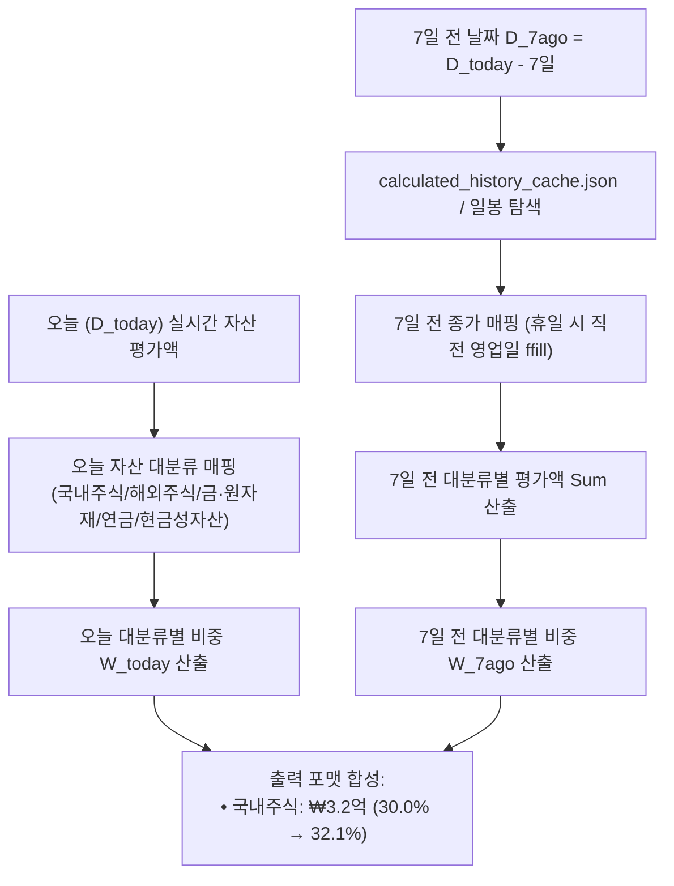

# Phase 21: 텔레그램 봇 가독성 혁신 및 명령어 고도화 설계 명세서
> **문서 식별자**: `docs/telegram_command_spec.md`  
> **버전**: v1.0 (Phase 21 SSoT)  
> **작성자**: 설계자 / 금융 분석가 (`architect`)  
> **작성일**: 2026-11-09  
> **대상 독자**: `developer`, `qa-verifier`, 메인 오케스트레이터(`비서`)  

---

## 1. 개요 및 설계 목적 (Context & Motivation)

### 1.1 배경 및 사용자 페인포인트
현재 자산 관제탑 텔레그램 봇(`@sjstck_bot`)은 실시간 시세 반영 및 포괄적인 질의응답 기능을 갖추고 있으나, 스마트폰 모바일 화면에서 다음과 같은 심각한 가독성 및 기능적 한계가 존재합니다:

1. **상단 크롤링 배너의 과도한 시각적 부피**:
   - 크롤링 성공 시 2~3줄에 걸쳐 장황한 메시지가 출력되어 본문 핵심 요약이 한 화면 아래로 밀려남.
2. **복잡한 쉼표 단위 금액 표기 (`₩1,059,195,810`)**:
   - 모바일 작은 화면에서 9~10자리 원화 금액을 직관적으로 파악하기 어려움. 억/만 단위(`₩10억 5,920만`) 정갈한 포매팅이 필수적임.
3. **대분류별 비중의 정적 나열 (7일 전 추세 부재)**:
   - 포트폴리오 대분류 비중이 당일 시점만 출력되어, 최근 1주일간 어떤 자산군이 확대/축소되었는지 파악 불가.
4. **만기 알림 하드코딩 결함**:
   - `/자산` 요약 시 `만기 관리 대상: 4건`이 하드코딩되어 있어 실제 만기일과 괴리 발생. 7일 이내 만기 임박 자산만 실시간 필터링되어야 함.
5. **Phase 20 신규 엔진(자본금 원장, 월별 레포트 등) 미연계**:
   - 새롭게 구축된 `capital_manager.py`(총 납입원금 840,561,600원 보존), `monthly_reporter.py`(월별 결산 MTD), `transactions.json`이 텔레그램 명령어로 노출되지 않음.
6. **명령어 도움말(Cheat Sheet) 가독성 미흡**:
   - 신규 사용자가 텔레그램에서 무엇을 입력해야 할지 모를 때, 모바일 한 화면에 들어오는 직관적인 `?` 카드 제공 필요.

### 1.2 핵심 설계 목표
- **모바일 최적화 레이아웃**: 한 줄 배너 슬림화, 한국어 억/만 단위 포매팅, 시각 기호(`•`, `▲`, `▼`, `│`) 정돈.
- **7일 전 대비 비중 변화 표시**: 7일 전 종가 기반 대분류 비중을 산출하여 `(30.0% → 32.1%)` 형태로 깔끔하게 제공.
- **실시간 만기 7일 필터링**: `maturity_date` 기반 실시간 D-Day 계산 및 7일 임박 필터링.
- **Phase 20 신규 명령어 4종 신설**: `/월별`, `/원금`, `/위험자산`, `/거래` 완전 연계.
- **'?' 단축어 시트 제공**: 모바일 한 화면에 쏙 들어오는 직관적인 커맨드 팔레트.

---

## 2. 모바일 가독성 혁신 포맷 가이드라인

### 2.1 상단 크롤링 배너 슬림화 (One-Line Banner)
기존의 다중 행 배너를 1행의 간결한 메타정보로 압축합니다:

- **기존 (Bad)**:
  ```html
  ⚡ <b>실시간 시세 신규 크롤링 완료</b> (성공 38건, USD/JPY 환율 반영)
  📊 <b>[자산 컨트롤 타워 실시간 브리핑]</b>
  <i>기준시각: 2026-11-09 20:50:12</i>
  ```
- **개선 (Good)**:
  ```html
  ⚡ 20:50 시세 반영 (성공 38건)
  📊 <b>[자산 컨트롤 타워 종합 브리핑]</b> <i>2026-11-09</i>
  ```

### 2.2 한국어 금액 포매팅 규칙 (`format_korean_money`)
스마트폰 가독성을 위해 원화 금액을 '억'과 '만' 단위로 자연스럽게 축약하는 표준 헬퍼 함수를 정의합니다.

#### 포매팅 알고리즘 사양:
$$Value \in \mathbb{R} \xrightarrow{format\_korean\_money} String$$

1. **절댓값 1억 원 이상 ($|V| \ge 100,000,000$)**:
   - 억 단위 $E = \lfloor |V| / 100,000,000 \rfloor$
   - 만 단위 $M = \text{round}((|V| \pmod{100,000,000}) / 10,000)$
   - $M > 0$인 경우: `₩{E}억 {M:,}만` (예: `₩8억 1,848만`, `₩10억 5,920만`)
   - $M == 0$인 경우: `₩{E}억` (예: `₩8억`)
2. **절댓값 1만 원 이상 1억 원 미만 ($10,000 \le |V| < 100,000,000$)**:
   - 만 단위 $M = \text{round}(|V| / 10,000)$
   - `₩{M:,}만` (예: `₩3,450만`, `₩180만`)
3. **절댓값 1만 원 미만 ($|V| < 10,000$)**:
   - `₩{round(|V|):,}원` (예: `₩5,400원`)
4. **부호(Sign) 표기 규칙**:
   - 손익/변동금액(`signed=True`):
     - 양수 ($V > 0$): `+₩8,420만`
     - 음수 ($V < 0$): `-₩634만`
     - 0 ($V == 0$): `₩0`
   - 순자산/평가금액(`signed=False`):
     - `₩8억 1,848만`

```python
def format_korean_money(val: float, signed: bool = False) -> str:
    """한국어 억/만 단위 모바일 최적화 금액 포매터"""
    if val is None:
        return "₩0"
    sign_str = ""
    if signed:
        if val > 0:
            sign_str = "+"
        elif val < 0:
            sign_str = "-"
    elif val < 0:
        sign_str = "-"

    abs_v = abs(val)
    if abs_v >= 100_000_000:
        eok = int(abs_v // 100_000_000)
        man = int(round((abs_v % 100_000_000) / 10_000))
        if man >= 10_000:
            eok += 1
            man -= 10_000
        if man > 0:
            return f"{sign_str}₩{eok}억 {man:,}만"
        return f"{sign_str}₩{eok}억"
    elif abs_v >= 10_000:
        man = int(round(abs_v / 10_000))
        return f"{sign_str}₩{man:,}만"
    else:
        return f"{sign_str}₩{int(round(abs_v)):,}원"
```

### 2.3 시각 기호 체계 및 레이아웃 표준
- 불릿 기호: `•` (표준 항목 구분)
- 상승/이익: `▲` 또는 `+` (강조: `<b>+14.52%</b>`)
- 하락/손실: `▼` 또는 `-` (강조: `<b>-5.85%</b>`)
- 계층 구분: 2칸 들여쓰기 (`  │ ` 또는 `  • `)
- 모바일 줄바꿈: 메시지당 최대 30줄 이내, 빈 줄로 블록 구분

---

## 3. 대분류별 비중: 7일 전 대비 비교 산출 알고리즘

### 3.1 목적 및 금융적 배경
단순히 "국내주식 32.1%"만 표시하는 것은 현재 시점의 단면일 뿐입니다. 최근 1주일간 시장 변동 및 자산 리밸런싱에 따른 **추세(Trend)**를 사용자가 직관적으로 인지할 수 있도록 7일 전 비중 대비 변동을 병기합니다.

### 3.2 7일 전 대분류별 평가액 및 비중 산출 로직


1. **기준 날짜 산정**:
   - $D_{today} = \text{datetime.now(KST).strftime}("\%Y-\%m-\%d")$
   - $D_{7ago} = (date.today() - timedelta(days=7)).strftime("\%Y-\%m-\%d")$
2. **7일 전 자산별 평가액 역산 ($Value_a(D_{7ago})$)**:
   - 주식/ETF/금: 7일 전 일봉 종가 $\times$ 현재 수량 ($Quantity_a$)
     - 일봉 종가 소스: `scripts/calculate_pension_history.py`의 ffill 캐시 또는 네이버/야후 일봉 데이터
     - 휴장일(주말/공휴일)인 경우 $D_{7ago}$ 이전의 가장 최근 종가 채움(Forward Fill).
   - 현금/예금/RP: 원장 평가액 유지.
   - 해외 자산: 7일 전 환율($USD/KRW$, $JPY/KRW$) 적용.
3. **대분류 그룹핑 ($C \in \{\text{국내주식}, \text{해외주식}, \text{금·원자재}, \text{연금}, \text{현금성자산}\}$)**:
   - $NAV_{total}(D_{7ago}) = \sum_{a} Value_a(D_{7ago})$
   - $NAV_{C}(D_{7ago}) = \sum_{a \in C} Value_a(D_{7ago})$
   - $W_{C}(D_{7ago}) = \frac{NAV_{C}(D_{7ago})}{NAV_{total}(D_{7ago})} \times 100$
4. **출력 포맷 규격 (사용자 요청 엄격 반영)**:
   - 사용자 지침: **증감폭(±%p) 없이 깔끔하게 전후 비중만 표시**.
   - 포맷: `• {카테고리}: {금액(억/만)} ({7일전비중}% → {현재비중}%)`
   - **출력 예시**:
     ```html
     🏛️ <b>대분류별 비중 (7일 전 대비)</b>
     • 국내주식: ₩3.2억 (30.0% → 32.1%)
     • 해외주식: ₩2.4억 (24.5% → 23.8%)
     • 현금성자산: ₩2.1억 (21.0% → 20.7%)
     • 금·원자재: ₩1.2억 (11.8% → 12.1%)
     • 연금자산: ₩1.1억 (12.7% → 11.3%)
     ```

---

## 4. 만기 알림 7일 필터링 규격

### 4.1 기존 결함 및 개선 방향
기존에는 `/자산` 실행 시 `만기 관리 대상: 4건 (USD 일반RP 3건, 원화RP 1건)` 문구가 하드코딩되어 있었습니다.
이를 완전히 제거하고, `assets_v3.json`의 `maturity_date` 속성을 읽어 실시간으로 만기를 계산합니다.

### 4.2 필터링 알고리즘 및 D-Day 판정식
- **D-Day 계산식**:
  $$D_{diff} = (Date_{maturity} - Date_{today}).\text{days}$$
- **위험도 등급**:
  - $D_{diff} < 0$: `⚠️ 만기 경과 (D+{abs(D_diff)})`
  - $D_{diff} \le 1$: `🚨 D-1 (내일 만기!)` 또는 `🚨 D-Day (오늘 만기!)`
  - $2 \le D_{diff} \le 7$: `⏳ D-{D_diff} ({Date_maturity})`
  - $D_{diff} > 7$: 임박 자산 목록에서 제외 (안전)

### 4.3 명령어별 표출 사양

#### 1) 종합 요약 (`/자산`, `/요약`) 표출 사양
- 7일 이내 만기 임박 건수만 한 줄로 압축 표시:
  - **임박 건수 존재 시 ($N > 0$)**:
    `• 만기 관리 대상: <b>{N}건</b> (7일 이내 만기 임박 ⏳)`
  - **임박 건수 없을 시 ($N == 0$)**:
    `• 만기 관리 대상: 없음 (7일 이내)`

#### 2) 상세 조회 (`/만기`, `/알림`) 표출 사양
사용자가 `/만기`를 입력했을 때 전체 만기 대상 자산을 D-Day 순으로 정렬하여 상세 안내:

```html
🔔 <b>[만기 관리 대상 자산 현황]</b>

🚨 <b>7일 이내 만기 임박 (총 2건)</b>
1. <b>외화RP (키움증권 위탁종합)</b>
   • 잔고: $12,500.00 (₩1,735만)
   • 만기일: 2026-11-10 (<b>🚨 D-1 내일 만기!</b>)
   • 약정금리: 연 4.85%

2. <b>수시입출식 원화RP (나무증권)</b>
   • 잔고: ₩15,000,000 (₩1,500만)
   • 만기일: 2026-11-15 (<b>⏳ D-6</b>)
   • 약정금리: 연 3.20%

📌 <b>추후 만기 예정 자산 (7일 이후)</b>
• 정기예탁금 (신협): ₩20,000,000 (D-45, 2026-12-24)

💡 <i>조치 팁: 만기 도래 RP는 재투자하거나 고금리 파킹통장/KOFR로 이동하세요.</i>
```

---

## 5. '?' 단축어 시트 (Command Cheat Sheet) 템플릿

사용자가 `?`, `도움`, `명령어`, `help`를 입력했을 때 모바일 화면 1개에 완벽히 들어오는 깔끔한 안내 카드입니다.

### 5.1 시트 템플릿 마크업 사양
```html
🏛️ <b>[자산 관제탑 명령어 안내]</b>

📊 <b>종합 브리핑</b>
• <code>/자산</code> 또는 <code>/요약</code> : 전체 순자산 & 7일 추세
• <code>/수익률</code> : 7대 기간별 수익률 & 상하위 종목
• <code>/비중</code> : 대분류·위험도·테마별 비중 분석

🏛️ <b>자본금 & 결산 (Phase 20)</b>
• <code>/원금</code> : 총 납입원금(8.4억) 대비 실질손익
• <code>/월별</code> : 당월 MTD 성과 및 월별 결산 레포트
• <code>/위험자산</code> : 손절 손익 합산 위험자산 실질성과
• <code>/거래</code> : 최근 5건 매매 및 입출금 체결 내역

📁 <b>자산군별 상세</b>
• <code>/주식</code>, <code>/해외</code>, <code>/연금</code>, <code>/현금</code>, <code>/금</code>, <code>/계좌</code>

🔔 <b>알림 & 관리</b>
• <code>/만기</code> : 7일 이내 만기 도래 RP·예금 목록
• 종목 검색 : <code>삼전</code>, <code>테슬라</code>, <code>BOXX</code> 등 자유 입력

💡 <i>체결 문자(SMS/알림톡)를 그대로 복사해 붙여넣으면 포트폴리오에 자동 반영됩니다!</i>
```

---

## 6. Phase 20 신규 명령어 4종 연계 규격

Phase 20에서 새롭게 구축된 모듈(`capital_manager.py`, `monthly_reporter.py`, `history_metrics.py`, `transactions.json`)을 직접 호출하여 브리핑하는 세부 규격입니다.

### 6.1 `/원금` (총 납입원금 관리 현황)
- **연계 모듈**: `src/capital_manager.py`의 `get_cumulative_capital()`, `load_capital_ledger()`
- **핵심 금융 원칙**: 11/6 KODEX 반도체레버리지 손절(-634만 원)에도 불구하고 총 납입원금은 **840,561,600원**으로 영구 보존됨을 강조.
- **출력 포맷 예시**:
```html
💰 <b>[총 납입원금 & 실질 자본금 현황]</b>

• <b>총 납입원금 (누적)</b>: <b>₩8억 4,056만</b>
  │ • 연금제외 납입원금: ₩7억 6,847만
  │ • 연금계좌 납입원금: ₩7,209만
• <b>현재 총 순자산 (NAV)</b>: <b>₩9억 9,800만</b>

📈 <b>실질 누적 성과 (자본금 대비)</b>
• <b>실질 누적 수익금</b>: <b>+₩1억 5,744만</b>
• <b>실질 누적 수익률</b>: <b>+18.73%</b>

ℹ️ <i>주식 손절/매도는 포트폴리오 내부 자산 교환으로 총 납입원금을 훼손하지 않습니다. (11/6 반도체레버리지 -634만 손절 반영 완료)</i>
```

### 6.2 `/월별` (월별 결산 및 MTD 레포트)
- **연계 모듈**: `src/monthly_reporter.py`의 `generate_monthly_reports()`
- **출력 포맷 예시**:
```html
📊 <b>[월별 자산 운용 성과 레포트]</b>

🗓️ <b>2026년 11월 (진행중 MTD)</b>
• <b>현재 평가액</b>: ₩9억 9,800만
• <b>월초 평가액</b>: ₩10억 6,005만
• <b>당월 순입금</b>: ₩0 (입금 없음)
• <b>당월 손익금</b>: <b>-₩6,205만</b> (<b>-5.85%</b>)
• <b>확정 컷오프</b>: 12월 1일 06:00 KST (미국장 마감 후)

🏆 <b>직전 월 결산 요약</b>
• <b>2026-10 (FREEZE 확정)</b>: ₩10억 6,005만 (+₩3,420만, <b>+3.32%</b>)
• <b>2026-09 (FREEZE 확정)</b>: ₩10억 2,585만 (+₩1,890만, <b>+1.88%</b>)

💡 <i>웹 대시보드 [📊 월별 레포트] 버튼에서 1년치 전체 내역을 확인하실 수 있습니다.</i>
```

### 6.3 `/위험자산` (위험자산 실질 성과)
- **연계 모듈**: `src/history_metrics.py`, `data/transactions.json`
- **핵심 금융 원칙**: 살아있는 위험자산 매입가(Cost Basis)와 과거 실현손익(11/6 손절 -6.34M)을 합산한 '실질 누적수익금' 표출.
- **출력 포맷 예시**:
```html
⚡ <b>[위험자산 성과 및 배분 현황]</b>

🛡️ <b>위험도별 3단계 자산 비중</b>
• 안전자산 (현금·채권·금): ₩4억 3,831만 (43.9%)
• 일반 위험자산 (주식·ETF): ₩5억 5,969만 (56.1%)
• 초위험자산 (레버리지 2X·3X): ₩0 (0.0%, 11/6 전량매도)

📊 <b>위험자산 실질 누적 성과</b>
• 현재 보유 위험자산 평가액: ₩5억 5,969만
• 현재 보유 종목 매입원가: ₩4억 2,525만
• 현재 종목 미실현 손익: +₩1억 3,443만
• 과거 누적 실현손익: <b>-₩634만</b> (11/6 손절 반영)
───────────────────────────────
🔥 <b>위험자산 실질 순수익</b>: <b>+₩1억 2,809만</b> (<b>+29.68%</b>)
```

### 6.4 `/거래` (최근 체결 거래내역)
- **연계 파일**: `data/transactions.json`
- **출력 포맷 예시**:
```html
📝 <b>[최근 거래 및 입출금 내역 (최근 5건)]</b>

1. <b>[매도] KODEX 반도체레버리지</b>
   • 일시: 2026-11-06 23:48 (나무증권 CMA)
   • 체결: 56주 × ₩31,100 (₩174.2만)
   • 실현손익: <b>-₩634.4만</b> (<b>-78.46%</b>)

2. <b>[입금] 급여 추가 납입 (예시)</b>
   • 일시: 2026-10-25 10:00 (키움증권 위탁)
   • 입금액: +₩3,000,000 (총 납입원본 반영)

💡 <i>거래 알림 문자를 봇에게 전송하면 자동으로 장부에 기록되고 순자산이 재계산됩니다.</i>
```

---

## 7. developer 및 qa-verifier 구현/검증 체크리스트

### 7.1 개발자 (`developer`) 구현 체크리스트
- [ ] **금액 포매터 구현 (`src/live_price_server.py` 또는 유틸 모듈)**:
  - `format_korean_money(val, signed=False)` 함수 구현 (억/만 단위 자연스러운 절삭)
  - 모든 텔레그램 출력 블록에서 raw 원화 콤마 표기를 `format_korean_money`로 전환
- [ ] **7일 전 대분류 비중 역산 엔진 구현**:
  - `get_7days_ago_category_weights()` 함수 작성
  - $D_{today}-7$ 시점 종가 및 자산 평가액 합산, 7일 전 비중 계산
  - `• {카테고리}: ₩{금액} ({7일전}% → {현재}%)` 포맷 적용 (증감폭 없이 깔끔하게)
- [ ] **실시간 만기 7일 필터링 구현**:
  - `assets_v3.json`의 `maturity_date` 기반 실시간 D-Day 계산
  - `/자산`, `/요약`: 7일 이내 건수 표시 (없으면 없음)
  - `/만기`, `/알림`: D-Day별 상세 정렬 리스트 렌더링
- [ ] **'?' 단축어 시트 분기 추가**:
  - `q in ["?", "도움", "명령어", "help"]` 시 모바일 최적화 시트 반환
- [ ] **신규 명령어 4종 라우팅 구현**:
  - `/월별`, `월별`: `monthly_reporter.py` 연계
  - `/원금`, `원금`: `capital_manager.py` 연계 (840,561,600원 보존)
  - `/위험자산`, `위험자산`: `history_metrics.py` 및 실현손익 연계
  - `/거래`, `거래`: `data/transactions.json` 최신 5건 렌더링

### 7.2 품질 검증가 (`qa-verifier`) 검증 체크리스트
- [ ] **금액 포매팅 정합성 단언 (Unit Test)**:
  - 840,561,600원 $\rightarrow$ `₩8억 4,056만`
  - -6,343,875원 $\rightarrow$ `-₩634만`
  - 5,400원 $\rightarrow$ `₩5,400원`
- [ ] **7일 전 대분류 비중 수식 무결성 검증**:
  - 7일 전 각 카테고리 비중 합계 = 100.0% ($\pm 0.1\%$) 검증
  - 사용자 지침대로 불필요한 증감폭 기호(±)가 노출되지 않는지 확인
- [ ] **만기일 실시간 계산 검증**:
  - 만기 지난 자산, 1일 남은 자산, 6일 남은 자산, 8일 남은 자산 모킹 후 7일 이내 항목만 정확히 필터링되는지 확인
  - `/자산`에서 하드코딩 문구가 완전히 제거되었는지 확인
- [ ] **신규 4종 명령어 응답 테스트**:
  - `/원금` 입력 시 총 납입원금 840,561,600원이 정확히 출력되는지 확인
  - `/월별` 입력 시 11월 MTD 상태 및 컷오프(12/1 06:00 KST) 안내 확인
  - `/거래` 입력 시 11/6 반도체레버리지 손절 내역이 정상 출력되는지 확인
- [ ] **'?' 도움말 카드 가독성 검증**:
  - 모바일 텔레그램 화면 기준 세로 스크롤 없이 한 화면에 온전히 들어오는지 확인

---

## 8. 결론

본 명세서는 텔레그램 봇을 단순한 문자열 출력기에서 **최고급 자산 관리 비서의 스마트 인터페이스**로 혁신하는 핵심 기준입니다.
`developer`는 본 문서에 정의된 포맷 규격과 계산식을 철저히 준수하여 코드를 구현해 주시기 바랍니다.
